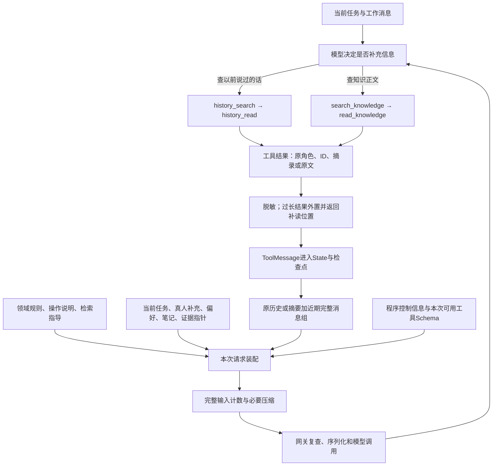
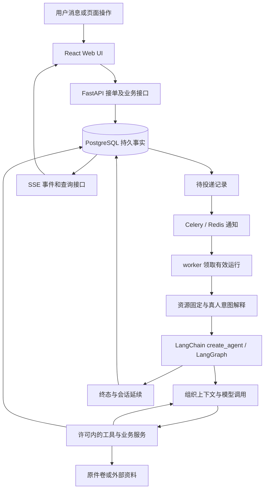

# KnowledgeOps Agent 开发实现记录与架构说明

更新：2026-10-18。对象：`D:\codes\KnowledgeOps Agent`。本文是供用户审查和后续开发接续的**当前实现正文**，与[实施计划](implementation-plan.md)、[进展及验证证据](progress.md)、[开发问题记录](development-issues.md)分工维护，不另建一套架构或开发计划。

本文按“Agent 如何运行 → 如何成为持续使用的 Web 应用 → 应用要求怎样反过来约束 Agent”的顺序解释源码。**这是理解当前系统的顺序，不是声称开发时严格按此顺序完成。** 能核对的历史变化另在文末说明；用户举出的 `create_agent`、状态扩展等只是写法示意，下面的接口、字段和行为均以本项目实际实现为准。仅在本地保留、不随仓库发布的教学目录 `exercises/` 和早期 M0 合同图不承担现行应用的运行入口。

实现与效果分开：通用长期记忆、学习模式、执行权限与Harness可靠性是此前已交付的基线；2026-10-16的数据所有权、保留期限、运行详情与暂存回收、会话删除及相应页面也已完成交付。新增机制用真实数据库、保存器、文件、缓存和浏览器验证，不调用收费模型；正常库已增量迁移至0030及0003_lifecycle（0030仅增加材料移除标记），完整回归及定向修正见[生命周期交付核对](lifecycle-delivery.md)。上一轮另有一次小范围真实模型联调核对工具理解和协作，不能混成本轮验证。实际完成状态、费用及表达质量限制集中在进展；框架接入、模型读到规则或工程检查通过都不能证明任意知识内容正确。

阅读路线：

需要先定位代码时，可从[源码怎样按功能组织](#源码怎样按功能组织)和[后端目录导航](../backend/README.md)、[前端目录导航](../frontend/README.md)开始。

1. [Agent 的创建入口与状态分工](#agent的创建入口与状态分工)
2. [一轮模型输入如何形成](#一轮模型输入如何形成)
3. [工具如何选择、执行与反馈](#工具如何选择执行与反馈)
4. [领域规则、Skills 与知识业务](#领域规则skills与知识业务)
5. [上下文压缩、历史补读和任务笔记](#上下文压缩改变送入模型的工作视图保留原历史)
6. [模型网关、停止与最终回答](#模型网关停止与最终回答)
7. [MCP、子 Agent 与可选模型工具](#mcp子agent与可选模型工具)
8. [从 Agent 到 Web 应用](#从agent到web应用)
9. [会话、引导、授权与长期偏好](#会话持续保留运行分别执行和恢复)
   本轮学习业务继续阅读[通用记忆](#通用长期记忆怎样跨会话使用)、[学习配置](#学习任务与两层配置怎样接入现有聊天)、[独立审读](#委托整理如何形成可核验的成果)及[持续推进](#持续推进怎样与会话预算及用户介入协作)。
10. [前端交互与数据落点](#前端如何展示过程和重新打开结果)
11. [数据保存、保留期限与会话删除](#数据分别存在哪里以及怎样关联)，逐表查阅[数据存储与生命周期](database-design.md)
12. [环境、开发变化、复用来源及边界](#环境与维护怎样落地)

## 当前实现的开发设计说明

### 源码怎样按功能组织

代码入口现在分成两层：包顶层的 `api.py`、`worker.py` 只保留稳定启动方式；`app/` 负责 Web 生命周期、HTTP 接口、服务装配及后台运行。进入 `app/routes/` 可以直接找到会话、材料、知识、记忆、学习、工具或权限接口；进入 `app/runs/` 则是运行领取、Celery 投递、取消、恢复和消息引导。输入校验仍沿用原字段与约束，路由只转换 HTTP，不另写一套业务规则。

Agent 创建沿 `harness/runtime/agent.py` 阅读。原先同文件的图状态和运行依赖移到 `state.py`，LangChain模型适配移到 `harness/models/chat.py`，统一调用守卫移到 `runtime/control.py`。知识编辑/发布工具现在与知识服务同在 `knowledge/`，材料与网页工具同在 `sources/`。工具名称、说明、注册集合和中间件顺序没有因拆文件而改变。上下文、模型、工具策略、权限、Skills、MCP、子角色和本地执行各有功能目录，帮助从一个机制连续读到相关实现。

这次借鉴的是 DeerFlow cb90f5dca47f68fec329746a53df7b437a11c4e8 的应用接入与 Harness 分区、Harness 内按能力组织模块的方式；没有复制其源码或把本项目改成多个发行包。本应用的 Harness 仍引用运行服务与领域依赖，目录清楚不代表已经成为独立 SDK。知识服务、运行事务服务与ORM模型中仍有较大的文件，本次未为了缩短文件而继续拆散相关事务。

前端把路由和侧栏装配放在 `app/`，页面、专用组件和组件测试按功能放在 `features/`，HTTP请求、类型、工作区刷新和基础展示放在 `shared/`。2026-10-18起，组件布局采用 Tailwind 工具类，主题、基础控件和正文排版留在 `styles/`。例如聊天页可以使用权限功能提供的审批组件，但共享网络层不反向依赖聊天页面。这是适合现有 React/Vite 应用的功能分组，没有搬用 DeerFlow 的 Next.js 路由框架。

资源与程序的位置分开处理：部署可编辑的根 `skills/` 和 `config/` 继续保留，`harness/skills/` 是加载代码；包内提示、词表及上游许可保持原位置。`core/resources.py` 统一定位包资源，避免文件搬进子目录后读错相对路径。旧检查点存储的图状态、消息、工具名和固定资源标识维持原格式，本次不需要数据库结构迁移。完整目录导航见[后端说明](../backend/README.md)、[前端说明](../frontend/README.md)及[决策0026](decisions/0026-source-layout.md)。

### 产品定位与两类任务怎样共存

用户明确定位：这是以聊天为主要交互、由Agent理解目标并推进执行的应用，知识库构建、维护与问答是重点特化业务，同时保留基础工具所支持的通用任务能力。前端负责接收指令、展示过程与产物并提供管理入口，执行步骤由主Agent结合当前工具结果选择；不是只把自然语言映射成固定知识库菜单，也不要求每次任务都产出知识文章。

例如“统计work中的CSV并输出报告”可以使用文件工具、execute与present_files完成，结果留在outputs；不需要先开启学习主题或创建知识草稿。“把刚才讨论的知识整理入库”才应用常驻领域规则、维护Skill、草稿/发布和引用索引流程。一般任务与知识任务共用现有模型—工具循环、上下文、运行记录和控制机制，不另设一个通用Agent与知识Agent的强制路由层。

当前工具与Web入口已允许通用任务，knowledge_only开关默认关闭，最终回答检查也不要求每个普通回答必须有知识引用。此前SYSTEM_PROMPT的角色描述和常驻规则仍偏知识助手，本次明确通用执行定位，并将学习引导、知识入库规则的适用范围写入领域规则v5；发布意图说明也区分普通文件保存与知识发布。这是提示与规则适用性的修正，不新增工具权限，也不将模型一定正确分类任务写成已经通过的效果结论。新根任务冻结新说明，已有运行保持原资源快照。

### Agent的创建入口与状态分工

先看一个已经由应用领取的知识任务。核心入口是 `harness/runtime/agent.py` 的 `build_agent()`：它调用 **LangChain 的 `create_agent()`**，由这个接口生成基于 LangGraph 的执行图。不是“LangGraph 有一个名叫 create_agent 的原生接口”，也不是复制 DeerFlow 的主应用后再改业务。源码依据为[runtime.py](../backend/src/knowledgeops_agent/harness/runtime/agent.py)、[已锁定依赖](../pyproject.toml)，框架的能力边界见[LangChain Agent 文档](https://docs.langchain.com/oss/python/langchain/agents)。

`build_agent()`并不立即回答用户。它先取得本次运行已经固定的资源，选择可用工具和中间件，再交给框架构造图。传入内容有明确分工：

| 传给创建接口的内容 | 本项目实际提供的对象 | 为什么需要这一层 |
|---|---|---|
| model | `LedgerChatModel` | 保持 LangChain 标准消息接口，同时让每次实际请求经过统一预算、协议、用量和事件记录。 |
| tools | 经过任务、角色、策略许可筛选的本地工具与 MCP 工具 | 模型只能选择本轮实际允许的能力；工具说明与执行函数必须同时存在。 |
| system_prompt | 冻结的知识库领域规则＋通用任务指令；子角色另加角色提示 | 用户不用每次重述知识库目的；角色差异也不需要复制整套循环。 |
| middleware | 连续性、Skills、委派、运行控制、上下文、回答检查、用户引导 | 在框架公开扩展点接入应用需要的行为。 |
| state_schema | `KnowledgeOpsState` | 声明图执行和恢复真正需要保存的字段。 |
| context_schema | `RunContext` | 显式传入当前运行身份和应用服务，不把客户端写进检查点。 |
| checkpointer | 以官方 PostgreSQL 保存器为基础的 `CachedPostgresSaver` | PG保存执行状态与位置；Redis仅加速确定检查点内容读取，最新位置及待处理写入仍读PG。 |

图的基础循环仍是“模型提出工具调用 → 框架执行工具 → 工具结果进入消息 → 模型继续判断”。模型没有提出工具调用且后置检查允许结束时，才完成图执行。计划不是每个任务的固定首站；主模型遇到复杂任务可调用 `update_plan`，简单问题可以直接查证并回答。应用没有另设一个必须先完成的规划 Agent，也没有为“搜索、读文、写草稿、发布”分别写死一个必经业务节点。

工具种类变化主要改变模型可见的工具集合。一次运行中的十次读取，是工具节点被调用十次，不是实时新增十个图节点。中间件可以生成模型前后处理节点或包装调用，所以实际图也不能简单说永远只有两个节点。路由由 `create_agent` 生成；本项目通过正常工具调用，以及回答修订、用户引导时的 `jump_to="model"` 接入分支，没有修改 LangChain 的路由源码。

要理解后面的记忆与 Web 功能，先区分三个数据位置：

| 数据位置 | 当前内容 | 不承担什么 |
|---|---|---|
| 图 State | 基类 `messages`；本项目增加下表中的计划、压缩、修订与连续性字段 | 不把全部业务表、服务客户端和费用账本复制进去。 |
| `runtime.context` 中的 `RunContext` | run/root/worker 身份；jobs、knowledge、sources、gateway 服务；检查点句柄、资源清单、构图工具目录等 | 这些对象不是框架自动从程序收集的，也不会自动全部发给模型。 |
| PostgreSQL 业务记录 | 会话、Run、草稿、知识版本、证据、授权、调用记录、偏好、配置和回执 | 不能因为模型在 State 中写了“成功”就替代实际事务结果。 |

本项目显式扩展的 State 如下。这是当前类的真实字段，不是建议未来添加的清单；生态中间件还可贡献自己的框架状态。

| 字段 | 当前用途及更新来源 |
|---|---|
| `messages`（继承） | 用户消息、模型响应和工具结果；由框架按消息 ID 合并。模型的工具提议和对应 `ToolMessage` 必须配对。 |
| `plan` | `update_plan` 保存模型提出的显式步骤；用于后续决策参考，不代替业务完成记录。 |
| `working_summary`、`context_compaction` | 保存工作摘要、压缩截止消息与原文/摘要产物指针；后续调用据此形成工作视图。 |
| `final_response_feedback`、`answer_repair_count` | 保存确定性回答校验的问题与修订次数，防止修订无止境循环。 |
| `guidance_seen_sequence`、`decision_authority_epoch` | 标记已接收的用户补充及本次模型决策依据的授权代次，识别过期行动提议。 |
| `task_notes` | 模型工作笔记；通过带合并规则的状态通道更新，不把并发更新简单互相覆盖。 |
| `task_history` | 本检查点允许补读的历史批次引用和完整性状态，避免读取未来消息或别的会话。 |

这里没有练习代码那种用 `status="running"` 控制整个循环的设计。应用的运行状态保存在 Run 记录中，图中的消息、钩子和分支决定下一节点；worker 最后再把图结果与真实草稿、发布回执合成业务结果。首字响应、token 消耗和错误详情主要进入网关账本与运行事件，不为了页面统计塞入 AgentState。

### 一轮模型输入如何形成

假设用户在同一会话说“继续解释刚才的事务边界，暂时不要整理文档”。后台这一条任务可能多次调用模型。第一次输入包含任务背景；模型若请求读知识原文，读取结果会成为工具消息；第二次调用就在这些消息基础上继续判断。**用户只发送了一条消息，并不意味着后台只调用一次模型。**

当前实现没有再用一个隐藏模型把每轮历史全部改写成新系统提示词。它把不同身份的信息组织成标准消息和工具 Schema，步骤如下：

1. 构图时，`harness/context/assembly.py`先将冻结的领域规则、通用操作说明、检索说明和可选角色说明装成系统指令；新运行的 `initial_messages()`再取得截至本任务的会话背景与当前真人消息。恢复旧运行从原检查点接着走，不重新注入一遍任务。
2. `ContinuityMiddleware.before_agent`接入前序快照中的任务笔记和历史范围。Skills 中间件加入可用技能的发现信息；委派中间件加入可选择的子角色说明。
3. `RuntimeControlMiddleware.wrap_model_call`每次重新读取当前预算、发布模式、草稿状态、工具可用性等控制信息，并组织任务、已应用的真人补充、计划、偏好、笔记及证据指针。
4. 程序控制信息加入系统消息；资料背景作为一条明确标识“应用组织的任务背景，不是新用户消息”的临时消息。模型笔记、历史助手结论不会因为被拼装进输入就升级为系统规则。
5. `ContextMiddleware`看到上述内容及当前工具 Schema 之后，才计算完整输入容量，并决定使用原工作历史还是“摘要＋近期完整消息组”。临时背景不再写回历史反复摘要。
6. `LedgerChatModel`在真正请求供应商前复查停止、资源和工具许可，再通过统一网关完成序列化、容量检查和调用。

因此，一次真实请求可以按用途理解为：**系统规则与控制信息＋临时任务背景＋工作摘要/近期消息＋本轮有效工具 Schema＋模型参数**。它们并非先拼成一个巨大字符串；聊天消息仍带有 system/human/ai/tool 身份，工具 Schema 是请求的独立部分。MCP 服务的工具说明可以进入请求，但连接密码、数据库客户端和任意 runtime 变量不会因此进入提示词。

当前中间件的注册次序是：连续性 → Skills/文件工具（可选）→ 子 Agent（可选）→ 延迟工具过滤（可选）→ 运行控制 → 文件可靠性（可选）→ 知识文件同步 → 上下文预算 → 原生HITL审批 → 回答校验 → 子任务收束 → 澄清问题 → 用户引导 → 模型步骤回执。这不是“每个对象完整执行完，再执行下一个”：框架分别组织 before/after 钩子和 wrap 包装栈，后置钩子反向衔接。运行控制补齐规则和背景，上下文包装检查最终候选输入；延迟过滤在执行入口阻止未加载的工具；模型步骤身份在供应商调用前保存。引导与澄清后置处理及时否决过期或同批冲突提议。装配使用本地锁定 LangChain 的公开扩展点，真实图测试验证顺序，不能只依靠注册名称推断执行行为。

“哪些资料最相关”目前仍由模型根据任务选择读取、搜索和补读。固定拼装规则解决数据身份、可用性与容量，不承诺每次自动理解所有历史的重要程度。长期偏好、任务笔记和压缩是不同机制，后面分别解释。

#### 把检索、保存与本次请求串起来

这些模块可以围绕同一个问题理解：**为了本次决策，模型现在需要看到哪些信息，以及这些信息是什么身份？** 检索负责从大量内容中找候选，读取负责取得可核对原文，历史/产物负责保留，背景装配负责表达当前任务，压缩负责控制工作视图大小。提示模板是其中组织稳定规则的一环，不独自承担所有上下文管理。



这是一张信息流图，不是源码中新增的固定业务节点。程序不会为了满足这张图每轮强制搜索两种库；需要哪类资料、是否继续补读，通常由主模型决定。查询返回空候选时也不必进入读取，模型可以换查询词或说明证据不足。

“检索结果进入上下文保存”还应拆成三件事：

| 对象 | 当前如何保留 | 以后如何进入模型 |
|---|---|---|
| 原文与派生检索索引 | PG保存知识版本、历史原话及各自片段索引；建立索引本身不调用模型 | 搜索只返回候选；读取工具按ID、版本和偏移返回相应原文。 |
| 本次工具观察 | 框架把返回值转为关联原调用ID的ToolMessage，保存到State/检查点；过长内容另有完整产物 | 尚在工作视图时参加后续调用；被压缩后主要通过摘要、指针及再次读取使用。 |
| 模型认为应继续保留的要点 | 模型显式调用task_note更新工作笔记；不会把每条搜索命中自动提炼成笔记 | 运行控制中间件将笔记作为“模型报告”放入临时任务背景；并非系统规则或新授权。 |

例如搜索返回某篇文章第4800字符附近的候选后，Agent可按命中偏移读取固定版本；下一次请求里增加“先前的读取提议＋对应原文工具结果”。后来历史变长，这段原文可能不再全文进入请求，但PG原文、Evidence和补读位置仍在。**保留原始数据、把它做成可检索记录、在某次请求里呈现它，是三个不同动作。** 检索不会自动发布知识，也不会自动变成跨会话偏好。

长工具结果的外置发生在工具返回进入消息之前；上下文容量处理发生在模型请求已经补齐规则、临时背景和工具定义之后。这里也没有一个独立、自动的语义重排器每轮重选全部旧工具结果。后台控制对象只有经程序选择的字段进入请求，服务客户端、连接密码和MCP连接配置不发送；可用MCP工具的说明与Schema则可能发送。

#### 模型实际看到的请求轮廓

下面按现有代码写出一份**缩略结构示意**，省略长规则和完整Schema，材料、数字及ID仅用于解释；不是某次真实模型请求的逐字导出，也没有为展示它调用收费模型。

```text
messages:
  SystemMessage:
    <application_policy>
      本应用知识库的用途、知识质量、用户主导与维护规则全文
    </application_policy>
    <operating_instructions>
      如何读取、引用、起草、发布、反馈错误和停止的通用要求
    </operating_instructions>
    <retrieval_guidance>
      旧对话用history_search/history_read；正文用search_knowledge/read_knowledge
      候选不等于原文，摘要和模型笔记不产生新授权
    </retrieval_guidance>
    [按配置追加角色、Skills发现/读取说明及委派说明]
    任务背景的身份约定
    程序控制：publication_mode=preview、剩余预算、草稿状态等

  HumanMessage（应用临时背景，有专门标记，不写回messages）:
    current_task: 根据知识库解释事务边界，暂时不要整理文档
    user_guidance: 本轮已经接收并应用的真人补充
    preferences: 适用的表达或学习偏好
    plan / task_notes: 模型维护的计划和有来源工作要点
    evidence_catalog: 已读证据的固定引用、范围及重读参数

  HumanMessage（如果发生过压缩）:
    早期工作摘要；原记录补读指针；明确它不是新授权
  [尚在工作视图中的历史与当前用户消息]
  AIMessage:
    tool_calls: read_knowledge(document_id=示例ID, version_id=示例版本, ...)
  ToolMessage（与上述tool_call_id配对）:
    实际原文、版本、读取范围及真实citation

tools:
  本次实际可用工具的名称、说明、参数Schema
parameters:
  模型请求设置、输出上限及适用的供应商参数
```

上面是框架层轮廓；网关通过实际`DeepSeekClient._get_request_payload`序列化后，供应商看到`model`、`messages`、`tools`、`max_tokens`、`stream`等字段，**没有一个独立的AgentState或Runtime字段**。本次已用假密钥和示意消息走这条SDK序列化路径，没有发网络请求。默认输出预留为8192，这个`max_tokens`是本次输出上限，不是256K输入工作窗口。LangChain的HumanMessage、AIMessage分别变成API的`user`、`assistant`；AI工具调用中的`function.arguments`和ToolMessage的`content`在JSON请求中是字符串，框架负责序列化。

例如`tools`里一个真实工具声明如下，参数Schema为当前SDK实际生成，仅description缩短展示：

```json
{
  "type": "function",
  "function": {
    "name": "read_knowledge",
    "description": "读取固定知识版本并登记证据；按next_start补读。",
    "parameters": {
      "type": "object",
      "properties": {
        "document_id": {"type": "string"},
        "version_id": {
          "anyOf": [{"type": "string"}, {"type": "null"}],
          "default": null
        },
        "start": {"type": "integer", "default": 0}
      },
      "required": ["document_id"]
    }
  }
}
```

工具运行需要的`ToolRuntime`由框架注入，所以Schema没有`runtime`、数据库会话或根任务ID。`start`是原文字符偏移，分页大小目前由内部业务服务决定；Agent根据`next_start`继续补读。后台生成的临时背景使用一条明确标记身份的user消息，属于API承载方式，不是又收到一条真人消息；程序另行校验真实授权，不能让背景中的文字代替它。

真实请求会随阶段变化：没有历史压缩就没有摘要；没有开启委派就没有相应工具；工具结果增多会改变消息；接近预算上限或进入最终答案修订时，运行控制会撤下工具并给出收束要求。不是每次都原样发送上述每一个可选部分。

本项目确实参考了DeerFlow的分区装配与资料身份区分，但有明确差异：DeerFlow该版本将日期/记忆等动态信息放到独立动态上下文，努力保持基础系统前缀稳定；我们仍把每轮变化的预算、草稿等控制信息追加到SystemMessage。因而可以说“采用了分区与分层思想”，不能说“已经逐字复用其模板或完整复现其提示缓存策略”。当前角色标签转义也只能保护分区结构，不能替代执行许可检查。

### 工具如何选择、执行与反馈

本地业务工具使用 LangChain 工具定义，函数签名及字段约束形成参数 Schema，说明文字告诉模型用途。应用的 `ToolRuntime` 负责注入当前 State、context 和真实 `tool_call_id`；这些不是让模型猜出来的参数。模型只生成工具名和业务参数，框架按已注册对象分派。

这里没有向量化“工具召回”系统。当前工具数量和范围通过配置即可控制：先按全局策略、主/子角色工具选择、本次联网/委派/辅助选项及 MCP 许可筛选，再将可用工具提供给模型。模型随后决定是搜索知识、读材料、修改草稿，还是直接回答。“选出可用工具”和“模型决定本次用哪个”是两层工作。

实际执行前，`RuntimeControlMiddleware.wrap_tool_call`检查运行是否还可继续、登记工具尝试和事件，再检查此刻许可和用户引导代次。只有这些条件成立才调用工具函数。知识工具进入知识服务，读取工具进入来源服务，MCP 工具进入外部调用服务，不直接绕过这些服务操作数据库。

参数不合适、草稿版本冲突或许可拒绝等可反馈错误，会转换成带原 `tool_call_id` 的错误 `ToolMessage`。模型能看到失败原因，再决定是否修正参数、重读版本或向用户说明。取消、预算不足及不能可靠继续的系统错误则向外抛出，由 worker 保存停止原因，不假装成一个普通工具错误诱导模型反复尝试。LangGraph 的检查点负责执行进度，业务服务的幂等回执负责动作是否已完成，两者互相补充。

工具还可以返回 `Command`：例如 `task_note`同时更新 State 中的笔记并返回工具回执，子 Agent 的 `task`也可能用这种返回形式。运行包装会处理其中的工具消息，但不把 Command 当普通 JSON 丢掉其他状态更新。这是直接使用框架公开能力，不是新增一条私有路由协议。

#### 统一工具管理怎样接入已有能力

工具选择原先分散在构图、子角色选项和MCP装配中，容易出现“页面列出的能力”和“实际交给模型的能力”不一致。现在增加`harness/tools/catalog.py`作为共同目录，本地工具描述身份、分组、业务影响和可用于子角色的范围，构图与角色能力说明读取同一套已有任务约束。工具函数和业务服务保留原实现，目录不保存可执行Python路径。这里借鉴DeerFlow将名称、分组与实现分离的组织方式，未复制它的存储或执行系统。[DeerFlow工具配置](https://github.com/bytedance/deer-flow/blob/02ce9ab2832965eb3534e481e320d72f38bd5aec/backend/packages/harness/deerflow/config/tool_config.py)

实际装配同时收集普通工具与中间件公开声明的工具，因此Deep Agents提供的`task`和`read_file`也进入核对。只处理说明或状态的Skills中间件可以没有工具声明，不能因为缺少`tools`属性就视为错误。每个真正的工具必须有目录身份，名称重复或未登记时，在编译图前拒绝，防止框架按名称分派时静默覆盖。参数Schema仍由原LangChain工具对象提供，没有手写另一套模型协议。参考的是[DeerFlow中间件工具收集](https://github.com/bytedance/deer-flow/blob/02ce9ab2832965eb3534e481e320d72f38bd5aec/backend/packages/harness/deerflow/agents/middlewares/tool_declarations.py)解决的同一遗漏问题，本项目采用适合现有SDK装配的薄适配。

只读接口`GET /api/tools/catalog`汇集本地、中间件及MCP工具。MCP配置仍只有原注册服务一份事实源：查看目录不连接服务、不改变许可；禁用项留在目录中解释原因。MCP管理身份使用完整连接ID和原工具名，实际给模型的调用名保持原算法，避免旧消息与检查点失效；极端短名称碰撞会明确报错。比如禁用某个MCP连接后再查看目录，就会读到原服务的新修订和禁用原因，无需同步第二份开关数据。

现在的代码把配置与运行接通。`harness/tools/policy.py`在PostgreSQL保存本地/中间件工具的全局开关、主Agent的选择及不可变修订；`GET/PATCH /api/tools/policy`和修订历史接口共用这个服务。更新必须携带所看到的修订号，过时页面不能覆盖后来修改。MCP继续走原连接与许可管理，不在新表里保存第二份MCP开关；工具开关也不代替发布、外部操作确认等业务授权。

工具组是批量选择工具的方法。例如给角色选择“材料读取”，会得到列出材料、分页查询证据、查看材料目录和读取正文四项；也可另外显式选择补读运行产物。保存时把两种选择合成确定的工具列表，之后给组增加新工具，不会让旧角色和旧任务自动取得它。主Agent未设置选择时继承兼容默认值，显式空列表表示不选，相应字段省略则保持原配置。子角色沿用原角色记录和修订，只增加`tool_groups`及展开结果；旧修订保持原文。该部分借鉴[DeerFlow按组筛选本地工具、MCP另行选择](https://github.com/bytedance/deer-flow/blob/3e5bd081db383b57e4f20a6a67efdc16fe72dd98/backend/packages/harness/deerflow/tools/tools.py)，没有引入新的Agent配置平台。

全局开关与主角色选择不同：主Agent可以只选择`task`负责委派，而子Agent按自己的只读工具组取得读取能力；但两者都受全局关闭、根任务联网/辅助模型选项及原角色上限约束。构图时同时过滤普通工具和中间件工具。关闭`read_file`会使渐进Skills读取不可用，因此不安装该技能加载链，并在模型控制信息中说明工具不可用；默认知识库领域规则仍然加载。关闭`task`不安装委派中间件，不能只从普通工具数组移除名称而留下另一条调用路径。

每次根运行在意图解释前固定当时的工具策略，子运行使用同一份全局策略。模型请求经过LangChain公开的`request.override(tools=...)`筛选；工具执行前再次检查，避免模型已经提出调用后配置才被关闭的时间差。上下文处理可能先运行摘要，所以真正请求供应商前再核对一次工具集合。这里继续使用现有模型和工具钩子，未重写框架路由或工具执行器，接口依据见[LangChain动态工具选择](https://docs.langchain.com/oss/python/langchain/middleware/custom#dynamically-selecting-tools)。

撤回以逐工具递增代次保存。例如旧任务允许`read_source`，管理员关闭后再打开，新任务可以重新取得它，旧任务及其待执行检查点仍不能继续使用原许可；其他工具不因此全部失效。拒绝结果保留原`tool_call_id`反馈给模型，历史消息和聊天记忆不删除。已经开始执行或已经提交的动作不承诺撤销。旧资源快照没有工具策略字段时使用固定的兼容零版本，不能把恢复时的最新配置当作过去授权。

“工具与能力”页面将这些配置集中展示，但没有复制MCP连接或子角色的管理数据。页面提供全局开关、主Agent按组/按工具选择、配置历史，以及原MCP/子Agent管理入口。组织方式参考[DeerFlow能力中心](https://github.com/bytedance/deer-flow/blob/db1e0e10b43e9822888cbda68185309d1d5c51c7/frontend/src/components/workspace/capabilities/capability-center.tsx)，选择的继承/显式空值和不可用项展示参考[其Agent能力选择组件](https://github.com/bytedance/deer-flow/blob/db1e0e10b43e9822888cbda68185309d1d5c51c7/frontend/src/components/workspace/agents/agent-capability-selection.tsx)。采用本项目原React组件和API，并未复制DeerFlow前端组件或增添管理服务。

有效预览由`harness/tools/preview.py`和`GET /api/tools/effective`读取当前配置计算，与构图共享任务和角色限制。页面可以切换主/子角色以及联网、辅助模型、委派选项，逐项显示不可用原因。例如主角色只选择“材料读取”时，知识检索显示未选择，read_file不可用会同时说明Skills按需读取不可用；核心知识库规则仍然加载。MCP许可从原注册服务读取，预览不做连接发现、不创建运行、不调用模型。这里显示的是已保存配置下的新任务能力，未保存的编辑和旧运行被冻结的能力不会混为一谈，实际调用仍复核最新许可和业务条件。

前端只提交变化的选择字段。例如给某子角色保存“材料读取”后，只改其提示词不会再次提交工具组，后端因而保留原来展开的工具列表，不会意外纳入目录后来增加的成员。切换为显式空选择则确实提交空列表；恢复主角色默认选择提交null。更新冲突时保留本地输入，用户可以明确放弃后重新加载。子角色页显示保存过的组和展开结果，并可跳到同一有效预览，避免另一套前端自行推算实际权限。实现落点为`ToolsPage.tsx`和既有`SubagentsPage.tsx`。

上述配置、执行控制和UI已部署到正常应用；此前任务连续性这一轮迁移曾将数据库推进到0016，并以新增工具策略修订开放历史和笔记工具，旧任务权限不扩大，模型调用保持关闭。按[0017](decisions/0017-unified-tool-management-handoff.md)补充的真实轨迹中，主Agent只有委派、技能读取和产物补读能力，仍能调用具有独立材料读取组的两个子角色并整合结果；恢复复用已完成子任务。实际模型请求与工具执行均符合策略。这验证了主角色选择与子角色工具组分层的运行方式，未修改原委派循环。正文审读仍发现子答复内部矛盾，具体原文、验证和费用统一见progress及DEV-073；不以机制通过替代内容质量或完整目标验收。

#### 文件读写与本地执行怎样进入同一个循环

用户希望 Agent 能处理 Windows 专用文件夹中的材料，而不必每份都经过浏览器上传。因此新增的是主 Agent 的文件能力与一个明确的挂载边界，没有增加另一套 Agent、MCP 服务或每会话沙盒容器。默认 `data/agent-workspace` 映射为容器 `/data/agent-workspace`；API 负责上传/下载，worker 执行工具，dev 做迁移维护，所以三个后端服务共享该挂载。用户可以把待处理文件放到 `work/`，模型通过文件工具发现和阅读它。

直接复用锁定 Deep Agents 0.7.23 的 `FilesystemMiddleware` 与 `LocalShellBackend`：SDK 构造工具说明、参数 Schema、分页读取和精确编辑流程，项目仅适配工作区、冻结 Skills 和现有运行控制。这一选择不是复制 DeerFlow 源码；本轮对照了 DeerFlow 提交 `ab9920f25f1560a38a7820a52469ef3dc5767071` 的 [LocalSandboxProvider](https://github.com/bytedance/deer-flow/blob/ab9920f25f1560a38a7820a52469ef3dc5767071/backend/packages/harness/deerflow/sandbox/local/local_sandbox_provider.py)、[本地执行实现](https://github.com/bytedance/deer-flow/blob/ab9920f25f1560a38a7820a52469ef3dc5767071/backend/packages/harness/deerflow/sandbox/local/local_sandbox.py)及对应挂载/超时测试，借鉴工作目录职责划分和超时处理。Deep Agents 的公开后端接口已经适配本项目的 LangChain Agent，故不引入 DeerFlow 的配置与沙盒服务依赖。

工具范围以同一提交的 [DeerFlow工具配置](https://github.com/bytedance/deer-flow/blob/ab9920f25f1560a38a7820a52469ef3dc5767071/config.example.yaml)、[工具装配](https://github.com/bytedance/deer-flow/blob/ab9920f25f1560a38a7820a52469ef3dc5767071/backend/packages/harness/deerflow/tools/tools.py)和 [文件工具源码](https://github.com/bytedance/deer-flow/blob/ab9920f25f1560a38a7820a52469ef3dc5767071/backend/packages/harness/deerflow/sandbox/tools.py)为基线，不另拟一套抽象的“必备工具全集”。具体对应如下：

| DeerFlow能力 | 本项目采用方式与差别 |
|---|---|
| ls、read_file、glob、grep | 复用Deep Agents同类工具；本项目read_file用offset/limit分页，DeerFlow用start_line/end_line；SDK的grep为字面文本检索，上游另支持正则参数，不能混用Schema。 |
| write_file、str_replace | 对应SDK的write_file、edit_file，保留先读取和精确匹配规则；参照DeerFlow限制一次write_file至80KiB，长文用增量编辑/脚本。SDK没有DeerFlow的append参数，不伪装成完全相同的接口。 |
| bash | 对应SDK execute，均可运行Python/命令组合；采用当前worker Linux环境和程序时限，不复制上游宿主bash、每线程虚拟环境或后台服务生命周期。工具说明明确本地模式不具备强隔离。 |
| present_files | 借鉴明确交付文件的入口，本项目验证文件后返回HTTP下载；沿用既有前端链接，不复制DeerFlow artifacts状态和专属渲染器。 |
| web_search、web_fetch | 已有search_web/read_web；DDGS参数处理此前已摘取DeerFlow，网页提取沿用现有HTTPX/Trafilatura与固定来源证据，不换成示例配置的Jina。 |
| task、计划、澄清与历史补读 | 已有Deep Agents委派、update_plan、聊天引导/授权、history_search/history_read/task_note；沿用现有实现，不重复造一组近义工具。聊天澄清不等于已复制上游ask_clarification的完整交互组件。 |
| image_search、按视觉模型启用的view_image及其他可选集成 | 本轮未接入；当前模型以文本为主，PDF走既有解析/OCR。图像搜索、技能自修改、定时任务和复杂后台进程管理不声称已对齐，也不为补文件能力自动新增服务。 |

同时核对了上游read_file行范围/二进制/截断、write_file大小边界、present_files路径验证测试。采用其设计时仍按实际SDK合同验证，不把工具同名视为参数和运行行为完全相同。SDK额外已有delete，本项目直接沿用；import_file与知识同步则属于本项目需要的业务连接，不能说是DeerFlow原工具。

| 模型可见工具 | 作用及业务边界 |
|---|---|
| `ls`、`glob`、`grep` | 目录浏览、按路径找文件、按文本找位置；不是 BM25 或会话记忆检索的替代。 |
| `read_file` | 分页读工作区文件，也沿用冻结 `/skills/` 路由；读取普通文件不自动登记引用证据。 |
| `write_file`、`edit_file`、`delete` | 新建、精确编辑、删除普通文件和 `knowledge/documents` 中的知识工作文件；历史快照、原件和运行产物管理区只读。 |
| `execute` | 在 worker 中执行 Linux 命令及脚本，工作目录为挂载根；默认最多60秒，每次是新的 shell。 |
| `import_file` | 自行适配的业务连接工具：将已有 Markdown/TXT/PDF 交给原来源服务，生成固定来源版本、片段及可追溯引用入口；PDF直接复用本地解析/OCR及页级取消检查。 |
| `present_files` | 核对 work/outputs 文件真实存在后返回下载 URL，回答中的链接走原生 HTTP 下载，不被前端 SPA 路由截获。 |
| `sync_knowledge_files` | 显式同步外部编辑或中断后残留的知识工作文件。普通通用工具修改后自动同步，通常无需模型另外调用。 |

例如，用户要求“读取 work 下的资料，整理一个 Markdown 文件”。模型可以先 `ls`、`read_file`，再 `write_file` 写入 `/outputs/笔记.md`，必要时 `execute` 运行批处理脚本，最后 `present_files` 提供下载。若要求形成可追溯的正式知识，则先 `import_file` 登记材料、`read_source` 获得真实引用，再直接写入 `/knowledge/documents/主题/笔记.md`。后续“把第二节补充一个例子”同样使用通用读取与编辑工具。Markdown 不需要先写 Python 脚本才能生成；专门的 `prepare_changes/publish_changes` 仍用于适合明确表达为变更集的元数据、关系及多文章事务，不再是正文编辑的唯一入口。

这体现本轮用户强调的设计方向：先提供可组合的基础工具，由模型决定具体操作顺序；复杂任务可以用现有工具、脚本、Skills或委派完成，确实存在复用价值或业务不变量时才另封装工具。基础工具并不自动具备知识索引维护能力，因此新增 `KnowledgeFileSyncMiddleware` 负责连接两层。它在写文件、编辑、删除或命令执行前后比较知识工作树，把变更交给原知识服务。已授权直接保存则产生新版本；要求预览则保留工作文件和待确认草稿，后续编辑修订同一草稿，避免一个文件被当成多篇新文章。

同步仍核对引用、基础版本和发布权限，删除表示归档、历史不丢失；修改后的正文与索引在正式发布时衔接。失败明确返回 `sync_failed` 并保留工作文件，不能把文件写成功等同于正式入库。Windows外部编辑或进程中断后的遗留改动，由显式同步工具处理，不后台自行发布。草稿同时记录文件路径与内容指纹，批准仍输出原路径；发布重放遇到较新的未同步编辑时保留它并提示核对。应用内写操作共用锁，外部编辑器不参与该锁，因此不保证与宿主同时写同一文件的事务性。

当前工作树扫描上限1000篇/20MB、单文件800KB，一次知识变更最多20篇且单正文仍受原20万字符上限约束；这是本机项目的有界实现，不是大规模文件同步服务。直接改名暂按归档旧文章、新建文章处理，会改变文章ID；跨多个待确认草稿的批量改动需分开同步。完整的重命名关系迁移和目录监听未在本轮实现。

构图时只安装一次文件中间件，避免原 Skills 的 `read_file` 与新读工具重名。工具目录增加文件读取、编辑、执行、导入交付分组，沿用原 UI/API 管理；SDK 的读取依赖被关闭时，依赖它的整组文件工具不再装配。新根任务冻结工作区和工具策略，旧任务恢复保持原 Skills 只读范围，子 Agent 本轮仍不获得工作区或 shell。模型选择工具后仍经过原预算、用户引导代次和实时撤回检查；长结果继续由应用保存并分页补读。

用户随后明确开始接入 worker 本地沙盒运行管理。这并不是再开一个容器：上一轮已经接通 SDK 文件工具和命令入口，本轮补齐的是命令执行期间的控制。核对 DeerFlow 当时最新提交 `f71999d99c15630b673e46236cb65dce5d0ef531` 的 [LocalSandbox](https://github.com/bytedance/deer-flow/blob/f71999d99c15630b673e46236cb65dce5d0ef531/backend/packages/harness/deerflow/sandbox/local/local_sandbox.py)和[真实进程测试](https://github.com/bytedance/deer-flow/blob/f71999d99c15630b673e46236cb65dce5d0ef531/backend/tests/test_local_sandbox_command_timeout.py)后，摘取其有界输出捕获，借鉴独立进程组和超时清理；许可与具体改动在 vendor/deerflow/README-sandbox.md。Deep Agents 最新核对提交 `9f0e39d5` 的本地 execute 仍是阻塞执行后截断，没有应用运行期间的 guard 回调，因此保留0.7.23公开接口，只适配执行内核，不升级整套依赖。

现在一次命令的路径是：模型选择 `execute` → 原工具策略、预算及知识工作树检查 → `WorkspaceBackend`校验参数 → `harness/sandbox/execution.py`在挂载根启动 Bash → 运行期间排空输出并约每秒调用现有 `JobService.guard` → 清理本次进程组 → 返回 SDK `ExecuteResponse` → 原工具回执和知识同步。guard发现用户取消、任务租约丢失或活跃时间预算耗尽时，先终止普通子进程，再向Runtime传播原控制异常，由既有worker保存终态；不会将“用户已经取消”伪装成模型可以继续重试的普通命令失败。

例如用户要求“执行work中的Python脚本并把结果放outputs”。命令从共享挂载根开始，使用容器中的Python/依赖，stdin立即结束，不等待交互输入；每次是新shell，上一条命令的cd/export不保留。`HOME`仍是工作区`.home`，PATH固定，应用环境变量不传给子进程。现在应用执行链将合并的stdout/stderr边接收边写到工作区产物，默认最多保存10 MiB，由 WORKSPACE_OUTPUT_LIMIT_BYTES 配置并随Run冻结。已知凭据在跨块拼接时也脱敏；模型接收约4000字节的有效UTF-8预览、产物ID和 read_tool_result 补读方法。超过保存上限继续排空管道，分别记录收到/保存字节、预览截断和存储截断原因，不能声称超上限的部分仍存在。

超时、取消和执行异常会先回收普通子进程、排空已到达输出，再将已收内容登记为产物，退出状态及停止原因关联原命令回执。正文只存工作区，PG保存引用。强杀进程来不及完成登记时仍可能只有临时文件，命令结果进入unknown而不能自动重跑；不承诺任意崩溃都留下完整日志。没有应用产物服务的旧直接后端调用仍保留64,000字节有界捕获，正常Agent调用使用新链路。未新增交互终端、持久Shell或后台服务。

默认命令上限60秒，`.env`的`WORKSPACE_EXECUTE_TIMEOUT`可在1至300秒内设置，模型只能在这个上限内选择单次时限。超时返回124和明确说明，不能因前面打印“完成”就认定成功。取消/超时用SIGKILL回收本次普通进程组，忽略TERM的子进程也不能继续运行。与DeerFlow允许常驻后台服务不同，本项目结束命令时还会清理同组后台进程，并提示不支持跨调用后台运行；需要命令内部并行时可使用`& ... wait`，由前台等待全部完成。这一取舍让工具回执、任务停止和知识工作树同步具有清晰时机，不额外建设后台服务注册/端口管理。文件照常保留，不随进程结束删除。

**这是本地执行模式，不是强安全沙盒**：虚拟根只限制文件接口，shell仍拥有worker的文件系统权限，可以访问已有源码等挂载；干净环境不等于凭据隔离。没有每会话容器、CPU/内存/磁盘硬配额、网络隔离，主动`setsid`脱组的进程及宿主强杀场景也不获得任意进程回收保证。只用于当前可信的单用户本机任务。重建/停止整个worker容器会由容器运行时清理其中进程，单任务正常取消则走上述机制；业务发布仍由独立服务控制，不因名称叫“沙盒”就获得文件系统强制隔离。

当前文件工具有版本及操作回执，命令工具也在执行前保存意图；二者均不能使操作系统与PG变成一个原子事务。命令已经产生副作用而回执丢失时，恢复保留unknown并等待真人核对，不自动重跑。文件工具能够通过目标内容哈希进一步识别已完成修改。脚本仍应自行设计幂等，不承诺通用shell的exactly-once语义。

#### 文件修改如何检查版本、怎样处理提交窗口

2026-10-15 增加的 FileReliabilityMiddleware 保留 SDK 的文件工具及参数，在其外层补上“模型读到的版本是否还是当前版本”。成功读到内容的 ToolMessage 带工作区、规范化路径、整文件哈希和最近修改身份；edit/delete 检查当前模型可见消息中的对应标记。只列文件名、读取空范围、旧正文已被摘要移出工作视图，都不能当作读过。写入之后即使内容恰好相同，旧标记仍失效。删除目录需要先列目录并读过包含的文件。相同路径及祖先/后代路径用进程内锁串行检查和修改，独立路径可以并行。

读取标记、反向查找和路径锁适配 DeerFlow `8d994cc1` 的 read_before_write_middleware，来源及许可见 vendor/deerflow/README-files.md。本项目没有采用上游检查异常时放行的分支，也没有把整个中间件直接导入。新建仍沿用 SDK 的“不覆盖已存在文件”合同；编辑仍直接使用其精确字符串替换函数。它保护的是应用文件工具，不是操作系统沙盒，也无法约束外部编辑器或分析任意 Shell 脚本中的写入。

可靠恢复另由 FileJournal 完成：模型真实 tool_call_id 绑定 PG 文件操作记录，先保存参数指纹、修改前后哈希和不可变内容引用，再进入实际写入。正文由临时文件原子替换，删除则原子移入该操作的产物目录，保存可供核对的内容。重放时若已有成功回执，直接返回；若文件已经达到预期内容，只补回执与知识同步；若出现第三种内容或不能证明原操作结果，则停止并记录冲突/未知，不自动覆盖。

未知文件操作出现在聊天与运行详情的执行确认区。用户可查看当前片段，选择保留现状并跳过，向模型返回明确的未确认错误回执；如果外部核对后实际内容恰好等于原预期，可以重新验证哈希并继续补齐知识同步，按钮本身不写文件。该入口复用审批的原Run/outbox接续，检查根身份、修订、暂停/取消及授权代次。暂停中只保存决定，取消后必须先由用户重开核对；不能用普通恢复跳过待核对项目。若仍要更改冲突文件，Agent必须重新读取再提出新操作，而不是拿旧读取标记盲目覆盖。

知识同步继续使用原草稿、发布权限和版本服务。文件操作记录只固定原知识版本身份，不再复制一份正文进 PG。恢复时读取原不可变版本作为基线；发布已提交而工具回执尚未提交时，通过同一 operation_key 找回原发布回执，避免重新生成文章 ID。工作文件已等于正式版本时不再做无意义替换。因此一次工具修改、一次知识版本和图检查点虽然不属于同一数据库事务，也能通过持久回执识别已完成的步骤。此处不能笼统宣称跨文件系统与 PG 的原子事务。

### 领域规则Skills与知识业务

有了工具循环还不能保证它理解“这个应用的知识库要怎样维护”。当前把提示分成三个层次，而不是为每条用户消息重写一份临时规则：

- `config/knowledge-policy.md`是版本化领域规则：知识库用途、用户决定学习方向和固化时机、正文质量、内联来源、增量维护及写入边界。每次构图强制加载，缺失时停止，不要求用户在新窗口重讲。
- `harness/runtime/agent.py`中的固定行为指令约定怎样理解任务、澄清关键缺口、选择Skills与委派、读取查证及交付；当前既保留本项目的业务约束，也适配DeerFlow这些固定指令的设计，不只是借用占位符。
- 根目录`skills/`保存更具体的操作方法：原有`guided-learning`、`knowledge-maintenance`、`evidence-check`，以及本轮从DeerFlow移植适配的`code-documentation`、`academic-paper-review`。模型需要时再读，读取内容通过工具结果进入后续上下文，避免把所有长说明每次无差别注入。

2026-10-10核对DeerFlow提交`0fe6e63a68f014e931393f15e639fe0042cebd93`的[apply_prompt_template](https://github.com/bytedance/deer-flow/blob/0fe6e63a68f014e931393f15e639fe0042cebd93/backend/packages/harness/deerflow/agents/lead_agent/prompt.py)及`test_soul_prompt_injection.py`。最初只采用分区装配、按能力补说明和角色内容转义，这还没有充分借鉴固定指令本身。`harness/context/assembly.py`将核心规则、通用行为、检索选择、角色与只读边界分区；模板和指令全文随根任务资源冻结，旧清单缺少模板时沿用原来的逐字拼接方式，不改写历史快照。

随后用户明确指出，更有价值的是占位符之外的行为指导。本次沿同一固定提交阅读`SYSTEM_PROMPT_TEMPLATE`、Skills/委派说明、`interaction_policy.py`，并核对`test_lead_agent_prompt.py`、`test_subagent_routing_prompt.py`及`test_interaction_policy.py`的相关契约。当前`SYSTEM_PROMPT`已按理解任务、Skills、委派、答复风格、证据、知识维护、交付核对分区，并作如下适配：

| 固定指令解决的问题 | 参考设计与本项目落地 |
|---|---|
| 用户短指令省略了必要条件 | 参考上游先区分明确、含糊与缺失信息。先利用可见约定，只询问会改变方向、范围、正确性或授权的关键缺口；具体问题直接回答，不机械重开计划。 |
| 模型知道有Skill，却凭名称猜做法 | 参考先读主文件、再按需读取支持资源。与已经直接使用的Deep Agents SkillsMiddleware配合：中间件提供目录和能力，固定指令说明何时利用这些能力。 |
| 复杂任务无条件变成多Agent | 参考委派净收益：比较专长、上下文隔离或独立并行与启动、重复读取、核对成本。默认直接做，必要时给最少子Agent清楚的范围、材料与预期结果；结果仍需核对。 |
| 任务执行完却只交代过程或空泛承诺 | 参考思考和交付的区分、自然简洁的答复与语言一致性。最终应交付实际答案或产物状态，沿用用户语言及已明确的详略要求。 |
| 引用或工具成功被当成内容正确 | 参考行内引用和可点击来源的要求，保留本项目更严格的“读取后取得固定版本citation”合同；交付前核对要求、证据和真实保存状态。部分成功保留，针对缺口处理，不重复全部任务。 |

这里是中文行为设计适配，不是原模板逐字翻译或导入DeerFlow应用。尤其是上游交互模式要求先澄清再行动，并绑定`ask_clarification`工具；本应用仍遵循已经确认的交互规则，只阻止依赖关键未决项的操作，允许继续不受影响的已授权工作，不引入一个并不存在的澄清工具。最初提示词维护时没有照搬上游沙盒目录、文件编辑和`present_files`；随后本地工作区开发已接入对应文件能力，并由文件中间件补入路径、编辑和交付说明，具体见前节。技能自修改、定时模式和固定报告Sources章节仍未照搬，正文继续使用邻近的固定证据链接。[交互策略源码](https://github.com/bytedance/deer-flow/blob/0fe6e63a68f014e931393f15e639fe0042cebd93/backend/packages/harness/deerflow/agents/interaction_policy.py)

例如“整理我们刚才讨论的重试机制”不应自动触发全网研究和两名子Agent。模型应先判断整理范围与保存意图，缺上下文时用历史检索补读，读取适用Skill，按现有约定形成草稿；只有真正影响内容或授权的缺口才询问。以上是提示期望引导的行为，不是已用新提示完成的真实模型效果验证，也不是强制的固定业务图。

本次核对真实工具Schema还发现一处指令错误：`read_knowledge`只接受`document_id`、`version_id`、`start`，原搜索说明却建议额外传`length`。已把说明改为按返回的`next_start`继续读取，修改前从0完整读完；没有为了迁就错误说明新增无必要的工具参数。新根任务冻结更新后的系统指令，已有任务仍使用自己的提示快照；冻结提示不等于冻结整个Python程序。

本项目已经有受控、版本化的`config/knowledge-policy.md`承担领域身份和常驻规则，因此不另造第二份可能冲突的`SOUL.md`。这里的“必定加载”确实是程序在构图时把规则正文放进系统提示，不能只在提示里嘱咐模型自己去找文件。可选Skill仍渐进读取；历史和正文检索结果仍保持ToolMessage身份。检索说明明确区分“找过去说过的话”和“找已发布知识正文”，告诉模型用返回的稳定ID、版本和偏移继续补读。它引导选择，不意味着每轮强制搜全库，也不保证模型每次都作出正确选择。

领域规则明确：新学习主题先给适量、可调整且交代依据的框架；具体追问直接接续；用户决定方向、范围和最后取舍，Agent负责查证、解释、提出适当建议和整理。**实现方式是规则＋Skills＋工具反馈，不是一条强制“框架—教学—考试—写书”的固定业务图。** 它也不是已经训练出可以可靠判断用户掌握程度的模型。框架与整理质量仍需内容审读，不能靠提示中写了“保证完整”就宣布达到。

Skills 直接使用 Deep Agents 0.7.23 的 `SkillsMiddleware`和`FilesystemMiddleware`，项目适配 `FrozenSkillBackend` 与资源快照。后端提供已冻结的 `/skills/`只读视图和阅读回执；关闭 `read_file`时，相应渐进加载链停用，但强制领域规则仍然存在。使用 SDK 解决发现和按需读取，资源快照解决恢复时读到哪版，这是两层不同职责。[本地适配](../backend/src/knowledgeops_agent/harness/skills/resources.py)、[资源决策0011](decisions/0011-frozen-runtime-resources-and-continuation.md)。

部署者直接在根目录`skills/<name>/SKILL.md`维护技能。2026-10-13修复了把包内测试样例也注册为技能的错误：加载器只认直接子目录的入口，内部同名文件作为支持资料。入口验证名称和用途；availability.json记录暂不兼容的包及原因。当前26个包中12个满足部署条件、14个不可用；用户要求删除后，开发工具的自动审批拦截了目录删除，文件尚在并保持禁用，不将它们计入可执行能力。

“工具与能力”页面现在还能维护技能开关。部署文件保存兼容性上限，用户选择存进PG原有ToolPolicy及修订表，两者取交集后才进入新运行的资源清单。沿用原配置历史和并发修订检查，不增加第二份独立配置数据库，也不让UI改写部署文件。关闭技能会增加撤回代次，读取和脚本资源装配再次核对；重新开启只供新运行使用，不能让旧批准悄悄复活。已读取正文仍存在历史中，已使用技能被撤回的任务会停止后续调用，不能承诺“模型忘记了它”。子角色的持久技能选择仍保留名字，但实际装配只能取根任务有效快照的子集。

原加载器只冻结Markdown，所以即使工作区有execute，读到技能要求运行脚本时也取不到对应资源。现在根任务冻结脚本、模板、参考文档及二进制资源的内容与哈希，文本保持UTF-8，二进制使用Base64；上限和路径检查避免意外打包缓存或越界文件。SDK仍先给模型名称与description，再由read_file补读；没有把全部代码塞入提示词。包内资源变化只影响新任务，旧纯文本快照保持兼容，不要求新增数据库迁移。

执行仍调用已注册的execute。WorkspaceBackend为该次命令临时准备当前获准的固定资源，将路径作为SKILLS_DIR环境变量提供，脚本可以通过自身位置读取同版本模板。调用结束清理临时目录，输出保存到原挂载工作区。这样不必把每个脚本变成独立模型工具，又能避免恢复时说明和代码版本不同。发现技能不会自动运行程序、安装依赖或绑定密钥；没有execute权限的子角色只能阅读。显式阅读记为skill_read，执行资源准备记为skill_materialized，两者不混淆。入口撤回同时阻断附属脚本；已使用资源撤回后停止后续调用。普通本地shell仍非强隔离，不能仅凭技能只读视图承诺命令无法访问容器其他位置。

本轮核对上游最新提交[3343522](https://github.com/bytedance/deer-flow/tree/3343522fa2e62b1a1bb7df430affcba647103daf)，采用其LocalSkillStorage的包边界及projection模块按启用状态提供资源的设计；保留本项目固定运行版本与撤回服务，没有导入DeerFlow整套应用。deerflow-harness虽已是可单独安装的源码包，其依赖仍覆盖多种模型、沙盒、存储和运行设施；当前Deep Agents公开接口已满足这项接入，所以没有为修复加载器引入第二套运行框架。适配清单、未启用原因和新增方式集中在[Skills说明](../skills/README.md)。

2026-10-12核对DeerFlow最新主干`c89fed0be4c64b4d881942a0fd240f239e239e96`后，移植了代码文档和论文审读两份技能的主体方法，保留MIT许可。改动包括工具名、工作区虚拟路径与shell实际路径、PDF来源读取、固定引用、输出下载，以及不强行凑优缺点数量；不携带未安装的deep-research依赖。它们适配当前文件、来源、搜索工具，不额外调用一个写作模型。文生图、音乐、视频、外部部署等上游技能需要另一组工具或服务，没有仅复制说明就标成可用。根`skills/README.md`说明具体来源和差异；能力页面展示发现结果并维护用户开关，实际调用仍受工具策略约束。

主模型既能决定下一步，也能直接完成解释、比较或正文起草。当前知识整理的正文通常由主模型生成后作为 `prepare_changes`的参数提交；该工具负责校验和保存草稿，不在里面再隐藏调用一个写作模型。需要更具体的写作方法时由 Skill 提供约束。后面的可选 `call_model`是另一种能力，目前默认关闭，并非每次整理必经步骤。

#### 从找资料到得到可引用证据

现在的知识检索使用jieba分词、LangChain分段和PostgreSQL内的`pg_search` BM25索引。用户明确选择继续用PG并采用真实BM25，因此不另建SQLite索引库，也不把原生`ts_rank_cd`称为BM25。发布文章时，正文先按段落、句界递归分成有重叠的片段；初值为最多1200字符、重叠160字符，小文章或短消息仍可只有一段。这直接依赖`langchain-text-splitters`的`RecursiveCharacterTextSplitter`，不是手写分段算法；参数是本项目的初始工程取值，不冒称DeerFlow默认值或已证明的最佳值。

每个片段保留文章/版本、序号和原文字符起止位置，索引存分词结果，不改写原文。jieba对正文和查询使用同一套处理，保留词频、数字、否定词和完整技术标识符；`pg_search`用whitespace tokenizer接收已经分好的词。查询使用公开的`|||`、`===`运算符和`pdb.score`，BM25的词频饱和、逆文档频率与长度归一化直接由扩展实现；没有另写一个Python评分器。标题、标签/摘要/分类、正文的查询boost分别为3、2、1，自然语言查询允许部分词命中，数字仍作硬约束。SQL参数绑定，不把用户文本当成高级查询表达式。[ParadeDB匹配接口](https://www.paradedb.com/docs/reference/full-text/match)、[BM25分数与权重](https://www.paradedb.com/docs/reference/full-text/score)

这借鉴DeerFlow同一固定提交中[DeerMem的分词、OR召回和BM25排序](https://github.com/bytedance/deer-flow/blob/0fe6e63a68f014e931393f15e639fe0042cebd93/backend/packages/harness/deerflow/agents/memory/backends/deermem/deermem/core/retrieval.py)，但没有照搬其SQLite存储或记忆置信度/时间权重。FTS5是SQLite的全文检索模块，不会自动替应用把文章切段；DeerFlow任务历史主要按消息建记录，DeerMem另有自己的记忆条目。我们的知识正文是正式版本化产物，不是必须先出现在对话里才可检索的记忆。本轮额外分段正是为了能定位长正文、长消息后半部分，不能把这一差异说成完整复刻上游。

Agent调用`search_knowledge`后，先得到候选文章、固定版本、BM25分数、围绕命中位置的摘录及字符偏移。SQL只查当前非归档版本，先逐片段排序，再按文章选最佳片段，避免一篇长文占满结果。需要据此回答时，再调用`read_knowledge`读取该版本和范围，登记Evidence并返回引用。文章后来修改，旧回答仍打开原先引用的内容。上传材料仍走材料读取入口，不会仅因上传就自动成为已发布知识文章。

例如用户问某个接口的重试限制，Agent先搜接口名称，从返回的`start`读命中附近的原文，而不是每次只看到长文章前700字符。`knowledge_search_chunks`是当前版本的派生表，挂在`search_entries`下；发布、修改或归档时，版本、当前指针、片段和回执在同一事务完成。旧GIN字段暂时保留供兼容回退，正常搜索不再用它评分。片段可从固定原文重建，旧版本不会随当前索引删除。共用组件在`retrieval/search.py`和`retrieval/index.py`，知识业务仍在`knowledge/service.py`。BM25仍属词法检索，对纯同义改写和隐含语义召回有限；本轮没有嵌入模型、向量召回或语义重排，也没有用这些工程改动宣称K09回答顺序错误已解决。

材料有自己的生命周期。网页搜索用 DDGS 发现候选，`read_web`通过 HTTPX 下载、Trafilatura 提取正文，再保存原始快照和固定来源版本。搜索摘要不登记为已读正文。下载限制为公开 HTTP/HTTPS、标准端口、重定向和体积/时间上限，DNS 检查后固定连接地址；已有快照可缓存复用。这里复用成熟搜索和解析库，网络边界及证据接入由本项目实现，未复制 DeerFlow 的整个浏览器/沙盒系统。

2026-10-10按用户要求补齐联网搜索配置。参考[DeerFlow固定版本的DDGS工具](https://github.com/bytedance/deer-flow/blob/ee0ba401a6fa566459b85517ead136ebae908b53/backend/packages/harness/deerflow/community/ddg_search/tools.py)及其参数/Schema测试，把“部署时如何搜索”和“模型本次搜什么”分开：`config/web-search.yaml`设置后端、地区、SafeSearch、默认条数和超时，Agent只在工具参数中选择查询词、1至8条结果及可选day/week/month/year。中文地区推断和原后端集合保持默认；一般资料查询不加日期限制，避免排除旧但仍正确的官方文档。这是DDGS库的配置能力，不需要先接一层MCP。

本轮确实复用了上游代码：后端规范化与Wikipedia地区修正的六个纯函数摘入vendor，保留MIT许可；逐函数AST与固定源码比对一致。配置加载、校验和运行快照接入沿用本项目PyYAML/Pydantic与资源服务，未复制DeerFlow的应用配置框架。时间范围按引擎能力过滤的设计也来自DeerFlow，但本项目DDGS是9.16.0，已核对Google和Startpage等实际实现，未照抄上游针对9.14.1的能力表。显式配置的后端均不支持筛选时，给模型具体错误以便调整，不自动扩充到配置以外的后端。条数配置作为默认值，模型可在既定上限内调整，区别于上游配置始终覆盖调用参数。出处、差异与测试路径集中在[搜索复用说明](../backend/src/knowledgeops_agent/vendor/deerflow/README-search.md)。

一个例子是用户询问“最近一周Python有什么更新”：主模型可以调用`search_web(query="Python release", time_range="week")`，服务从根任务快照取地区/后端设置，映射成DDGS的`timelimit="w"`并排除不支持过滤的引擎。结果仍只是候选；读取网页后才有可引用证据。配置在首次模型请求前冻结为`resources.web_search`，子运行与恢复复用，新任务才读取变更后的YAML；旧快照缺字段则沿用改动前的固定默认值。不新增数据库表，也不改变统一工具许可、搜索预算或来源版本机制。

配置正确只证明请求按预期构造，不能证明搜索全面、日期准确或答案正确。本轮四次真实公开搜索中，普通英文查询和带时间范围的查询返回结果；严格限定路径的查询为空，中文查询一次抛出DDGS异常，原始结果均保留。另只读复查旧K09模型请求，确认官方venv原文中的重建建议确实进入模型输入，但模型仍把安装依赖写在创建环境之前；错误在初稿已存在，缩写后更明确。本轮没有修改回答生成策略或重跑该模型任务，因此不能把检索配置完善宣称为K09内容问题已解决。

上传 PDF 先保存原件，再由材料任务逐页提取；文本层不足时通过 pypdfium2 渲染并用本地 Tesseract OCR。当前上限40页、10MiB，完成页与失败页分别保存，重试跳过已经完成的页。解析不调用模型；模型再通过 `inspect_material`与`read_source`选择实际阅读范围。失败页不能成为已读证据，OCR有文本也不能证明识别准确。原件、解析内容和知识文章是三个对象，上传不会自动发布知识文档。

用户要求把聊天整理入库时，还可以用 `capture_conversation`形成讨论快照，再读取需引用的片段。这保留“我们讨论过什么”的来源，但不把聊天自动当成外部事实的证明。知识组织使用标题、摘要、分类、标签及有阅读价值的文章关系；不照搬桌面个人知识库的全部目录，也不自动导入其正文。

#### 从正文草稿到真正发布

`prepare_changes`准备的是一个包含完整正文及操作的变更集，可新增、更新、合并、拆分、归档或恢复。对旧文章的修改必须指明基础版本。`revise_changeset`产生新的草稿修订，用户看到的 r1 和后来修改后的 r2 不是同一次批准对象。元数据字段的“省略”和“显式清空”分开处理，避免仅改正文就误删标签，也避免想清空时被旧值填回。

真正发布进入 `KnowledgeService.publish()`的同一个事务：锁定草稿 → 检查批准修订、运行权限和幂等键 → 按文档ID锁定并核对基础版本 → 创建不可变正文版本、引用和关系 → 更新当前版本指针及检索索引 → 保存发布回执。任何一步失败都回滚，不能只写一半。合并、拆分使用同一个变更集原子提交；有影响确认要求的操作，普通 direct 许可不能绕过。

恢复旧版本是创建一个内容源自旧版本的新版本，旧引用不改指向；归档是退出默认目录和搜索，不删除历史。发布期间别人已经改了基础文章，会得到版本冲突，Agent应重读并修订，不能用自然语言“继续”强制覆盖。页面编辑和 Agent 工具共同调用这套服务，业务规则没有分成两份。[知识服务](../backend/src/knowledgeops_agent/knowledge/service.py)

例如，用户讨论后说“先整理给我看”，Agent读取讨论及必要来源、搜索已有文章、提交完整草稿，应用保存草稿并返回入口；用户之后说“补上例子，再给我看”，产生新草稿修订；只有批准当前修订或明确授权当前直接保存，才进入发布事务。这里描述的是实现允许的一条交互路径，不是预先写死必须执行的工具顺序，也不是新跑的一次验收记录。

#### 可选 Skill 的错误为什么不会再阻断普通聊天

2026-10-15 的加载器把扫描边界收束到每个技能包。入口解析、路径/符号链接检查和资源容量检查全部通过，才将该包及其附属资源加入快照；一项失败就排除整个包，记录原因，继续扫描其他包。不会在失败前先暴露半个包，也不会在扫描中执行脚本。全局 availability.json 损坏则停止全部可选 Skills 的加载并显示配置错误，普通聊天仍可构图；强制系统规则与领域规则不适用这个容错政策。

资源清单仍在新根任务开始时冻结，修复部署文件不会把新技能偷偷加入进行中的任务。运行时继续检查撤回；全局配置不可读按不可用处理，不能解释为默认全部启用。工具页区分用户关闭、部署禁用、当前不兼容、包格式错误和全局配置错误；用户开关只能启停有效包。这是对项目包扫描器的故障隔离改造，实际渐进读取继续由 Deep Agents SkillsMiddleware 提供。

### 上下文压缩：改变送入模型的工作视图，保留原历史

模型输入除了聊天历史，还包含系统规则、Skills、工具定义和运行控制信息，所以仅按“消息超过多少条”判断容量并不可靠。上下文中间件检查组装后的完整请求，模型网关再检查实际要发出的请求。本轮代码将旧的UTF-8字节估算改为DeepSeek官方SDK与V4.1词表离线计数。模型物理容量为已核实的1048576 token；用户最终确认应用工作窗口取256K，即262144 token，输入超过其90%时尝试摘要（整数计数从235930开始触发）。这取代本轮早期按1M工作窗口、80%触发的配置。输入、8192输出预留和4096协议余量合计还要符合工作窗口，否则即使未达摘要阈值也提前处理。这轮容量维护的代码及UI已部署，当时正常库迁移到0016；旧冻结运行保留原容量及计数合同，恢复旧任务不会悄悄换计数方法。

这里直接依赖deepseek-recipe，而不是自行发明“多少字符等于一个token”的换算。词表与模板固定版本、离线使用，并校验词表文件摘要；不在聊天时下载词表。旧请求的供应商用量可以用于核对本地计数，但本地值仍标为估计，不能承诺供应商未来模板不变。依据见[官方tokenizer接口](https://github.com/deepseek-ai/deepseek-recipe/blob/8cadfede7063c896b944e7bae05daa3549ae97ea/docs/tokenizer.md)。DeerFlow的[示例配置](https://github.com/bytedance/deer-flow/blob/127c2c220c30d875b2995e95608b98d86db6bc13/config.example.yaml#L2134-L2153)启用的是32000 token触发，并列出了按容量80%触发的备选写法。我们借鉴可配置触发和保留近期消息的思路，256K/90%是用户对本项目的选择，不是DeerFlow默认值，也不是已证明最优的参数；成本、响应时间和长上下文质量仍需在真实使用中权衡。

检查有两个时机。每次真正调用模型前，用当时组装的完整输入检查，覆盖同一轮内不断增长的工具结果；本轮Agent给出最终回答后，再通过after_agent钩子检查新增回答后的工作上下文，避免必须等用户下次发消息才整理。轮末检查复用最后一次成功主模型请求的系统规则、临时背景、工具和参数，再加当前工作消息；它是对下一轮可用背景的估计，不能预知下一轮的新指令或工具变化，因此调用前检查仍然必要。摘要失败或摘要预算不足时保留原回复与历史，记录未完成整理；若后续请求仍超容量，网关会阻止发送，不用截断原文冒充成功。

新根运行的预算版本把压缩后输入目标设为工作窗口80%，扣除规则、工具、背景和摘要预留后，保留能容纳的最长完整近期消息后缀；当前用户要求及其后工具调用关系优先保留。旧冻结快照继续原约10%的近期保留合同，不在恢复时改变算法。较早消息才交给独立摘要调用，原历史和产物保留；摘要失败不会用空内容覆盖历史，请求仍经过统一费用和容量网关。必需信息本身过大时在调用前明确报错，不以反复摘要或静默删要求解决。

上下文压力先处理可补读背景。当前任务、有效真人补充和学习约束保持完整；其他候选按原来源规则及优先级确定性去重，压力缩减目标为 min(16384 tokens, 工作窗口/8)，省略正文以脱敏运行产物保存，背景留下补读入口。长期记忆与笔记仍沿用原召回和身份，不另造记忆系统。证据目录改为分页查询，按已用引用、当前材料、关键词相关性和时间排序；同一来源版本/范围去重，老引用ID仍有效，list_evidence可查余下条目。这些是本项目可配置的工程初值，不宣称行业最佳参数。

可选MCP Schema也共用容量：tool_search从已经授权、冻结的目录按关键词或精确名称找到工具，下一次请求才展示完整定义。目录哈希和Run共同绑定已加载集合；压力下可卸载较早加载的定义，刚发现的保留，再次需要可以重新搜索。实现摘取 DeerFlow 8d994cc1 的目录/公开过滤钩子，适配本地权限、状态归并与回执，来源见 vendor/deerflow/README-deferred.md。未加载调用会被阻断，搜索不能越过撤回和子角色上限。旧快照或显式关闭按需发现时保留原直接展示方式，不把Schema加载状态当权限来源。

这部分采用本项目的 `ContextMiddleware`，借鉴了参考项目的容量触发、近期保留和原文可回读思路，未直接照搬其整个摘要模块。需要适配的地方包括完整请求容量、统一计费、固定原文产物、检查点恢复与跨轮延续。摘要明确被标识为资料，权限、预算和草稿状态从数据库读取，不能由摘要中的一句话重新授予。

长工具输出另有一条处理路径：超过12000字符时保存完整产物，只在工具消息里留下前4000字符预览、产物 ID 和继续读取的位置；模型可按范围补读。这是结果外置，不是语义摘要，也不是自动找出了最相关段落。当前机制主要解决容量和可追溯性，并未在每次调用前自动辨认、删除所有无关历史。本轮任务连续性改进之前，旧I04曾出现要求已保留在输入中、回答却没有落实的情况。后续已经补上下一节的背景分层、历史补读与来源笔记，并验证了对应机制；没有重跑旧语义案例，不能把旧失败继续当作新版仍有同一工程缺陷的证据，也不能宣称新版已消除所有漏遵守行为。实现落点为 `harness/context/management.py`、`harness/context/capacity.py` 与 `harness/runtime/agent.py`。

聊天页上下文占比读取最近一次主Agent请求：优先供应商输入token，否则本地计数，除以该请求工作窗口，物理容量另列。新预算版本可展开系统规则、必需/可选背景、工作对话及工具定义的分项估计；分项用同一SDK序列化计数逐段增量求出，协议包装随首个非空部分计入，不假造供应商逐项统计。最终总量仍以完整实际请求校验。轮末成功压缩后显示整理后估计，下次真实请求再替代。匹配Run和请求身份，避免串用；不表示累计消费，也不预知尚未发送的新消息。旧字节记录没有真实token用量则显示未知。

### 任务连续性：从“只带摘要”补成“要点可保留、原话可找回”

本轮先解决一个具体缺口：同一会话一直保留聊天，并不代表模型每次都能看到所有原文。如果早期讨论已被摘要，模型需要能回头查用户究竟说过什么，而不只是反复猜摘要的含义。现在的代码增加历史搜索、按ID分页补读和任务工作笔记，仍接在现有模型—工具循环里；模型在需要时选择这些工具，没有新增一个每轮必跑的“记忆模型”。这些改动已部署，离线与浏览器验证完成；真实模型也在合成历史和摘要夹具上完成了原话补读、笔记保存与后续输入使用。该联调没有实际让模型压缩巨量历史，不替代完整业务和交互验收。

这部分参考DeerFlow的[任务连续性工具](https://github.com/bytedance/deer-flow/blob/127c2c220c30d875b2995e95608b98d86db6bc13/backend/packages/harness/deerflow/agents/task_continuity/tools.py)与[状态实现](https://github.com/bytedance/deer-flow/blob/127c2c220c30d875b2995e95608b98d86db6bc13/backend/packages/harness/deerflow/agents/task_continuity/state.py)。笔记归并、并行新增时的容量检查、中文关键词处理直接摘取上游适用部分，保留许可证；历史存储则适配到本项目已有PostgreSQL，不把DeerFlow的私有运行目录和SQLite整套搬来。它仍是关键词检索，没有增加向量数据库或宣称能理解任意隐含语义。

此前开发时再次核对到的上游提交bec63a6107b634651eb8e304f4bb04393bd81901，这组实现及对应测试相对上述参考提交没有变化。需要区分名字相近的组件：DeerFlow的[MemoryMiddleware](https://github.com/bytedance/deer-flow/blob/bec63a6107b634651eb8e304f4bb04393bd81901/backend/packages/harness/deerflow/agents/middlewares/memory_middleware.py)主要在一轮执行完成后，把会话提交给记忆管理器异步提炼；本节借鉴的DurableContextMiddleware在模型调用前组织已有背景。没有把全部聊天提炼为长期偏好，也没有新增一个每轮先调用大模型改写完整提示词的步骤。

压缩或结束一轮时，程序为可见的用户消息、助手消息和工具结果建立不可变历史记录，保留原角色与稳定ID，并把允许读取的记录批次放进检查点和延续快照。搜索先找摘录，补读工具再按ID取原话。例如用户很早说过“先讲概念，暂时不要写代码”，后来讨论较长，Agent可以搜索并核对这句话的身份和内容，再结合用户现在是否改口作判断。检索不到只代表本次未找到，不能证明用户从未说过。读取范围受会话及当前检查点引用约束，恢复旧任务不能查到后来才出现的对话；子Agent的历史检索限定在自己的运行范围。此前资料目录仍有根任务共享的可见性，不能把这项历史隔离夸大为全部资料权限隔离。

2026-10-10对照上游同提交的[archive.py](https://github.com/bytedance/deer-flow/blob/0fe6e63a68f014e931393f15e639fe0042cebd93/backend/packages/harness/deerflow/agents/task_continuity/archive.py)及`test_task_continuity.py`后，历史查询改为与知识检索共用分段/分词组件、使用独立`task_history_chunks` BM25索引。知识与历史仍是两个工具、两套权限和生命周期，不能仅改一个地址就混查。查询先限制scope、检查点批次和可选角色，再按消息选最佳片段、取前8条；不再让最近的弱匹配无条件压过更早的准确原话。摘录围绕命中点返回`start/end`，完整文本由`history_read`按稳定来源ID分页补读。

当前尚未归档的消息也需要进入真实索引才能使用同一套BM25统计。`history_search`幂等缓存当前可见且脱敏的原话及片段，随后只查询当前消息ID与当前检查点批准的历史ID；缓存动作不创建批次、不修改State、不把库中所有消息变成可读。重复查询复用记录，旧检查点依然看不到未来消息。检索排序统计来自各自片段表，会随材料增减变化，不宣称旧运行的候选名次永久冻结。长期用户偏好仍按原有生效/撤回和资源快照加载，本轮没有把它改成跨全部会话自由搜索的事实记忆库。

工作笔记用于保留模型认为后面还要用的要求、决定、失败尝试和下一步，可引用刚查到的原话；同一键可更新或删除，后续轮次继续承接。沿用上游的8条、每条750字符和最多4个来源限制，超出时要求修订已有要点，避免再造一份无限增长的聊天记录。笔记始终标为模型整理，来源存在不代表模型概括一定正确，也不自动变成长期偏好、发布授权或已执行成功的回执。历史批次引用有64批的边界，超出或原件不可用时需要明确报告可读范围不完整，原始数据不因此删除。

下一次调用前，中间件把系统控制规则与任务背景分开：程序确定的预算、权限和当前业务状态作为控制信息；任务、用户补充、计划、偏好、笔记及证据指针按身份放进临时上下文消息，再接上摘要和近期工作消息。这借鉴DeerFlow的[DurableContextMiddleware](https://github.com/bytedance/deer-flow/blob/127c2c220c30d875b2995e95608b98d86db6bc13/backend/packages/harness/deerflow/agents/middlewares/durable_context_middleware.py)，继续使用本项目各模块作为数据来源。临时消息计入请求容量，但不写回聊天历史再反复摘要，避免每轮复制同一份背景。模型过去的判断仍是过去的判断，知识引用仍要通过固定版本的证据读取，不能拿工作笔记替代原文。

这些机制增强的是信息可用性和来源辨认，并不保证模型主动检索、笔记概括准确或最终遵守所有要求。因此本轮先验证跨轮承接、压缩后补读、工具开关和恢复边界，再做真实交互；不会因接口能调用就宣布回答质量已经改善。主要适配集中在task_history、task_continuity、continuation与现有运行中间件，三个新工具也进入统一工具管理。迁移创建新的工具策略修订，新任务可用；旧角色选择和旧任务冻结权限不自动扩张。

例如用户说“继续早前工作稿的约定”，新任务先带入摘要、近期消息、当前有效要求及资料指针。摘要没有保留约定细节时，模型可搜索本会话原话，再读取完整命中；把核实过的操作要点与原话ID记入工作笔记后，下一次模型调用和后续会话任务都能得到这条背景。检索发生在模型选择工具时，中间件负责把已经取得的信息放入正确位置；这里没有每轮先调用一个模型筛选所有历史的隐藏步骤，也没有声称关键词查询能理解任意含糊指代。

工具接口本身也要让模型看得懂。笔记正文可以写中文，内部键沿用上游的ASCII短键限制。早期适配漏掉了DeerFlow的限制提示，真实模型保存中文键时反复收到`invalid_note`，却不知道应修改键而非正文。现在参数Schema公开同一组限制，框架返回具体字段错误，直接调用也保留上游的限制反馈。这样修的是“模型知道工具怎样使用”的接口合同，没有靠重试或放宽保存规则掩盖失败，原始失败保留在DEV-077。

### 模型网关停止与最终回答

2026-10-13补齐聊天的思考强度选择。此前主模型没有显式传reasoning_effort，并不意味着模型没有思考：DeepSeek当前供应商默认启用思考且为high。现在新增model_reasoning模块，将供应商能力、用户本次选择和实际HTTP参数分开。能力合同借鉴DeerFlow 3343522的ReasoningEffortCapabilities（供应商自己的档位词汇、默认值、校验），使用本项目较小的Chat Completions适配，没有导入整套deerflow-harness或复制其模型工厂。

聊天页读取/api/model-capabilities。DeepSeek在线配置通过GET /models取得effort.supported_levels和default_level，缓存五分钟；这不是推理请求。失败或离线时，按供应商、模型名、端点精确匹配config/model-reasoning.json，来源随接口返回；没有证据支持的档位不生成。其他OpenAI兼容渠道先使用显式能力声明，不假定所有/models都具有相同Schema。部署配置错误直接报告，不能根据模型名猜测能力。DeepSeek官方合同见[模型元数据](https://api-docs.deepseek.com/api/list-models/)及[思考模式](https://api-docs.deepseek.com/guides/thinking_mode/)。

发送时服务器校验用户选择，把requested、effective、模型身份、来源和请求参数保存到Run输入，再纳入根运行资源快照。比如选max会生成reasoning_effort=max和thinking.type=enabled，选关闭只传thinking.type=disabled；默认项在已知默认值时也固定为明确档位。相同发送重试返回原选择，子Agent读取同一根快照，恢复不会随部署默认值改变。原任务没有该字段就保持原请求行为；自动学习协调器创建的新根Run仍采用原供应商默认，这个控件不是整个学习任务的全局配置。摘要、意图解释等内部用途继续原显式设置，不被聊天选择覆盖。容量计算和实际主/子请求使用同一参数。

MODEL_PROVIDER明确选择deepseek薄层或langchain_openai.ChatOpenAI。前者保留reasoning_content修补；后者提供标准Chat Completions参数通道。只完成接口合同和离线序列化验证，不宣称Anthropic原生接口、任意代理或多模态均兼容。更换模型仍需同步容量档案和计数方法；未知默认值只能保持provider-default，无法保证供应商未来默认值不变。客户端不接收模型密钥，页面也不能自行提交任意供应商参数。配置和协议详情见[部署配置](../config/README.md)。

主图用的 `LedgerChatModel`是 LangChain `BaseChatModel`适配层；`bind_tools`保存本轮工具声明，真正调用时才进入 `ModelGateway`。意图解释、摘要、子 Agent 和可选辅助调用也经过这个网关，因此费用不会只计算主图 model 节点。网关在请求之前持久化预占，响应之后记录原始输入输出、用量、时间及关联身份；失败但用量未知时保留未知，不能记成零费用。[模型网关](../backend/src/knowledgeops_agent/harness/models/gateway.py)

默认供应商客户端是锁定的 `langchain-deepseek`集成加 `DeepSeekClient`薄层。此前 SDK 可以接收 `reasoning_content`，但发送历史时仍可能漏掉它；本项目摘取 DeerFlow 的 assistant 消息匹配/字段恢复函数，并适配当前请求设置优先级。真实协议字段与用户可见正文分开保存和回传，摘要不伪造推理内容；旧客户端已经丢失的字段无法事后重建。空字符串只在特定协议情形下补位，不表示找回了隐藏思考。[当前适配](../backend/src/knowledgeops_agent/harness/models/deepseek.py)、[参考的PatchedChatDeepSeek](https://github.com/bytedance/deer-flow/blob/7797409355cbf257923a81ab9781b706c38f9c3c/backend/packages/harness/deerflow/models/patched_deepseek.py)。

运行预算由程序执行，提示中告知模型剩余量只是帮助安排。当前默认每根任务40次模型请求、80次工具尝试、20次搜索、1200秒活跃执行时间；主/子任务及重试共享根预算。图另有 `recursion_limit=400`兜底，它不是400次模型请求。剩余模型额度不超过两次时，运行控制撤下新工具、要求交付已有成果或说明未完成事项，为收束留余量；并发子任务仍由原子账本防止超额，不能保证任何时候都恰好留足两次。

项目累计上限和累计统计已退役。正常网关只预占根任务预算，不再递增项目/canary累计数；旧聚合值显式清零，不作为页面或API字段返回。独立accounting库继续保存任务预算、调用输入输出与call_id关联，用于同一调用的结果回放、未知结果停止及DeepSeek协议恢复。旧表的scope身份和兼容列保留，历史迁移验证只能在隔离测试库开启旧计数模式。新请求按根任务内已有最大序号继续，避免旧全局序号比新请求大而让上下文读取到过时输入。具体取代关系见[0018](decisions/0018-cumulative-budget-2000.md)。

模型开关是部署配置：Settings读取MODEL_CALLS_ENABLED，Compose将.env/进程环境注入API和worker。启动脚本曾在未带参数时强制设置false，覆盖.env，现已修正为只有显式传旧兼容参数才覆盖；普通启动只装载环境配置。UI显示实际开关和模型名，不提供设置写入口。环境改变要重新创建应用容器，进程内缓存的Settings不会被浏览器自动改写。

收到模型响应后也不是立刻显示“成功”。`GuidanceMiddleware`先处理是否有新真人引导使本次决策过期；`FinalAnswerValidation`处理协议和最终答案。带工具调用的完整响应交回框架执行工具；无工具调用的答复检查引用和明确字数限制。有效引用标记可直接渲染；错误写进 State 的反馈字段并回到模型，最多修订两次。修订时不给业务工具，只修正现有回答，避免为了修一个链接重新发起一串动作。

供应商明确返回 `finish_reason=length`时，即使工具参数似乎可解析，也在执行工具前停止；文本泄漏成原始 DSML 工具协议也不会从正文当代码执行。worker 在恢复已结束检查点时复查同样的边界，防止跳过钩子后把截断结果交付为成功。原响应、已保存草稿和已经提交的业务动作都保留，失败不等于全部回滚。输出上限检测参考 DeerFlow 的处理思路，再接入本项目停止与回执机制，见DEV-067；DSML识别只覆盖已知边界，不是任意协议修复器。

引用交付曾暴露三个不同问题：无真实ID的占位符没有跳转目标；正确链接写在代码块中时只显示代码；旧文章规则过时被模型误说成引用不可读。当前分别处理：服务校验真实ID及归属；为答案中仅存在于代码里的已核实证据补充可点击入口；`read_knowledge`返回当前/历史版本、归档状态和原有citation_ids，并明确继承边界。读取一篇旧文的引用清单不等于重新读过其所有来源，更不能拿这些ID为无关新文绕过证据登记。

这里对照了 DeerFlow 的[正文外来源入口](https://github.com/bytedance/deer-flow/blob/5ecc1c2ac2de624af354bc515d5cb04f80df226c/frontend/src/components/workspace/citations/citation-sources-panel.tsx)及[引用提取器](https://github.com/bytedance/deer-flow/blob/215758818edeeabbbdf8d848637bfaf82c2500bb/frontend/src/core/citations/sources.ts)。其URL处理不管理本项目的知识版本与批准关系，所以本项目复用既有PG证据服务完成后端约束，没有照抄一个前端正则当作全部解决方案。知识正文仍需在相关结论旁引用，不能靠最终聊天回复的链接补齐正文缺失。

这些校验能判断链接是否存在、有没有截断、是否超出明确长度，却不能自动证明每段话与证据语义一致。旧失败中就有“要求已经进入输入，但模型仍遗漏”和“链接真实但步骤顺序错误”的情况。当前不引入一个每次必跑的语义裁判来掩盖问题；真实内容审查仍是验证的一部分，不能宣称工程校验已经消除模型事实错误。

### MCP子Agent与可选模型工具

#### MCP：连接复用、作用域隔离与调用许可

MCP 接入使用锁定 LangChain 版本提供的 `MCPAdapter`，底层通过 FastMCP 处理 stdio 或 Streamable HTTP 连接，没有重新编写 MCP 协议。协议适配器负责把远端工具的名称、说明和参数 Schema 转成模型可用的工具对象；主模型选择这些工具时，仍使用和本地工具类似的结构化工具调用。[LangChain MCP 文档](https://docs.langchain.com/oss/python/langchain/mcp)

2026-10-14补齐了此前缺少的运行时会话管理。旧路径在每次调用里创建临时事件循环，打开适配器、执行工具，随后关闭；虽然聊天中保存了返回文本，浏览器进程或服务端临时会话并没有因此继续存在。现在`app/services.py`为运行服务装配惰性的`MCPSessionManager`，`harness/mcp/sessions.py`直接使用AnyIO的BlockingPortal保持一个专用事件循环；每条连接由独立所有者协程进入并持续持有官方`MCPAdapter`上下文，在同一协程内退出。同步工具从不同线程、不同Run调用它时，不再各自重建和销毁协议连接。未使用MCP的应用不会启动连接池线程。

连接按“聊天＋执行角色＋服务”划分。一个聊天里的主Agent完成当前Run，用户接着发送下一条消息，只要连接未被回收，就能继续使用；其他聊天，以及每个真实子Run都使用独立连接。同一连接的多个请求串行借用，避免两个动作同时改动同一个浏览器页面；不同连接可并行。默认最多32条连接，空闲30分钟回收；容量满时淘汰最近最少使用的空闲连接，使用中或关闭中的连接也计入上限，不偷偷扩大容量。所有连接都在当前worker进程内，切换聊天不会立即关闭，worker退出则统一释放。

这里借鉴[DeerFlow 4e9f6c6 的session_pool](https://github.com/bytedance/deer-flow/blob/4e9f6c68ea107265d28017d332285b843b033e57/backend/packages/harness/deerflow/mcp/session_pool.py)及[其生命周期测试](https://github.com/bytedance/deer-flow/blob/4e9f6c68ea107265d28017d332285b843b033e57/backend/tests/test_mcp_session_pool.py)中的作用域、连接所有者、LRU和失效设计。上游池绑定它的MCP客户端、事件循环和配置系统，并主要接入stdio路径；本项目直接复用当前生态的协议客户端和线程入口，应用层适配PG修订/授权代次、聊天身份与回执，并用于stdio和HTTP，没有复制整份上游池。独立`langchain-mcp-adapters`仓库已归档、官方维护转到`langchain.mcp`，所以保留LangChain 1.4.3与锁定FastMCP版本；模块的Beta警告仍表示今后升级要复核接口，不表示当前没有会话能力。[官方迁移说明](https://github.com/langchain-ai/langchain-mcp-adapters)、[保持连接的公开接口](https://docs.langchain.com/oss/python/langchain/mcp/connections)。

还有一个不能混淆的边界：客户端连接持续存在，不保证服务端按会话保存业务状态。FastMCP 4默认`auto`会协商新版逐请求协议；真实测试发现保持连接时，按请求生成的服务端状态仍会重置。连接配置因此支持显式`"protocol_mode":"legacy"`，让依赖握手会话的服务使用SDK仍支持的会话协议；缺省继续`auto`，旧配置和已冻结资源不被自动改写。Web的MCP配置处有说明，调用回执另给出本地连接身份、是否复用和实际协议版本，模型不能只根据`reused`就假定页面/登录状态一定还在。服务本身仍须支持所需状态和隔离方式；HTTP服务若主动把各客户端映射到同一个全局浏览器，本应用的分连接不能替它实现业务隔离。[FastMCP协议协商说明](https://gofastmcp.com/clients/client#protocol-negotiation)

应用增加的部分是管理和执行控制。连接配置、发现的工具及许可存入 PostgreSQL，密钥只保存环境变量引用；新发现或 Schema 改变的工具默认不放行。一次运行固定已获许可的工具定义，模型真正提出调用后，程序再次检查连接、工具 Schema 和当前许可。需要单次确认时，保存待确认记录并释放 worker，用户决定后再恢复，不让后台进程一直占用资源等待点击。

连接配置或凭据变化后旧连接被释放。维护协程默认每2秒从PG复查配置启停和授权代次，API进程禁用服务后，worker中的空闲连接也会被回收；每次业务调用前仍复查许可和远端工具Schema，执行中也检查取消、预算与撤回。复用前直接在已连接客户端上读取工具目录，检查真实连接可用性；不用新版协议已经移除的旧ping方法，也不把本地缓存当健康证明。单次超时、取消、断线会丢弃该连接，下一次新的合法调用可建立新连接；当前失败调用不会被池自动重发。

调用结果先保存回执，再转为固定材料版本和运行产物，供 Agent 阅读、引用。恢复时已经成功的调用复用回执；远端可能已经执行但本地没有收到结果时，记录为结果未知，不自动换个调用 ID 重试。取消不承诺撤销远端已经执行的动作；进程重启、空闲淘汰后也不宣称恢复了原来的浏览器登录或页面。数据库保存回执与来源，不持久化活的客户端或服务进程。实现分在`harness/mcp/transport.py`、`registry.py`、`sessions.py`和`calls.py`，分别负责协议、配置、连接生命周期和实际调用；`Services.close()`先关闭会话池再释放数据库。四项池容量/回收设置同步在`.env`与`.env.example`，由Settings读取。当前默认服务列表为空，Context7或其他外部服务不是使用这套接入能力的前提。

2026-10-15进一步把相同接入能力交给配置子角色。根任务先冻结可用服务及工具，子角色从中继承只读部分；角色编辑页的“继承只读 MCP”工具组可以收窄这个集合。实际执行使用子 Run 自己的 worker 身份和连接范围，同时检查根任务暂停、预算、当前许可与追加要求，不再用父 worker 身份校验子调用。旧资源快照没有新的子 MCP 能力标记，恢复旧任务不会因此获得权限。这参考了 DeerFlow `8d994cc1` 中主子共用工具筛选/装配的职责，直接沿用本项目原连接池、回执与角色修订，未复制一套子客户端；独立领取后的执行守卫由本项目适配。

#### MCP 补问：图保存等待位置，客户端保存协议续接状态

有些 MCP 工具不能一次返回结果。例如服务先询问核对数量，再要求用户到外部页面确认。此时需要保存“原工具调用已执行到哪一轮”，不能只把问题作为文字返回给模型，再让模型重新调用一次。`harness/mcp/input.py`把普通表单或 URL 请求存为 RunQuestion，将服务的不透明 request_state 单独放入 MCPContinuation，并关联原 MCPCall 和协议轮次；图线程调用 LangGraph interrupt 保存等待位置，连接池线程不持有用户交互。worker 释放执行槽位，网页刷新后仍从 PG 读取同一个问题。

用户回答后，后端按保存的表单 Schema 验证字段、类型、枚举和范围，再让原 outbox 接续实际提出问题的 Run。客户端通过 MCPAdapter 公开的 client/session 和 MCP 协议类型发送原 request_state 与 input_responses，下一轮仍属于同一次工具调用，不再次扣一份工具预算，也不重新请求模型猜测答案。多轮图重入按顺序消费原中断位置；是否允许继续仍以 PG 最新问题、任务代次及服务许可为准。根任务暂停时回答只保存；追加要求撤回旧问题及尚未发送的续接，子任务的问题不会错误地唤醒主任务并遗漏实际执行者。

这条路径直接使用锁定 LangChain 1.4.3、FastMCP 4.0.11、MCP 2.3.0 的公开接口，未修改 SDK 私有驱动。核对 `langchain/mcp/elicitation.py` 后发现默认适配器的图恢复会重新进入首轮，不能替代本项目跨 worker 的调用回执，所以这里只适配持久化与图中断桥。字段校验直接用 jsonschema，不自写 Schema 校验器。URL 请求只显示外部链接和“已操作，继续核对”；不在聊天收集认证凭据，用户点击继续不表示服务已核验成功。

恢复还取决于服务端。FastMCP 默认用每进程临时密钥封装 requestState；stdio 服务随连接关闭而退出时，下次进程可能不再认识旧状态。客户端必须原样转交，不能伪造或退回首轮。支持跨进程续接的服务须自行保留对应密钥或服务状态；过期、服务撤回和未知结果都停止自动续接。旧式依赖活连接的反向补问返回明确兼容限制，普通 legacy 工具与会话复用继续可用。双轮连接重建、PG 跨 worker、主子暂停及浏览器补问/刷新/继续已有证据；这些机制结果不代表真实模型理解能力已验证。

#### 子 Agent：直接接入 SDK 委派，业务身份仍由本项目管理

当前子角色通过 Web/API 配置名称、说明、系统提示、工具/工具组、Skills与启停，定义和不可变修订保存在PG。主 Agent可从冻结目录中选择角色，但不会临时凭空生成一个带任意权限的新角色或改写运行程序。这是可配置、按需使用的多 Agent 基础，不要求每个任务委派，也不将网络研究员当作核心产品目标。

委派直接使用 Deep Agents 0.7.23 的 `SubAgentMiddleware`、`CompiledSubAgent`和标准 `task`。本地薄层把 SDK 的隔离任务消息交给已有 `delegate_one`服务，再创建本项目子Run及检查点；不是把一个由SDK独立托管的应用后台搬进来，也没有复制上游的委派循环。标准工具调用ID通过专用上下文桥传入服务，用于持久关联和恢复复用，不让模型生成的描述充当幂等身份。[接入层](../backend/src/knowledgeops_agent/harness/subagents/runtime.py)、[子角色决策0016](decisions/0016-configurable-subagent-catalog.md)、[Deep Agents接口](https://docs.langchain.com/oss/python/deepagents/subagents)。

各子运行有独立模型消息、任务和检查点，最多两个并发，只读、不递归、不发布，共享根预算。恢复时已经成功的子任务复用结果；中断子任务须随用户恢复后的有效根代次继续。主模型收到结果后负责整合，不能把子结果的 status/error 忽略后声称全部完成。

隔离有具体边界：子图不继承主聊天全文，但仍能看到根任务共有的材料标识和已读证据目录；目录只包含标题、固定引用、已读范围与重读参数，不复制所有原文。因此这是上下文隔离，不是按角色建立互不相见的资料权限域。真实轨迹证明可以按配置委派并恢复，不证明多个模型的答复一定比单模型更正确，已见正文矛盾保留在问题记录中。

选择 Deep Agents 是因为所需组件已有可直接导入的公开 Python API，能够保留本项目已有的业务服务和计费系统。DeerFlow用于核对角色配置、权限及管理交互设计；这一取舍不等于声称它没有任何SDK入口，而是其整套harness与本项目的数据/运行体系耦合不同，没有必要整体接入。[固定参考版本](https://github.com/langchain-ai/deepagents/tree/6a3a12bc5b3ac88aeb091e6c77ba81ad4d6732af)

#### 可选 call_model：一次隔离调用，默认关闭

`call_model`接受主模型生成的提示词和指定的固定材料引用，由应用解析原文后完成一次模型请求。它没有自己的工具循环，不继承整份主聊天，也不能借参数自行扩大权限；调用、产物及恢复回执仍经过同一网关。它与多步子 Agent、自动摘要、启动前意图解释是不同能力。

新任务默认关闭这个工具，统一工具管理会把它从有效工具集合中移除，模型没有可选入口。用户已明确关闭后不必继续为它做效果验收，因此本轮不补跑原辅助对照、不临时启用，代码及既有关闭/预算/恢复控制测试保留。历史实验未完成和失败照实保留，不能写成已证明有收益或没有收益。[决策0019](decisions/0019-remove-auxiliary-experiment-gate.md)

#### 模型响应、安全暂停与持久补问怎样配合

本轮在模型节点前增加稳定步骤身份，通过公开 LangChain 中间件钩子进入图检查点；真正发送请求前再保存完整请求快照，并绑定原网关回执。这样，即使供应商响应已经保存而图检查点尚未提交，恢复也能找回原响应。已保存的成功请求不会因动态预算背景变化而再请求一次；结果未知的请求仍按未知处理，不推断供应商没有执行。

用户点击暂停只保存控制标志。已经发出的模型请求继续接收，模型节点提交后才在后置安全点停止，后面的工具不会执行。恢复没有新要求时保留原待执行提议；有明确插入的新要求时，先由原引导机制应用，再使旧提议失效。暂停状态下可以回答补问或作出审批决定，但不能仅因收到这些决定就偷偷继续运行。根与子任务均在相关模型/工具边界检查暂停，主子MCP等待组合及独立worker接续已有离线证据。

通用 ask_clarification 把问题、选项、自由回答、状态和版本保存在 PG，公开 LangGraph interrupt 保存图的等待位置。worker 落下 waiting_input 后交还执行资源；回答接口与 worker 竞争同一控制锁和原 outbox，因此回答先到或等待先落盘都不会重复投递。刷新浏览器从 PG 读回待办，答案属于信息，不升级成执行许可。旧 wait_learning_input 复用这一入口，同时保留学习单元的状态。已用两个独立 Python 进程验证从 PG 检查点接续，真实模型的提问质量未在本轮验证。

补问的同批拦截参考 DeerFlow，并摘取其工具调用元数据同步函数；LangChain 消息中的正常 tool_calls、原始调用及内容块保持一致。先移除同批其他提议，回答后重新判断；旧检查点已经位于工具节点时，执行守卫仍会阻止那些操作。采用细节和许可见 vendor/deerflow/README-clarification.md。

#### 异步子运行怎样进入同一个调度器

旧实现虽然保存子 Run，但实际在 task 的线程池里同步执行，主线程一直等待。现在子 Run 与 dispatch 同事务入库，由原 worker 独立领取，主图可以立即拿到任务 ID 并继续处理独立工作。worker 改为三个受控线程；PG 控制锁保证同一时刻只有一个活跃根任务组、最多两个子运行。不是每个角色单独启动服务，也不是主 Agent 再调用模型轮询结果。

等待使用原图中断：主图停在 wait_async_tasks 或同步 task 的等待位置，worker 保存 waiting_children 并交还槽位。子运行结束时，PG 同事务保存结果通知和状态；主运行仍在工作时，下一模型安全点接收摘要和结果引用，主运行正在等待时，经原 outbox 唤醒同一 Run。通知消费位置进入检查点，原始子历史不整包加入主上下文。取消或暂停优先于结果通知。主 Agent 过早输出最终答案时，完成前钩子先等待未收束子任务，再安排汇总。

主子运行共用根请求/工具/搜索预算；子请求在同一模型预占锁中为主任务保留一次收尾请求。活跃时间统计整个任务组的运行时间并集：主任务等待而子任务仍在工作时继续计时，全部停止执行后才停表。追加指令保留 agent/human 来源，安全点应用并使旧工具提议失效；子 Agent 的建议不会变成真人偏好来源。

异步工具名称和基础参数参照 Deep Agents 825acb3c 的 async_subagents.py；上游实际依赖 Agent Protocol 服务，所以这里只复用接口设计，调度适配本项目已有 Run/outbox，不引入第二套服务。同步 task 仍直接使用 SDK 的 SubAgentMiddleware，其桥接函数改为调用同一持久服务和图等待。Celery 使用公开 threads 池，模型/工具超时继续由应用与底层客户端控制，不借用仅在 prefork 有效的软超时。实际 Celery/Redis/PG 的独立进程验收已证明三槽同时推进，以及重启后等待明确恢复、继续使用原检查点。旧同步与学习协作测试也沿真实图等待、生产 worker 入口推进，覆盖原有审读、发布门和共享预算合同。

等待真人的子任务仍是未收束任务。即使状态暂记为 interrupted，也要结合 waiting_approval、waiting_input 或 execution_unknown 原因判断：它仍占子任务名额，主任务不能跳过它完成，取消也必须传到它。失败结果则可以读取，即使角色随后停用；读取保存的回执不等于再次授予执行权限。若用户明确恢复了原任务，只有再次进入同一委派调用时才允许沿原失败子任务继续，自动通知和普通引导不会赋予这一重试权限，真正执行前仍复核角色。这样既保持原恢复能力，也避免重放全部历史失败任务。

人工决定按实际等待的Run接续：子图的待办处理齐全后，原outbox投递该子任务，主任务继续等待结果。不能要求主任务也停在“待批准”才能处理子图的决定。审批入口核对原动作和实际所属运行，根任务暂停期间只保存决定；重复提交不能多投递一个代次。生产子角色仍只有只读许可，这个接入修正不为其增加命令执行或需要确认的MCP工具。

聊天与运行详情共用子任务卡片。用户能查看角色、目标、状态和结果，向指定子任务追加要求或单独取消；这些按钮与模型管理工具调用同一个 ChildRuns 服务。追加要求有来源和唯一请求标识，网络断开后的重复提交不会多保存一条指令。已发要求可展开回看；暂停时允许保存要求，但不能因此启动模型。主 Agent 消息与真人消息分别标记，不能借子任务交互生成虚假的用户偏好。

等待结果期间，SSE 保持连接，完成事件使页面读取新状态。网页刷新从 PG 还原任务组，不依靠浏览器记住后台执行对象。等待也不剥夺用户介入能力：普通新消息继续排队，明确选择立即插入才唤醒主图、应用新要求，并让它决定继续、调整或取消现有分工；不会假装未完成的子结果已经就绪。前端把等待状态的读取与分页聊天记录分开。状态查询分别返回时，任务可能正从等待转为排队，暂时两个筛选列表都为空；此时仍保留已知未终结任务的观察者，直到读取终态，防止同时丢掉SSE和轮询。

### 从Agent到Web应用

前面解释的是“Agent 已经拿到一个任务之后如何工作”。真实用户入口还要解决：消息不能随页面刷新丢失，长任务不能占着一次HTTP请求等待，退出浏览器不能让后台失去结果，用户要能查看草稿、决定写入并恢复中断任务。因此现行项目把 Agent 放在一个普通的前后端应用中，Agent图是核心执行组件，但不是全部后端。

下面才是当前应用实际从头开始的时间顺序；图创建前有确定性的接单、资源准备和一次语义解释，并非先调用规划器：

1. React页面发送真人消息、选定材料和本次选项；FastAPI在PG同一事务保存消息、Run及待投递记录，返回运行ID。
2. 外盒投递器通过 Celery/Redis发送这个ID和调度代次。worker按数据库状态、会话顺序和租约领取，重复通知不等于可以重复执行。
3. 真正领取时绑定前序会话延续；在第一条收费解释请求前，固定领域规则、各类提示、Skills、模型/容量、偏好、MCP、子角色及工具策略。
4. `publication_intent`用无业务工具的模型调用解释当前真人消息的保存意图和偏好，再由服务验证。若只是批准已展示草稿且已发布完成，直接返回真实应用回执，不多调一次模型包装“已保存”。其余任务进入 `build_agent()`。
5. worker以Run的checkpoint标识调用或恢复图；模型—工具循环产生事件、证据、草稿等。前端观察事件，但不拥有后台生命周期。
6. 图结束或中断后，worker结合实际业务回执保存Run状态、业务结果及会话延续。页面从持久记录读取最终结果和操作入口，而不是把最后一个流式片段当唯一真相。



这里使用 Celery + Redis 的原因是把通知投递和消费交给成熟队列组件；PG继续保存任务事实、状态、事件、结果和恢复条件。Redis不是聊天数据库，也不是长期记忆库。Celery配置不使用result backend；自动补发的是未成功送达的通知，是否再次执行收费Agent仍由PG状态和代次控制。当前worker使用三个执行槽，数据库限制一个活跃根任务组，组内允许一个主Agent与最多两个子Agent独立推进；未为展示技术栈再叠加RocketMQ。[队列决策0008](decisions/0008-celery-redis-task-queue.md)、[task_queue.py](../backend/src/knowledgeops_agent/app/runs/queue.py)、[worker.py](../backend/src/knowledgeops_agent/app/runs/worker.py)。

2026-10-10根据用户要求扩展 Redis 的用途：DB 0 仍是 Celery broker，DB 1 承载实时事件和检查点内容缓存。两者复用原 Redis 容器，但分别使用数据库/schema 派生的键前缀，不新增另一个持久数据库。逻辑 DB 并不隔离内存和故障，继续保持 noeviction，缓存自身设条数、大小和 TTL 上限。它不保存唯一的聊天、正文或运行事实。[新增取舍0021](decisions/0021-redis-streams-and-checkpoint-cache.md)

资源固定是从长期执行和可恢复要求引出的应用设计：恢复旧任务时不能悄悄换成今天的提示词、角色和工具集合，也不能从配置缺失中猜出旧授权。快照有内容哈希，普通修改供新任务使用；许可撤回仍在实际调用前复验。冻结不是永久保留被撤销的权限，快照也不包含模型API密钥和数据库连接凭据。[run_resources.py](../backend/src/knowledgeops_agent/harness/runtime/resources.py)

### 会话持续保留运行分别执行和恢复

用户新建的是一个持续会话，不是只能执行一条指令的临时任务。会话中的用户消息、回复和讨论背景持续保存；完成一轮、刷新或关闭页面，都不会清空会话。重新打开同一会话仍可继续讨论。这里的“短期”指会话范围，不指只存在于进程内，也不指任务结束后失效。新建另一个会话才建立新的短期记忆范围；跨会话偏好由长期记忆机制单独提供。

我们把面向用户的聊天记录、一次运行的内部历史和下一轮需要继承的背景分开保存。聊天表记录用户可见的对话；运行中的 State 记录模型消息、工具结果、计划与摘要等，使用 LangGraph 的 PostgreSQL checkpointer 保存执行位置。这里直接使用框架的检查点能力，不自行实现一套图执行恢复机制。

检查点内容缓存解决的是重复读取较大历史的开销。每次恢复，`CachedPostgresSaver`先向PG询问真实检查点、最新位置及当前pending_writes，再用确定的checkpoint_id和通道版本查Redis中的消息等二进制内容；缺失就从PG补读。写入及反序列化仍使用官方PostgresSaver。这样即使某工具已经成功但图的其他分支失败，恢复时仍能从PG看到刚提交的完成信息，缓存中的旧内容不会令工具重做；源检查点已删除时也不会单靠缓存复活。这里缓存的是完整快照中的复杂通道，不是知识检索结果、用户长期偏好或整份可变运行状态。[实现](../backend/src/knowledgeops_agent/persistence/checkpoints.py)

这项设计参考DeerFlow提交0fe6e63a的[CachedHistorySaver](https://github.com/bytedance/deer-flow/blob/0fe6e63a68f014e931393f15e639fe0042cebd93/backend/packages/harness/deerflow/runtime/checkpointer/cached_saver.py)：只缓存可稳定定位的历史，不缓存latest判断。DeerFlow实际缓存的是DeltaChannel重建历史，其Redis后端用于异步Gateway；本项目是同步worker和完整快照，因此没有直接复制该包装器。我们继承锁定的PG保存器3.1.2，只适配读取SQL及缓存，写入、迁移和历史列表保留上游实现；旧格式回到官方读取路径。适配依赖其PG表结构和内部连接/转换方法，未来升级须验证等价性，而不是宣传成任意保存器可插拔。

缓存默认十五分钟过期，每个数据库命名空间约128条、单条至多2MiB，按写入顺序淘汰。Redis错误视作未命中并短暂退避，仍由PG完成恢复；清理缓存不丢业务数据。较小状态可能被额外网络往返拖慢，较大状态热读减少PG传输；缓存既不加速模型生成，也不能代替PG可用性。配置和本机小规模比较见0021与progress。

同一会话开始下一轮任务时，本项目创建新运行，并读取前一轮的不可变延续快照。新运行不等于空记忆：例如“解释上下文管理”执行结束后，用户再说“展开刚才的摘要方法”，第二次运行读取第一次留下的背景，再加入这条新消息。快照提供历史消息或已经压缩的工作视图、资料引用、产物和草稿修订线索；它不会把旧任务的发布许可、剩余预算或尚未执行的工具指令搬到新任务。上一次允许保存某篇文章，不会自动变成本轮任意写入的授权。恢复尚未结束的旧任务则使用原检查点，这与开始下一轮对话是不同入口；运行中的补充引导也可送入当前任务，不必每条消息都新建运行。

LangGraph/Deep Agents也允许直接在同一`thread_id`下多次调用，以检查点保存会话状态。本项目选择“应用会话＋每次运行的独立检查点＋延续快照”，是为了明确任务预算、授权、排队和恢复边界；这是应用设计取舍，不是框架要求每轮新开线程。聊天记录保留与每次模型收到全部原文也不是一回事，长会话的工作视图按下一节的上下文策略压缩。框架依据见[LangGraph持久化说明](https://docs.langchain.com/oss/python/langgraph/persistence)，DeerFlow同样区分thread与run，见[会话流实现](https://github.com/bytedance/deer-flow/blob/02ce9ab2832965eb3534e481e320d72f38bd5aec/frontend/src/core/threads/hooks.ts)。

延续快照不是简单复制消息数组：程序保留完整的模型工具调用及对应结果，剔除不能配对的待执行片段，并在运行结束的同一事务中保存快照。排队任务在真正领取时绑定前序结果，避免过早入队看不到上一轮后来产生的回复；旧任务恢复也不能覆盖较新的会话进展。相关应用逻辑在 `harness/context/continuation.py`、`app/runs/service.py` 和 `app/runs/worker.py`，取舍见[0011](decisions/0011-frozen-runtime-resources-and-continuation.md)。当前没有对所有过去会话进行自动语义检索；跨会话偏好另外保存来源、范围和修订，临时要求不自动成为长期偏好。

服务重启、浏览器断开和用户取消是不同事件。浏览器关闭只停止观察；运行仍可在worker继续。worker进程重启或租约失效，未完成任务转为中断，旧Redis通知不能自动恢复收费调用。用户明确恢复后递增调度代次、沿原检查点继续；若图已经完成，只是在保存应用终态前崩溃，就读取已有最终状态，不重跑模型。

恢复不是简单“再调用一次原函数”。知识发布读取持久回执避免重复写入；具备调用关联的辅助/MCP/子任务路径复用成功结果；外部动作可能已经完成而本地结果未知时，明确阻止自动重发。检查点不能替代这些动作回执。取消只阻止后续行动，不承诺撤销已经提交的版本；页面必须展示真实已完成部分。

等待草稿审核不让worker睡眠占用一个名额，草稿独立存储，用户之后通过页面或聊天继续处理。MCP需要单次确认时也保存pending记录并释放worker，确认后走恢复入口。Run的 `completed/failed/interrupted/budget_exhausted/cancelled`等执行状态，与“已回答、草稿待选择、已发布、等待确认、部分完成”的业务结果分开呈现；进入图的END不等于业务已成功。

### 用户指令草稿与发布权限

首版把不少操作放在页面按钮里，用户审查后补上聊天中的自然语言授权。现在“先给我看草稿”“这一版可以保存”“暂时不要写入”都先由无业务工具的意图解释调用分析，输入来源限定为当前真人消息和必要的已展示草稿信息。它不是匹配几句固定示例，也不允许材料中的一句“请发布”获得真人授权。当前明确指令优先于页面默认选项；这步使用模型做语义判断，因此仍可能遇到歧义，不能仅凭模型说“已获授权”就执行。

解释结果交给已有知识服务验证：批准的对象是不是用户看过的那版草稿、基础文章有没有被改动、本轮是否取消、合并或批量操作的影响是否已确认。通过后，正文版本、关系、索引、审计和操作回执在一个数据库事务里保存。页面与Agent工具调用同一个服务，因此两种入口不会有两套发布规则。用户只批准旧草稿时，也不会顺带授权模型后来另写的内容。草稿等待期间会释放后台执行资源，用户回来后可继续查看和操作。

运行中补充消息也有明确含义：普通追问先排队；用户选择“引导当前任务”才在模型循环的安全点应用。引导到达后，基于旧指令提出但尚未执行的写入不能继续借用过期许可。已经完成的动作保留真实回执，不假装撤销；需要下一步修订时走正常版本流程。这复用LangChain的模型前后钩子与图路由能力，应用补充消息顺序、授权代次和事务检查，没有改写框架循环。对应取舍见[运行资源与延续决策](decisions/0011-frozen-runtime-resources-and-continuation.md)。

具体到运行中的补充：`GuidanceMiddleware.before_model`把已应用的真人消息按稳定ID加入图消息，更新 `guidance_seen_sequence`及 `decision_authority_epoch`；若补充是在模型请求过程中到达，`after_model`为尚未执行的工具提议补上“未执行”的配对结果，再返回模型重新判断。工具执行前和发布事务内还复查授权代次，避免仅靠提示词阻止过期写入。已经执行完的工具不伪造为被撤销。

这也说明 UI功能并不是原样“注册成一个按钮工具”。页面和工具共用底层业务服务；真人授权入口对来源与对象作单独验证。模型可以使用 `prepare_changes`、`revise_changeset`、`publish_changes`，但它不能凭一个工具参数把自己变成批准者。用户可在聊天中操作，服务仍要确定究竟批准了哪个草稿修订。

### 通用长期记忆怎样跨会话使用

短期记忆解决“这个会话刚才谈了什么”，长期记忆解决“换个会话后，哪些用户信息仍然适用”。例如“以后解释新概念先给例子”有持续含义；“这次先简短说一下”只是本次要求，不能因此让所有新会话都变简短。本轮将原Preference服务扩展为MemoryService，保留原ID、来源、修订和提取回执，增加用户自述背景、协作习惯、思考与学习习惯、持续目标和明确纠正。旧偏好API是其中偏好类别的兼容视图，写入仍走同一服务，没有另建记忆库。

提取仍合并进新真人消息的语义意图解释，不在每次模型调用或后台定时扫描时额外收费。模型只提出候选；程序核对真实用户消息、原话、作用域、持久性、已有修订与冲突。推断出的无冲突表达/互动习惯至少需要来自两个不同任务或会话的真实证据，重复处理同一句话不会增加支持度。用户背景和目标的90天复查只产生提示，不自动删除，也不从一篇文章完成推断用户学会了知识。灵活表达仍可能被保守校验拒绝，用户可以在管理页面直接维护；离线合同检查不证明真实模型提取质量。

每次新运行先按全局/主题范围选出可读取记忆身份，再用现有PG BM25片段检索召回。排序直接摘取DeerFlow `3f7a0769` 的DeerMem纯函数模块（中文切词、IDF相关性与置信信号），来源、许可及改动在vendor/deerflow/README-memory.md；PG事务、证据、版本、撤回和用户管理由本项目适配，不整体导入DeerMem的文件库或后台队列。表达习惯有少量有界候选，即使查询不含“用中文”等词也可被保留。整个自动记忆背景按本项目tokenizer计量为最多2,000 tokens，其中最多500留给相关纠正；元数据也计入，不静默截断一条要求。

运行资源快照同时保存选中的背景和可读取的ID/版本目录。`memory_search`、`memory_read`可按需补读未自动注入的条目，旧运行读取固定修订。普通编辑从下一Run生效；停用、删除和被替代会增加撤回代次，调用前检查当前状态，所以后来重新启用也不会恢复旧快照的资格。索引覆盖不可变修订，保证运行恢复时仍能搜索当时版本；重建索引不改业务内容。调用过的内容可能仍在历史中，撤回不等于删除历史对话。

Web长期记忆页面扩展原偏好页，支持分类、主题范围、相关检索、确认/停用/删除、原话来源和修订回退。语义相近记录由用户审阅后合并，保留全部原版本与证据；撤销合并时检查整组原记录是否另有修改，不能覆盖后来决定。迁移0019只加字段、证据和派生索引，不批量重新分析旧聊天；迁移前备份用于恢复，不提供会丢来源含义的降列操作。学习配置和双模式使用这同一套记录，读者产生的追问不能反过来被提取为用户的长期事实。

### 学习任务与两层配置怎样接入现有聊天

同一个聊天窗口可以先学数据库，再学Agent；这些内容继续保存在同一会话历史里。本轮增加LearningTask和LearningUnit，保存目标、框架、依赖和任务进展，而不复制另一套聊天记录。Conversation仅记录当前选择，Run关联执行时的任务身份。旧Run没有学习字段仍按普通任务处理。切换只改变当前目标，不能把旧任务的发布许可或待执行动作转给新任务。

学习配置分成通用和任务两层。人工正文写入挂载工作区的不可变Markdown，PG记录ID、修订、哈希和来源；下载的完整角色说明只是快照。自动部分直接从统一MemoryService选择，不让模型周期性重写人工正文。运行准备时固定默认职责、两层人工内容、相关记忆与任务要求，主Agent和后续读者角色使用同一装配入口。重复记忆只注入一次；停用配置或撤回记忆在调用前检查，普通编辑供下一Run使用。

例如用户说“本任务多用SQL例子”，这属于任务配置中的examples，而不是把“用户始终喜欢SQL”写成长期偏好。任务具体要求保存值及真实来源；它细化当前范围，会使旧审读要求版本失效，但不凭空扩大保存权限。用户明确说“把通用角色说明中的这一段改成……”才修改人工正文，聊天桥按已展示修订和唯一旧片段替换，避免新增一句话时重写整篇文档。UI提供同一服务的编辑、导入预览、回退和导出，导入文本不会执行Skill脚本。

这些选择与原来的发布判断、记忆候选共用一次新真人消息解释。提交消息时固定可操作任务和配置的版本目录；模型只提出learning候选，服务复核消息来源、对象范围、修订和运行代次。每个候选的业务修改与OperationReceipt在一个事务提交，重复投递不会多改一次。某个过期配置被拒绝，不取消同条消息中另一个有效任务要求；错误作为真实回执返回主Agent，不能声称已经全部修改。

当前真人在执行期间的明确修改形成单独的learning_context事件，模型背景读取这一层；不会回写原先资源快照或制造新用户消息。没有当前修改时继续使用原冻结内容。交互学习规则在原create_agent调用前加入系统指令，任务和配置进入带来源的应用背景，聊天与工具消息仍保留原角色。宽泛主题先建立可修改框架，具体提问直接回答；这是一项提示与交互合同，离线测试只能证明输入和路由正确，不能保证模型每次引导质量。

这里复用了现有意图入口、事务回执、资源冻结、GuidanceMiddleware和文件服务；LearningTask、配置所有权和任务要求修订是本项目的业务适配，不是把DeerFlow的SOUL文档直接复制成另一套存储。任务结束后配置仍保留。复用时先选择某个任务的固定修订，比较用途、基础、重点、详略、例子和成果要求，再应用到当前任务；这也支持恢复当前任务较早的要求。它不会复制旧进度、预算、授权或框架，人工角色正文通过同页的Markdown导入/导出复用。来源任务和修订一并保存，后续能解释一项要求从何而来。

### 委托整理如何形成可核验的成果

主Agent仍执行原来的模型与工具循环，没有再增加一个监督模型。它先调用已有草稿服务，再通过learning_feedback选择读者或审读角色。角色定义保存在原子Agent目录中，用户仍能编辑或关闭；关闭必要角色、固定草稿读取工具或自动保存工具后，运行明确停止等待处理，不自动重新启用。执行继续直接依赖Deep Agents委派接口，业务上新增固定材料与报告合同；这部分是本项目适配，而不是宣称上游已有同一套学习产品。

程序把本单元目标、任务要求版本、有效配置、完整草稿和来源打包成不可变材料。子Agent使用read_learning_draft分页阅读，系统记录实际返回范围。读者给出问题，主Agent修订后，审读者独立检查正文并逐项回应读者问题。报告直接取自绑定子运行的最终结果；主Agent传一句“审读通过”没有效力。完整读取只能证明材料已提供，模型的质量判断仍然可能错，离线夹具不能代替真实语义验证。

自动发布要求当前草稿、正文哈希、任务要求与有效配置均对应实际完成的审读记录，且用户曾确认任务级自动保存。正文或要求改变后，旧结论失效。知识业务工具与通用文件同步共用KnowledgeService的发布门，不能绕过去；检查失败保留工作文件和草稿。用户也可明确批准某个精确草稿版本，这时记录为人工决定，不假装自动审读通过。

### 持续推进怎样与会话、预算及用户介入协作

一个知识单元可能经过多次Run。协调器只看持久草稿修订、真实协作记录和正式成果，事务内同时创建下一Run、推进记录与队列外盒。空答复没有产生业务进展时停止续跑；受阻单元的依赖不执行，独立单元可以继续。需要真人取舍时，主Agent用wait_learning_input保存原因并解释，后续工具被阻止，用户可以从任务页恢复。完成、部分完成、等待确认和异常中断分别显示，不把模型结束回答当成学习任务成功。

自动Run有automatic来源，不生成伪造的用户消息，也不运行真人意图或记忆提取。真人排队消息优先于尚未领取的自动Run；即时引导继续用原GuidanceMiddleware的安全点与一次性投递。用户消息序号服务于引导去重，新增执行序号记录真实执行顺序，因此自动答复不会跑到聊天最前，也不会让较旧延续快照覆盖较新的会话背景。

知识单元累计主模型、子模型、重试、摘要、工具、搜索和根运行活跃时长。恢复同一Run或另起Run都不清零；父子并发期间的墙钟时间不重复累加。模型账本与业务库之间采用保守预占，崩溃时可能多占一次，不能把不确定调用免费重做。控制面短事务沿用串行领取锁，统一暂停、发布与任务更新的锁顺序；锁不跨模型或工具执行。服务重启将未结束运行和自动任务转为等待，必须由用户手动恢复。若内容要求已改变，保留旧快照和成果，以新Run执行新要求而继承单元预算。

例如一个任务包含“事务原子性”和依赖它的“失败恢复”。第一单元里，主Agent形成草稿，读者要求补充失败边界，主Agent修订，独立审读检查新的全文并返回结构化结论，程序才允许保存。接着协调器安排第二单元；如果此时用户发来“这次用SQL例子”，排队消息先处理，产生任务配置修订，再继续第二单元。用户也可在执行中选择原有即时引导；消息仍保存真人来源，只有这一条真实反馈可以成为相关记忆证据。自动答复与子报告不会被当成新用户消息。

这里的顺序由模型选择具体工具、程序守住业务边界共同形成，不是让程序逐句写学习正文。未选自动保存时，审读后的草稿进入等待状态；用户在变更页保存后，可回到任务页点击“继续任务”，协调器再判断推进后续单元或整体完成。被预算耗尽或轮次上限阻止的单元不会靠点击继续获得新额度，已有工作仍可查看并由用户接管。

### Web需求怎样反向改变Agent设计

下表按需求解释当前代码为什么多出这些状态、接口和服务，不是补造开发者当时的思考过程：

| 应用必须面对的问题 | 对 Agent 或后端的实际影响 |
|---|---|
| 用户下一轮说“继续刚才的内容” | 除单Run检查点外保存会话延续；历史、摘要、笔记可承接，预算、授权和待执行动作不承接。 |
| 页面和聊天都能批准，草稿可能继续改 | 草稿增加精确修订和展示/批准关系；发布回执与正文事务一致。单靠模型的“已确认”不够。 |
| 运行中用户改变要求 | 引导消息有独立投递状态；State记录已应用序号与决策授权代次，旧工具提案可被阻止。 |
| 消息越来越长但用户仍需查原话 | State保留压缩锚点、历史范围和笔记；原历史独立保存，新增搜索/分页读取工具。 |
| 暂停后配置发生变化 | 根Run固定资源与工具策略；恢复检查兼容性，实时撤回另行处理。 |
| 任务断开后仍要知道发生了什么 | 模型/工具事件持久化，图状态和业务结果分开，前端可以查询重建。 |
| 同时有主模型、摘要和子Agent费用 | 网关统一预占和计量，统计不放在某一个节点的局部计数器里。 |
| 页面点击重试或队列重复通知 | 消息提交键、调度代次、业务幂等回执各守自己的边界，不用一种ID解决所有重复问题。 |

这些是本项目围绕聊天应用、知识版本与恢复作的设计适配。不能把它们统称为“LangGraph默认已经替应用做好”，也不能说必须从零写图循环才能实现；实际使用的是生态循环和扩展点，加上项目的业务状态与服务。

### 前端如何展示过程和重新打开结果

前端是 React + TypeScript + Vite 的 SPA，运行模式由Nginx提供静态文件并代理API；开发模式由Vite提供热更新和同源代理。面向用户的入口集中在对话、知识/来源、学习与整理、变更与运行、长期记忆和工具配置。开发验收的评估报告导航、页面及HTTP接口已移除，旧地址显示页面不存在；报告文件和开发执行器继续保留。模型名显示在聊天输入框的思考强度左侧，真实启用状态保留在悬停提示中，不展示已废弃的累计用量。聊天页提交时带幂等请求键；同一输入的网络失败重试复用该键，成功或输入变化后才生成新键，避免双击或重传创建两次相同任务。

学习页将编辑中的要求与实时控制状态分开：后台进度轮询不反复重建用户正在填写的表单，保存携带其加载时的版本，冲突时保留输入并说明需要重新加载；暂停/恢复使用更新后的控制版本。协作面板展示每个单元的草稿、实际子运行、阅读范围、问题与结果，不仅显示主Agent自行宣称的完成文字。学习配置页分别展示人工正文、默认职责、任务要求和相关记忆，用户可以看清实际角色由哪些内容组成。浏览器检查发现并修复了保存后重复显示表单的问题，不能只以API检查通过代替页面验证。

此前宽屏偏左的原因不是消息内容太少，而是主区域设置了最大宽度又固定靠在侧栏旁，屏幕多出的宽度全落在右侧。现在外层main占满侧栏右侧空间，main-content再居中限制总内容宽度；聊天保持1080px布局和840px正文/输入宽度，管理页面可以更宽。保留原绿色风格。手机上导航横向滚动，历史会话用折叠入口，新建对话和输入框模型名称仍可见；低屏高时侧栏可滚动。模型状态区分读取中和确实关闭，连接失败由页面错误提示呈现，避免没读到状态就误称关闭。输入框支持Ctrl/Command+Enter发送，普通Enter仍换行，输入法选字期间不会误发。

运行开始后，`ChatPage`的 `LiveRun`订阅 `/api/runs/{id}/events` SSE。模型文本增量作为 `model_delta`展示，工具开始事件显示当前操作，引导事件显示“等待应用/已应用”。服务器事件有序号并保存在PG，重连可以按事件游标继续；页面另每两秒查询运行和引导状态作兜底。排队阶段有单独查询，不假定每个任务都会先被页面观察到running才完成。

原实现的SSE每半秒查PG，所以此前已经具备流式展示；本轮改变的是后台传递方式。参考DeerFlow同提交的[RedisStreamBridge](https://github.com/bytedance/deer-flow/blob/0fe6e63a68f014e931393f15e639fe0042cebd93/backend/packages/harness/deerflow/runtime/stream_bridge/redis.py)，现在业务最外层事务提交后才XADD事件，API追平PG历史后以XREAD阻塞等待Redis的新事件。比如一个模型文本增量到达，不必再等半秒轮询，也不需要为该增量另查PG。原SSE整数序号不变，前端没有引入第二种游标。

Redis默认保留每运行最近1024条，一小时闲置过期；正文超过64KiB的事件只走PG。若数据库已提交而进程来不及发布，或Stream被裁剪、事件乱序、Redis连接失败，API会按连续序号从PG补齐；平稳时每五秒核对持久状态，防止最后的完成通知丢失，故障时退回半秒轮询。只有终态和全部持久事件都已交付才关闭连接。这个适配保留了已有PG日志，比复制DeerFlow的gap前端协议更合适；不承诺PG与Redis之间有分布式原子事务，也不需要它。浏览器断开只关闭订阅，不停止worker。[事件桥](../backend/src/knowledgeops_agent/app/runs/events.py)

流式文字是临时预览。最后的聊天回复、草稿、已发布结果和停止原因从数据库接口重建；刷新或关闭页面不删会话，也不依赖浏览器内存保存历史。用户还可打开运行详情检查模型/工具调用、子运行、资源版本、产物和错误。事件列表分页，导出明确记录本次观察到的终点，避免长运行只导出前一页却称完整。

运行详情的状态与调用/事件记录通过两个接口读取。记录刷新依据包含当前状态和last_event，因此即使旧记录先返回、随后状态进入终态，也会补读最新记录；不能因为停止活动轮询而留下执行前快照。加载与失败显式展示，不把尚未取得的记录写成0次调用或缺少冻结资源。材料恢复说明只在PDF条件下承诺保留已完成页面。这里参考DeerFlow 3343522f后台详情的加载反馈和运行终态后更新关联数据的设计，适配本项目useResource与事件序号；没有复制其TanStack Query模块，也没有改变发布/恢复授权。[运行详情](../frontend/src/features/runs/RunsPage.tsx)

知识页、来源页、变更页各有自己的对象身份。查看旧引用固定到来源/知识版本和范围；导航到新对象后，旧请求迟到不能覆盖新页面。草稿页展示完整正文和差异，可编辑修订、发布或拒绝；知识页支持版本、归档与恢复。工具能力页集中管理本地策略并连接原MCP、子角色入口，偏好页可核对来源、修订和撤回，不另建第二套管理数据库。

链接展示使用 `react-markdown`和`remark-gfm`，不是让模型返回前端HTML。后台把已验证引用规范化成Markdown链接；2026-10-17起，组件先读取 `/api/evidence/ID` 的目标身份：网页打开原始URL，知识文章打开被引用的完整版本，导入文档打开固定来源版本。旧 `/evidence/ID` 书签仍兼容，但不再默认把引文片段当作全文呈现。原始HTML跳过，不执行材料里的HTML。代码围栏仍按代码展示，因此代码内链接问题必须在交付层提供正确入口，而不是把前端Markdown语法改坏。[ChatPage](../frontend/src/features/chat/ChatPage.tsx)、[Markdown与草稿组件](../frontend/src/shared/ui/components.tsx)

#### Tailwind 样式组织

原有1326行单文件同时包含全局元素规则、页面布局和多轮覆盖，修改一个控件时需要反查多个位置。2026-10-18按用户确认迁移到 Tailwind CSS 4.3.3，直接使用官方 `@tailwindcss/vite` 插件；依赖与锁文件同步，现有 Vite 热更新、静态构建及 Nginx 部署继续使用。参考的是 Tailwind 的[官方 Vite 接入](https://tailwindcss.com/docs/installation/using-vite)、[主题变量](https://tailwindcss.com/docs/theme)与[Preflight](https://tailwindcss.com/docs/preflight)，不是复制参考项目的视觉组件。

数据和事件路径保持原样：页面读取 HTTP/SSE、更新 React 状态，再由 JSX 选择明确的布局和状态类；构建阶段扫描这些类生成静态 CSS，浏览器不用运行额外样式服务。主题文件集中声明绿色主色、背景、边框、字体以及760/1100px断点；各功能组件维护自己的布局、间距、窄屏和弹出层规则。公共 Button 保留原生 type、ref、disabled 与事件，按钮式链接共享同一配方，组件工具类可覆盖尺寸。既有语义类保留为测试定位和局部关系标记，已替换的全局布局规则删除，避免两套样式分别维护。

Preflight 会重置标题、列表和边距，因此基础层明确恢复应用的排版与表单规范。字号工具移除默认行距，避免改变聊天正文的1.9倍行距。Markdown 正文由运行时渲染，保留有 `.markdown` 作用域的标题、列表、表格、引用、代码样式；源码行号与材料文本也保留专用样式。颜色等动态状态选择完整的静态类名，模板插值前后显式保留空格，使构建扫描器正确识别类名。此次是样式组织迁移，后端协议、运行权限、消息插入/排队和持久化没有变化。

用户确认继续保留 SPA：当前聊天、编辑与任务控制沿用 React Router 和 HTTP/SSE 即可。只有后续确实需要公开知识页的搜索收录或按页预渲染时，再独立评估 Next.js；本轮不改变前后端部署边界。[决策0030](decisions/0030-tailwind-styles.md)记录选择理由和后续评估条件。

#### 输入框、主动压缩和全文阅读

输入框原先跟随整个页面滚动，长聊天时会被推到屏幕之外；上下文占用又放在页面顶部，两个常用控制无法同时看到。现在聊天外层占用可用视口，只有历史区域滚动，底部输入区保留。权限在左下，右侧依次为上下文圆环、模型名称、思考强度和发送；知识变更方式、知识库限制、子Agent/辅助模型和关联材料放入加号菜单。上下文折叠控件取消全局面板上边距，与选择器及发送键居中对齐。圆环弧长表示已经测得的占用比例，具体数值通过悬停和点击详情查看；尚无记录时显示空轨道并明确未知，不把它当成0%。模型名称使用原settings接口，侧栏不再重复展示，启停状态保留在模型名称的悬停提示中。收起菜单不重置配置；阅读旧消息时不会被流式新内容强行拉回底部，回到最新消息按钮恢复跟随。沿用原配色、键盘发送、消息插入与排队。

这次以用户给出的Codex界面作为交互目标，并核对DeerFlow `169002a4c995881ae046f34a540bb83b6ac828d6` 的 [input-box](https://github.com/bytedance/deer-flow/blob/169002a4c995881ae046f34a540bb83b6ac828d6/frontend/src/components/workspace/input-box.tsx) 和 [artifact-viewer](https://github.com/bytedance/deer-flow/blob/169002a4c995881ae046f34a540bb83b6ac828d6/frontend/src/components/workspace/artifacts/artifact-viewer.tsx)：采用底部控制分组、按需展开、完整内容阅读与独立下载入口的设计，继续使用本项目React状态、HTTP接口和固定版本身份，没有复制上游应用或引入新的UI框架。

上下文浮层展示完整请求口径的最近测量，并提供主动压缩入口。点击后创建专门的 `context_compaction` Run，经原事务outbox、Celery、领取互斥、预算和模型网关执行现有摘要器，不伪装成用户聊天或交给主Agent自由解释“压缩”指令。它没有真人消息序号，按创建顺序排列在前后两轮聊天之间；有运行中、待审批、暂停或排队的任务时拒绝并发提交。仅保留摘要加最近完整消息，工具调用和结果不拆开；摘要失败、取消或没有缩短上下文时，不推进会话快照。成功后只改变后续模型看到的工作视图，原聊天、历史索引与引用继续保留，也不会因此自动推进学习任务。

主动压缩复用最近主模型请求中的系统背景、工具定义和参数估计完整输入；旧请求详情已按生命周期回收时仍能压缩历史，但UI明确暂不能给出完整请求百分比，等待下次真实请求更新。它属于收费的摘要调用，受独立Run预算约束；模型开关关闭时按钮禁用。验证只替换供应商，实际执行队列、worker、快照与HTTP，证明工程行为，不声称已验证真实模型的摘要质量。[压缩入口](../backend/src/knowledgeops_agent/harness/context/manual.py)、[压缩器](../backend/src/knowledgeops_agent/harness/context/management.py)

引用摘录与浏览器全文是两个层次。网页或文本导入时，解析正文按每2400字符保存成 `SourceSegment`，PDF按页保存；模型读取某片段才登记 `Evidence`，旧证据页展示的就是这份固定摘录。点击引用不会执行新搜索。知识正文/历史BM25检索另外使用最长1200字符、160字符重叠的递归分段；按相同中文分词处理查询与索引，PG `pg_search` 排序，围绕命中点返回有界摘录及版本/偏移（知识正文最多700字符，历史原话最多600字符），再由读取工具补读并登记证据。因此不能把网页的2400字符阅读片段解释成BM25的检索分块，也不能把搜索候选等同于已经阅读的证据。

文档阅读器通过固定版本接口拼接所有解析片段，不为浏览器GET新增Agent阅读证据；Markdown预览全文，可切换源文本，PDF默认展示原件并可切到分页提取文本。工作区交付文件新增文本预览接口，沿用 `work/outputs` 路径与符号链接边界，代码支持 `#L行号` 定位；UTF-8文本超过2MiB或二进制文件回退下载，不用截断内容冒充全文。普通Web应用无法保证任意外站可嵌入，因此外部URL按用户要求打开本机浏览器新页，不强行嵌入iframe。

来源列表的网页标题直接链接原网址，文档标题进入阅读器，并提供删除确认。删除用 `sources.deleted_at` 将材料移出列表、缓存命中和后续选择，释放内容去重身份以允许重新导入；原件、来源版本和已有Evidence继续保留，历史固定链接仍可读。这是逻辑删除，不是释放磁盘空间的物理擦除，也不由Run定期清理器级联删除用户资产。迁移0030仅增加可空标记，旧记录默认可见。[来源服务](../backend/src/knowledgeops_agent/sources/service.py)、[全文阅读页](../frontend/src/features/sources/SourcesPage.tsx)

上下文百分比也来自后端请求/压缩事件，不在浏览器按聊天字符串长度估算。它区分供应商实际输入token与本地工作视图估计，工作窗口与模型物理容量分别说明，避免用户把“历次花了多少token”误认为“下一次输入占了多少空间”。

界面组织借鉴 DeerFlow 的能力中心和来源入口，但 React页面、FastAPI接口和PG业务服务是本项目实现；没有复制其完整前端或宣称所有交互已经与Codex等成熟产品等价。当前面向本机单用户，没有多租户账户体系或生产公网部署能力。

### 数据分别存在哪里以及怎样关联

2026-10-16开始补齐这些数据的生命周期，逐表说明见[数据库设计](database-design.md)。参考的DeerFlow固定提交、对应删除入口与测试，以及没有照搬整目录删除的理由，集中在[决策0029](decisions/0029-data-lifecycle.md)。任务执行完成不等于数据马上可删，程序还检查审批、未知调用、子结果消费和恢复依赖；旧终态从实际纳管时刻获得完整保留期。纳管和预览不删除数据。为了以后可以释放完整调用轨迹，最终答复会把可见正文与真实供应商消息协议单独绑定到聊天记录。旧答复必须能由对应Run的成功响应证明，缺失或存在歧义时保护原记录；不会只凭显示文字补一个假的推理字段。

实际清理先在业务PG中封闭旧Run并保存必要结果，才封闭独立模型账本、删除检查点和完整回执。两套数据库与Redis不能一起提交，所以CleanupJob保存当前阶段和游标，每步成功后才前进。比如检查点已经删除、随后数据库提交失败，下一次仍调用相同公开删除接口，缺失检查点按幂等完成处理。旧调用预算身份保留，不能因为请求正文不在了就再次请求模型。与缓存读取不同，删除作业不吞掉Redis清理错误，而是保留阶段待重试。

会话延续与执行恢复也分别管理。当前快照及尚可恢复Run绑定的快照仍保留，父快照指针只是追溯关系，不无限保留祖先全文；快照正文与哈希不被改写。历史原文只有在不被存活批次或当前工作消息使用时才回收。快照中累积的artifact_ids仍表示可访问范围，真正的正文、笔记、草稿等引用另行登记，所以清理不会扩大旧运行权限。旧数据的引用回填按表及复合主键续跑，遇到文件缺失或内容校验失败先保护材料。

文件删除也独立设了边界：它只接受内部材料和文件操作回执按稳定身份生成的地址，不能拿数据库中的任意路径去删文件。Linux通过目录描述符逐层打开目录，拒绝中间目录及文件本身的符号链接，再比较实际文件哈希。已经不存在允许重试收敛，被外部改写则报告待核对。该组件不拥有删除用户资料的权限，业务协调器仍须先核对所有权、引用和恢复依赖；宿主编辑器不遵守应用锁，所以也不将这套检查称作操作系统安全隔离。

详情阶段之后由RunRetentionCleaner接续清理失去引用的快照、历史和内部材料。引用跟随业务事务保存，活动Run补读也会先登记保留关系，避免文件已经读到但检查点尚未提交的空档。存活正文引用另一份材料时继续沿引用关系保留；没有存活拥有者的两份旧材料相互引用则不会永久留下。用户直接在工作文件中写下的内部链接也参与保护。访问权限仍由原运行目录决定，保留内容不等于授予其他任务读取权。

原API后台维护循环现在每次只推进一个删除步骤和一个扫描批次，PG记录租约、阶段及游标。每日扫描先纳管和检查到期任务，也检查已过期任务后来失去的引用；失败按原阶段重试。维护命令默认只预览，关闭自动扫描仍继续已接受的作业。最后保留请求指纹和必要业务结果，清空完整输入；重复的旧提交仍找到原Run，不能因正文已经回收而重做任务。

删除整个会话比清理旧Run多了一层所有权判断。用户先看到将清理的聊天、历史和运行数量，以及明确保留的独立资产；提交时携带预览版本。后台在与发消息、恢复执行相同的控制锁内重新检查，仍有暂停、待审批、未消费子结果或结果未知的操作就拒绝删除。接受后立即把会话设为“删除中”，所有读取和写入入口都检查这个状态。这样即便后台清理需要多批事务，也不会在页面隐藏后又收到消息或从旧运行读回聊天。

ConversationCleaner随后依次解除学习任务关联、处理保留资产的来源、删除消息与延续快照、删除历史原文及检索片段，再复用Run的清理流程释放检查点、模型详情和缓存。每一步保存进度，检查点删除失败时停在原阶段，重试不会重新执行Agent任务。MCP连接沿用已有作用域关闭接口；其他进程中的连接池也会检查会话是否仍有效。学习任务的目标、框架和个性化配置仍在，但撤回自动推进权限，不能继续往已删会话写内容。

长期记忆正文与它的原话证据分开处理。例如用户已经保存“先讲原理再举例”的学习偏好，删除产生这条偏好的聊天后，偏好仍可使用；指向已删消息的ID、摘录和配置修订中的来源副本则移除，并标明来源不可用。这里不会把偏好正文一起级联删除，也不会保留一份藏在修订记录里的聊天原话。草稿、已发布知识、上传资料和用户工作文件有独立拥有者，聊天删除流程没有删除这些资产的权限。

前端区分“请求已接受”和“清理已完成”，提供进度查询及失败重试；刷新页面仍能接着查询同一作业。详情自然过期的Run显示简短结果、仍有效的交付链接和不能恢复的说明，停止完整事件轮询，不再提供伪完整导出。会话已删除的学习任务显示解绑状态，配置仍可查看和复用。这些应用入口与页面是本项目适配；设计借鉴DeerFlow的所有权和分阶段重试，检查点删除直接调用LangGraph保存器公开接口，没有照搬会话整目录删除。

暂存文件另走一个更短的生命周期。以前原子写入和命令捕获各自产生临时路径，正常结束能删除，进程被强杀后却没有可靠的清理依据。现在三类写入共用ManagedTemporary：在各自存储根的隐藏受管目录生成随机身份，登记用途和命令所属Run，写入者持有系统文件锁。安装正式文件后清掉暂存和登记；进程退出会自动释放锁，日常维护才能接管。原子写入和上传暂存超过24小时可回收；命令捕获还需确认所属Run已过恢复窗口或已随聊天删除。登记只保存控制信息，正文仍是文件，不为每个临时文件新增一张业务表。

维护器只处理受管目录里可识别的登记，每批按游标推进；未知文件、损坏登记、符号链接和仍有写入者的文件保留。用户自己创建的.tmp文件不会仅因名字和时间被删除。旧版本没有登记的暂存也不靠猜测纳入回收，已安装的知识正文和配置文件同样不属于这个规则。这是针对本项目存储方式的适配，沿用了本轮参考的24小时保护思路，并未复制DeerFlow的完整文件管理服务。

浏览器联调还补上一个事务边界：PostgresSaver首次setup可能创建并发索引，不能在已经开启的业务清理事务中调用，否则索引等待旧事务结束，旧事务又等待setup返回。现在先打开并初始化保存器，再开启短业务事务和核对清理身份，实际删除仍调用公开delete_thread。这个调整解决的是应用组合方式，不修改框架内部表结构或用更长超时掩盖等待。

收尾核对进一步检查了“谁还需要这份数据”。一个LangGraph线程除了主图，还可能有工具子图；已经完成的并行结果也可能暂存在pending_writes，尚未合入主状态。保留计算现在通过保存器公开list接口分页发现各namespace的最新状态，并检查这些待合并结果，避免主图没出现链接就删除正文。历史检索可以留下尚未归档成批次的原话，因此清理也从会话和子Run的稳定身份找历史作用域。日常复查会重新检查实际检查点，不把上一次登记的引用永久当作仍在使用。

清理与编辑还需要遵守同一锁顺序。偏好和学习角色编辑原先可能先锁业务记录，再等引用维护的控制锁；清理恰好反过来，两个操作就可能相互等待。现在写入入口先取得控制锁，再锁具体记录，引用与内容仍在同一事务提交。清理作业自身也有交接关系：已完成的子清理作业只要还被未完成的会话删除作业等待，就暂不按30天回收；父作业消费完成凭据后才允许释放。这些是本项目应用层的适配，未改写LangGraph调度或另造任务队列。

以上后端、页面组件和浏览器闭环已经完成隔离存储与模型替身验证，暂存也覆盖真实文件锁和拥有者保护；完整批次中的旧夹具及分页假设问题已定向修正。正常库迁移已完成：业务库原表原列、回执库原请求和预算均保持，工作区逐文件与备份一致。迁移没有运行清理，也没有提前纳管旧任务；正常应用下一次启动才通过原维护入口逐批纳管。逐项结果和验证边界见[交付核对](lifecycle-delivery.md)。

保留判断也有适用范围：工作区扫描识别文件原始字节中的显式材料ID和路径，不解压ZIP/DOCX内部链接，也不推断自然语言暗指。用户文件自身从不按Run清理；一万文件或256MiB的扫描上限超出时停止清理，不能把部分扫描当作完整结果。检查点使用公开分页接口，但总体检查仍随历史规模增长。无法证明消息协议或文件归属的旧记录会受到保护，不能为了减少占用而猜测删除。此处没有增加任意文件解析、独立资产回收站或大规模多租户清理系统。

用户本轮要求文件可直接在宿主工作目录中使用，因此存储按用途重新划分。文件保存不可变正文、原件和文件产物；PostgreSQL 维护稳定身份、版本指针、引用、关系、事务回执与运行记录，并保留读取/检索所需的派生文本。模型回执与根任务预算仍放在独立 accounting 数据库；Redis 继续负责通知、实时事件和可丢弃检查点缓存，没有替换为文件或另一数据库。

| 对象 | 保存位置与关联 | 这项区分解决的问题 |
|---|---|---|
| 原始文件、网页原始快照 | workspace 的 uploads/originals；PG保存来源、版本、哈希和路径元数据 | 原件可备份且固定，网页抓取与浏览器上传仍走同一来源服务。 |
| PDF页/网页解析正文 | PG的来源版本与片段 | 证据可以固定到页、章节或字符范围；解析失败与成功区分。 |
| 知识正文 | knowledge/versions 中的不可变Markdown；PG保存文档ID、版本、路径/哈希、标题与元数据 | 文件是正文事实来源，旧引用仍能定位历史版本。 |
| 知识编辑工作树 | knowledge/documents；PG关联每篇文档的工作路径，待确认草稿保存文件指纹 | 可以通用编辑；工作文件尚未同步时不冒充已发布版本，不进入正式检索。 |
| 当前知识阅读目录 | knowledge/current 的正文、相对来源链接、README和manifest | 可直接在Windows阅读，是可重建视图，不是第二套可编辑事实来源。 |
| 关系、引用、索引 | 关联具体知识版本；发布事务一起维护 | 当前检索与已发布正文保持一致，索引可重建。 |
| 草稿/变更集 | PG独立记录操作、正文、基础版本、修订和批准 | 草稿可跨轮编辑，不把“生成正文”冒充“发布”。 |
| 聊天消息与引导投递 | 会话ID、序号、原角色、目标Run与应用状态 | UI能重建，排队和引导不会靠到达时间猜含义。 |
| Run、子Run、事件、产物 | PG保存父根关系、状态、预算、回执和有界事件；run_artifacts保存身份/哈希，长文本位于workspace/artifacts | 进度可观测，失败保留成果，子任务费用可归根。 |
| 普通工作文件与交付文件 | workspace/work、workspace/outputs | 可通过工具编辑、脚本处理和HTTP下载，不自动变成已引用来源或正式知识。 |
| LangGraph检查点 | PostgreSQL checkpointer；Redis按确定检查点/通道版本缓存复杂内容 | 最新位置及pending_writes始终读PG，缓存不代替持久事实或业务幂等。 |
| 会话延续、原话索引、笔记 | 不可变延续快照、历史批次；笔记在State并随快照延续 | 下一任务可继续背景，旧检查点不会看到未来。 |
| 偏好、MCP、子角色、工具策略 | PG保存当前定义及修订；运行另有资源快照 | 配置可管理和撤回，恢复知道当时使用哪版。 |
| 通用长期记忆 | 扩展原偏好表；PG保存类别、范围、证据、不可变修订、取代关系和记忆BM25片段 | 所有入口共享同一记忆事实，停用后派生背景不能重新带回旧条目。 |
| 学习任务、单元和推进 | PG保存独立任务目标、框架、依赖、累计预算、LearningAdvance及Run关联 | 会话可连续聊天，业务进度与运行生命周期仍能单独控制。 |
| 人工学习配置 | workspace/profiles/versions中的不可变Markdown及PG版本/哈希/来源；自动部分按记忆和配置动态生成 | 不维护一份会偷偷改写人工正文的自动文档，导出只是某时刻的可携带视图。 |
| 读者与审读记录 | PG保存草稿修订、材料哈希、实际读取范围、子运行、结构化报告及要求/配置版本 | 审阅与具体成果绑定，重启能核对，不能拿旧报告批准新正文。 |
| 模型调用与任务预算 | 独立accounting库及调用关联 | 用于恢复、防重复和上下文容量，不维护项目累计统计；成功回放与未知结果可区分。 |

一次知识沉淀仍可沿“真人消息 → 根Run/子Run → 实际读取的来源版本 → Evidence → 草稿修订 → 发布版本/回执”追溯。草稿保留在PG，因为它是等待修改与授权的事务工作数据；解析片段、引用摘录、BM25片段及兼容检索字段也保留派生文本，但不作为第二份可直接编辑的正文。聊天和检查点不为了“全部文件化”而改成目录扫描。

发布先在 `knowledge/versions/<version_id>.md` 写入不可变正文并校验哈希，再提交PG版本指针、引用、索引及回执。事务失败可能留下尚未引用的文件，不会留下指向未写好正文的已提交记录；当前不自动清理孤立文件。读取在业务Session注入的FileStore中完成，文件缺失或遭到外部修改时明确失败，不回退到旧数据库正文。旧内联正文和运行产物由可重入迁移脚本写文件、验证后清空旧正文列，原ID及索引不变；旧原件卷不删除。

发布后同步相应 `knowledge/documents` 工作文件，并调用原Markdown导出器生成 `knowledge/current`：文章、引用说明与相关历史文档组成相对链接闭包，README展示标题和阅读入口。工作文件刷新前比较指纹，保留晚于草稿的未同步编辑；阅读视图通过PG锁串行刷新、每个文件原子替换、manifest最后更新。这不是文件系统与PG之间的分布式事务。刷新失败时发布仍已成功，回执明确文件视图待同步；应用启动和下一次发布可重建阅读视图。手动编辑current不会入库且会被下次导出覆盖，手动篡改versions会触发完整性检查；只有documents是正式知识的编辑入口。换设备应同时备份PG和整个workspace，仅复制数据库已不足以恢复正文。

### 环境与维护怎样落地

| 部分 | 采用方案 | 选择理由 |
|---|---|---|
| Agent | LangChain `create_agent`、LangGraph、自定义工具与中间件 | 使用已有模型—工具循环，同时由项目明确状态、上下文、权限、预算和业务行为。 |
| 后端 | Python 3.12、FastAPI、Pydantic | 与 Agent 生态保持一致，便于定义接口和校验数据。 |
| 持久化与本地检索 | PostgreSQL 17、pg_search 0.26.1、SQLAlchemy 2、Alembic、psycopg | 同一PG内处理业务事务和两类BM25片段索引，不增加SQLite。 |
| 后台任务与运行加速 | Celery + Redis broker、Redis Streams、确定检查点内容缓存 | 队列与实时传递复用成熟组件；运行事实、正式检查点与恢复授权仍在PG。见决策0008、0021。 |
| 前端 | React、TypeScript、Vite、Tailwind CSS v4，Node.js 24 LTS | SPA客户端路由；Tailwind负责组件样式，保留专用正文排版。 |
| 搜索 | DDGS | 按已确认方案实现无需额外搜索 API Key 的搜索入口。 |
| 网页读取 | HTTPX 获取页面，Trafilatura 提取正文 | 明确控制下载、错误、快照和正文提取，便于来源追溯。 |
| PDF | pypdf；扫描页使用 pypdfium2 渲染与 Tesseract OCR | 文本提取优先，需要时使用本地 OCR，不为 OCR 默认增加模型费用。 |
| 依赖 | 后端 uv 与根目录 `uv.lock`；前端 npm 与锁文件 | 保证容器内安装与验证可复现。 |
| 测试 | pytest、Ruff、类型检查、前端测试、Playwright | 分别验证业务规则、接口和真实页面行为。 |

`create_agent` 提供基于 LangGraph 的 Agent 结构；持久化使用 PostgreSQL checkpointer，并与应用自身的业务记录分开。[LangChain Agent 文档](https://docs.langchain.com/oss/python/langchain/agents)、[LangGraph 持久化文档](https://docs.langchain.com/oss/python/langgraph/persistence)

名为`knowledgeops-agent`的独立Compose项目现在分两种启动模式，共用持久数据。默认`compose.yaml`是构建后运行模式：API/worker来自已安装锁定依赖的应用镜像，不挂载整个源码和宿主.venv；web来自构建好的静态前端镜像。它只挂载配置、Skills和专用工作区。运行模式并不新增公网认证、多用户或生产集群能力。

开发模式叠加`compose.dev.yaml`，只启用dev和PG/Redis基础服务。一次性init服务作为唯一依赖写入者安装uv/npm锁定依赖，随后执行Alembic及文件存储迁移/视图同步，再让dev可用。dev继续挂载源码、项目根Linux.venv和前端依赖卷。用户进入开发容器后执行`python scripts/dev.py`，由这个前台父进程启动API、Celery worker和Vite；不需要回Windows启动三个应用容器。API使用Uvicorn reload，前端使用Vite HMR，Windows文件挂载默认轮询。worker承载长任务和独占租约，不在保存代码时热重启；修改worker后在终端停止脚本并重新启动，未完成任务仍等待用户恢复。

Makefile的`make up`、`make dev`和Windows兼容的`start.ps1 -Mode`只管理Docker生命周期。make up自动启动部署应用，make dev只准备开发环境；日常启动交给容器内Python入口。这个入口使用标准库subprocess创建三个独立进程组，日志继承当前终端；Ctrl+C、启动异常或任一进程意外退出时，先请求停止，再回收超时进程及reload/npm的后代。锁和端口检查阻止同容器重复启动，跨容器仍由原worker的PG租约防重复。它不执行Docker命令，不安装依赖、不重复迁移，也不修改模型开关或自动重试任务。数据库不作为它的子进程，停止开发应用不会停止PG/Redis。

进程合并到一个容器后，通信协议并没有合并：浏览器通过宿主8787映射访问dev内5173上的Vite，Vite将/api代理到同容器的127.0.0.1:8000；API通过Redis的Celery队列投递，worker消费；两者访问postgres:5432。API和worker的业务代码仍使用现有HTTP、消息队列和数据库接口，只有Vite目标从跨容器的api:8000改为本机回环。Docker提供网络、名称解析和端口映射，不代替业务协议。开发容器已经有Python/Node和原项目依赖，无需重新设计一套环境；这次重建dev是为了加载端口/环境配置，依赖与数据按原挂载保留。

用户进一步明确希望目录直观区分前后端，因此顶层使用backend和frontend，Python包在backend/src/knowledgeops_agent。构建、热更新、包安装、前端依赖卷与验证指纹同步使用新路径；Python锁文件和开发.venv仍在项目根，迁移与跨模块集成验证也统一维护。部署容器服务名web和工具/API名称不变，不改已有业务数据或运行快照。

此前参考DeerFlow c89fed0的Makefile、两份Compose和dev-entrypoint，借鉴构建运行与挂载开发分离、初始化封装。用户随后指出开发时多个应用容器增加操作成本，于是调整为单dev内多进程；这是本项目的开发体验取舍，Python启动器没有摘取DeerFlow代码。DeerFlow还有宿主机本地开发和make install，本项目按用户要求只提供Docker。我们的.devcontainer负责编辑器接入，热更新来自Uvicorn/Vite，而非编辑器本身。

部署模式长期服务为api、worker、web、postgres、redis；开发模式为dev、postgres、redis，init成功后退出。切换入口停止旧应用及dev再准备新模式，避免端口冲突及同库双worker。PG和Redis保留原命名卷；初始化才挂载只读旧来源卷。部署Nginx用Docker DNS重新解析API地址，重建API后不再要求手工reload。备份的文件打包/校验使用临时应用容器和指定备份挂载，不要求常驻dev；开发模式备份前在dev.py终端停止应用，不能只停已经不用的独立api/worker容器。

配置也分了职责：.env保存部署地址、密钥、开关、超时、端口和挂载位置，config保存模型容量、联网搜索、知识规则的结构与正文，PG继续保存工具/MCP/子角色和学习配置的管理版本。前端没有独立的模型密钥和重复环境文件。模型名称取消原先只允许deepseek-flash的硬编码，但必须匹配显式容量档案；当前协议验证仍只有DeepSeek兼容路径，不能因此声称其他厂商开箱即用。权限边界、根预算共享、worker单消费者等合同不做成任意.env开关。

环境配置要沿完整调用链验证。生产模式由Compose从根.env生成端口和挂载，通过env_file向API/worker及初始化服务注入配置，再由显式environment覆盖内部连接和路径，初始化强制离线；并非所有容器都接收整份.env。Settings将字符串转换为布尔值、数字、路径或SecretStr，业务服务再把超时、缓存容量等传给实际组件。构造参数和进程环境优先于.env，缺省时使用代码默认值；资源路径加载器读取进程环境。增加模板字段不会自动更新既有本机.env，维护时保留用户值并补齐缺项。APP_LOG_LEVEL统一控制API和worker，并在Settings校验。模板中的普通默认值可以公开，真实凭据只保留在本机忽略文件。

开发模式进一步分开“容器配置”和“应用配置”：compose.dev.yaml清除继承的生产env_file及应用环境，只保留非业务的开发标志，不注入应用参数。dev.py每次启动通过已有python-dotenv读取当前.env，合并显式进程覆盖、按当前PG密码生成连接、设置与挂载一致的内部目录，然后把同一份环境传给API、worker、Vite；--run也用这套配置执行单条调试或测试命令。这个过程不修改父终端；下次重启重新读文件，删除的可选字段也不会从上次启动残留。显式MODEL_CALLS_ENABLED=false继续优先，离线验证不会被文件中的true反向打开。模型、日志、超时、Redis加速和资源路径的修改因此只需重启进程；没有做运行中自动重启worker，避免打断长任务。旧dev首次需要重新创建以清除旧快照，启动器通过配置来源标志识别该情况。

端口和挂载仍由Docker管理；数据库/Celery在开发时由启动器生成连接，在生产时由Compose注入；已有PG密码变更还需修改数据库账户，不能把它当普通应用参数。生产普通配置变更需要重新创建应用容器，但不需要重新构建镜像；镜像构建、容器创建和进程启动是三件事。工作区和原件的内部路径仍与备份合同固定配套，宿主位置由AGENT_WORKSPACE_HOST决定。本地沙盒代码在worker进程所在容器运行，开发在dev、生产在worker，二者都挂载/data/agent-workspace并具备同一工具链，因此没有需要切换的远程沙盒连接；换任意运行位置时仍需核对挂载、权限及依赖，不能只移动进程就假设文件可见。

PG使用ParadeDB官方`0.26.1-pg17`预装镜像并固定摘要，数据目录仍为`/var/lib/postgresql/data`，直接复用原卷。启动参数显式预加载扩展，让旧卷与新安装都适用；新装关闭镜像自动调参。镜像包不等于每个数据库已启用扩展，0017迁移明确创建pg_search并回填派生索引。本次bookworm→trixie同时带来glibc排序规则变化，已重建受影响索引再刷新版本，没有只隐藏警告。pg_search依赖vector，但本项目未启用向量搜索。版本、取舍和恢复要求见[0020](decisions/0020-pg-search-bm25-and-prompt-assembly.md)。

Windows 负责容器生命周期和浏览器访问；项目依赖安装、运行、测试在本项目容器内完成。依赖精确版本通过安装、兼容性检查和锁文件固定，不能把“计划采用”写成“已经验证兼容”。

本项目的可迁移交付由源码、锁文件、容器配置和持久数据组成。Linux虚拟环境在项目目录内生成，开发模式换设备时由容器初始化执行`uv sync --locked --group dev`重建，不打包或复用旧设备的`.venv`。前端同样按package-lock安装。Alembic负责将空业务库或旧版本库升级到当前结构；独立模型回执库不归Alembic管理，因此bootstrap还显式执行它的生命周期增量迁移，再进入工作区准备。任一步失败都会停止初始化，避免业务库已更新而回执库缺字段时仍启动应用。普通API/worker构造只创建缺失的回执表，不承担旧表升级。部署启动入口等待真实Celery消费者就绪后才报告可接单。dev.py打印“启动中”，API和worker各自初始化就绪后才能使用，不把进程创建当成消费者就绪。此前隔离环境已验证迁移路径，报告对应的迁移版本与最新正常库版本分别记录，具体证据集中在progress。

整库恢复与恢复一条Agent任务是两种操作。`backup.ps1`用PostgreSQL自身的逻辑备份保存业务库及独立模型回执库副本，并打包完整工作区、记录SHA-256；角色定义、工具策略、修订历史、学习任务、会话快照和LangGraph检查点随业务库保存，人工学习配置的正文修订随工作区保存。恢复只创建新的隔离数据库和工作区卷，先校验归档，再检查原件、引用、索引及每份配置正文的哈希；不会把旧账本覆盖到当前使用中的回执库，也不自动切换应用配置。

恢复之后，知识版本、角色选择、冻结工具清单和会话背景应保持原内容；原先运行中或排队中的任务则明确转为中断，等待用户恢复。这样既保留了“之前讨论到哪里”，也避免数据库恢复或Redis旧消息触发新的执行。当前演练除了核对文件可读，还比较了角色/策略修订、非空的会话延续与引导记录、检查点以及旧事件的内容；只接受约定的运行状态转换。演练使用确定性消息和独立数据，不代表真实模型回答质量已通过。

学习模式最初交付时，正常库从0018升至0022，核对旧行和原工具开关保持；非空旧记忆、会话与索引迁移另用隔离夹具验证。那轮恢复演练实际打包并还原了学习任务、通用及任务人工配置的四份正文历史、原件、知识版本和检查点；临时库与卷随后清理，正常业务未覆盖。此前0016的整套空环境部署、0017的BM25迁移各保留原版本证据，不冒充本轮重演。当前正常库已是0029，2026-10-16的迁移只增加生命周期结构，未重做上述部署演练。维护脚本见[README](../README.md)，报告集中在progress。用户不使用GitHub CI，本项目保留容器内按改动范围执行的必要验证。

### 哪些变化确实发生过

这里概括已有文档能够支持的开发变化，不按每次格式修正、测试命令或报告编号叙述；更详细的历史、失败原文仍在progress和development-issues中。

| 已有开发变化 | 当时暴露的问题与实际处理 | 依据 |
|---|---|---|
| 从教学/合同原型变成知识Web应用 | 接通材料、正文、版本、引用、聊天和后台任务；使用PG事务及独立容器组，后台方案随后按用户选择确定为Celery/Redis。 | 决策0006、0008及进展中的首版记录。 |
| 从偏重自主研究调整为用户主导的交互整理 | 加入默认知识库规则和可调整框架，普通讨论不自动固化；联网作为查证工具，不等于接到主题就必须独立写完整手册。 | 决策0009、0010及knowledge_policy。 |
| 补齐自然语言操作与精确批准 | 首版页面入口不足以覆盖聊天授权，增加真人意图解释，复用知识服务；草稿修订、当前指令优先级与影响确认保持确定性校验。 | publication_intent、knowledge及相应问题记录。 |
| 给长任务增加可复用的运行资源和会话延续 | 每Run有检查点仍不足以表达跨轮背景、配置变更和授权分离；增加资源快照、延续快照及用户引导代次。 | 决策0011，continuation、run_resources、guidance。 |
| 接入Skills、偏好和MCP | 复用SDK处理通用协议/发现，应用处理版本、许可、回执和UI；默认不选择外部MCP服务。 | 决策0012及相关实现。 |
| 从固定研究配置补成可配置子角色和统一工具入口 | 直接使用Deep Agents委派接口，后来统一本地/中间件/MCP目录，增加tool_groups、策略修订和有效预览；保留原业务服务。 | 决策0016、0017。 |
| 从早期简单历史/容量处理补成当前上下文机制 | 完整请求计数、官方词表、用户确定的256K/90%、轮末整理；再借鉴DeerFlow加入原话检索、笔记和控制/背景分离。 | task_continuity、context_management，DEV-075至077。 |
| 根据真实输出修复协议和引用合同 | reasoning_content回传、截断停止、无效占位符与代码内链接、旧文版本信息分别处理；没有把模型表述错误都归因于前端。 | deepseek_client、response_validation、knowledge，DEV-021、065、067、078。 |
| 按用户要求停止无必要的效果实验 | 保留默认关闭的call_model实现，取消继续补完辅助效果对照；小窗口验证压缩程序，不额外填满正式窗口。 | 决策0019及现行实施计划第八部分。 |
| 把历史与正文检索升级为单PG BM25，并梳理提示装配 | 共用分段/分词，分别维护权限与索引；独立提示装配模块分开常驻规则、操作和检索指导，没有引入SQLite或重写整个Agent。 | 决策0020，retrieval、retrieval_index、prompt_assembly。 |
| 在已有Redis上补充运行加速 | 原SSE增加提交后Streams传递；PG检查点增加确定内容缓存，缺口和故障回PG。收益只在已测范围内陈述。 | 决策0021，event_stream、checkpoint_cache。 |

本轮进一步从通用聊天增加两种可选择的学习方式：在现有偏好基础上扩展通用记忆，将学习任务、人工配置、自动部分、读者/审读和跨Run推进接在既有循环与队列上，普通聊天保留。依据为决策0023与learning_*、memory_retrieval实现，工程验证默认使用离线模型响应。这些变化既有应用需求引出的本地设计，也有直接借用成熟组件的部分。两者都如实记录；没有用“借鉴”模糊代码复制范围，也不把参考项目已经解决的机制包装成本项目原创。

### 参考项目的具体采用方式

直接依赖：LangChain `create_agent`、消息和工具接口，LangGraph检查点，Deep Agents 0.7.23 的Skills/文件/子Agent中间件，以及锁定LangChain的MCPAdapter；检索直接依赖LangChain递归分段、jieba和pg_search。项目没有复制这些框架主体或手写BM25评分器，只做业务接入。Python精确安装以根 `uv.lock`为准；调查上游新提交与升级本项目依赖是两件事。

源码摘取：DeerFlow的assistant消息匹配/协议字段恢复、任务笔记规范化/归并/并行容量检查，以及DDGS后端和地区纯函数。历史查询词处理的早期摘取保留在vendor中，当前BM25主查询使用retrieval.py的共用预处理，不能把历史保留代码都说成当前主路径。相关文件与MIT许可证保留在[vendor/deerflow](../backend/src/knowledgeops_agent/vendor/deerflow/)，适配范围见[任务连续性说明](../backend/src/knowledgeops_agent/vendor/deerflow/README-continuity.md)和[DDGS说明](../backend/src/knowledgeops_agent/vendor/deerflow/README-search.md)。官方tokenizer直接依赖deepseek-recipe并保存校验过的词表，出处在[vendor/deepseek](../backend/src/knowledgeops_agent/vendor/deepseek/README.md)。

设计适配：DeerFlow的持久上下文分层、工具声明收集/分组、能力管理页面、轮末记忆更新职责和引用来源入口。它们帮助确定职责，但PG知识版本、草稿授权、任务外盒、运行代次、会话延续及当前前端代码由本项目实现。固定源码链接说明采用时看到的实现，不声称文中某个提交永远代表上游最新版本。

按用户要求，通用能力继续优先核对DeerFlow的真实中间件及其测试。任务连续性开发时的对照固定到bec63a6107b634651eb8e304f4bb04393bd81901，装配关系见[主Agent构建代码](https://github.com/bytedance/deer-flow/blob/bec63a6107b634651eb8e304f4bb04393bd81901/backend/packages/harness/deerflow/agents/lead_agent/agent.py)。是否作为一个Python类直接导入，要看它是否依赖DeerFlow自己的文件系统、配置、记忆后端或权限服务，不能把所有参考都写成“已使用原中间件”。

| 参考组件 | 本项目的实际采用方式与理由 |
| --- | --- |
| DurableContextMiddleware与任务连续性工具 | 借鉴控制信息和临时背景分离；摘取笔记归并、并行容量和关键词函数，保留MIT许可；历史和来源许可接到已有PG服务。不是整个类直接导入。 |
| MemoryMiddleware、DynamicContextMiddleware与DeerMem | 对照提取、选择、注入的分工；本轮扩展原偏好服务为通用记忆，直接摘取DeerMem 3f7a0769的纯排序函数。提取合并在新真人消息解释中，存储/修订/撤回沿用PG，不复制其文件库和后台扫描队列；详见[记忆摘取说明](../backend/src/knowledgeops_agent/vendor/deerflow/README-memory.md)。 |
| SummarizationMiddleware扩展 | 借鉴容量触发、近期完整消息组和原话可补读；本地ContextMiddleware接统一网关、不可变产物、256K/90%及轮末检查。不是原模块的等价复制。 |
| ToolOutputBudgetMiddleware | 对照长结果外置再补读的方式，现有工具包装统一处理普通ToolMessage与子Agent返回的Command。产物元数据在PG，长内容现已迁到工作区文件；预览仍为长度受限摘录。上游的多格式概要和文件写入参数精简没有接入，不能声称已具备。 |
| Skills与子Agent中间件 | 已直接使用Deep Agents公开的SkillsMiddleware、FilesystemMiddleware与SubAgentMiddleware，再适配本项目只读技能快照和子运行。DeerFlow同类设计用于核对职责，不另实现重复的技能加载器或委派循环。 |
| TokenUsageMiddleware | 对照用量观测职责，现有所有主/子、摘要、辅助调用统一由网关持久计费，页面从同一账本取数据。仅复制after_model统计会漏掉本项目其他调用及失败预占，因此不另建一份统计来源。 |
| apply_prompt_template、固定指令与SOUL内容处理 | 分区、能力说明、角色转义由prompt_assembly适配；固定文本进一步借鉴任务辨析、Skills渐进读取、委派净收益、答复和交付核对。knowledge_policy.md仍是领域规则唯一正文；本地文件路径和操作说明由FilesystemMiddleware补入，不复制上游沙盒/强制先澄清流程，也未完整采用静态系统前缀缓存策略。 |
| DeerMem/任务历史的词法检索 | 参考分词、候选召回、BM25和稳定ID补读；用现有PG加pg_search，另做正文/历史分段与业务过滤。没有接入DeerMem后端、SQLite、记忆时间权重或向量服务。 |
| DDGS工具与配置 | 摘取上游后端/地区纯函数，其余适配项目配置快照、许可和来源服务；按锁定DDGS版本核对时间筛选能力。 |
| RedisStreamBridge | 参考阻塞读Streams传递事件，适配现有PG事件序号、提交后发布和缺口回源；没有复制上游整套Gateway或前端协议。 |
| CachedHistorySaver | 借鉴只缓存确定历史的边界；本地同步完整快照读取适配官方PostgresSaver 3.1.2。不是DeerFlow异步DeltaChannel历史缓存的原样导入，PG内部接口升级是维护风险。 |

这份对照是当前采用边界。后续发现具体缺口时，优先检查相应上游实现能否直接使用或局部摘取，再补本项目适配和针对性回归；不会为凑齐中间件名称而接入与本应用无关的运行设施。

2026-10-10本次文档复核重新查询上游提交：DeerFlow为`0fe6e63a68f014e931393f15e639fe0042cebd93`，Deep Agents为`a2ad7b8b2c4db7865db31825eb238f1f279e63e6`。核对范围是提示装配、记忆/持久背景与相关公开接口，不声称重新审计了两个项目的全部代码或升级了本项目依赖。[DeerFlow提示装配](https://github.com/bytedance/deer-flow/blob/0fe6e63a68f014e931393f15e639fe0042cebd93/backend/packages/harness/deerflow/agents/lead_agent/prompt.py)、[Deep Agents记忆加载](https://github.com/langchain-ai/deepagents/blob/a2ad7b8b2c4db7865db31825eb238f1f279e63e6/libs/deepagents/deepagents/middleware/memory.py)。

本文记录“项目接入到哪里、已解释和对照哪些设计”，不自动判断用户是否掌握。面试准备使用个人知识库任务板块中的完整问答，项目仅保留[迁移入口](interview-qa.md)；通用设计知识应另以官方资料及固定源码为依据，项目参数、已知失败和局部实现不能直接升级成行业结论。

### 源码定位与实际边界

2026-10-13按用户要求用Harness视角复核，2026-10-14按确认计划增量实现。这里的权限是Agent执行范围与审批方式，不是账户登录和企业RBAC。本应用选择“请求批准／自动执行”两种模式，不引入Codex式自动审查模型。下表是针对当前产品的工程审查框架，不是行业规定的完整必选清单；缺少选配能力不能直接判定Harness不合格。

| 能力及应关注的细节 | 当前实际实现 | 剩余边界与建议 |
|---|---|---|
| 模型循环与协议：工具配对、流式响应、停止、参数 | create_agent/LangGraph、统一网关、DeepSeek回传修补、本次新增思考档位 | 原生多供应商/多模态不是已验证能力；当前先维持文本与工具闭环 |
| 工具：描述/Schema、启停、角色范围、调用前复核、结果外置 | 统一工具目录、tool_groups、冻结许可与实时撤回、长结果补读 | 未做大量工具的动态检索装载；目前按有效集合整体暴露，规模增长后再考虑 |
| Skills：发现、渐进加载、脚本资源、选择、版本 | 完整包冻结、12兼容/14不可用、Web用户开关、PG修订与撤回 | 14个不可用包删除被开发工具审批拦截；新包若声明allowed-tools则显示不兼容，未实现该声明的细粒度执行系统 |
| 文件/执行：路径、进程生命周期、输出、隔离 | 虚拟根文件工具、知识同步、本地Shell、超时/取消/普通子进程回收 | Shell不是OS沙盒，无路径/网络硬隔离及每任务CPU/内存配额；文件工具限制不能覆盖Shell |
| 执行审批：动作、范围、具体参数、批准后恢复、撤回 | 会话模式、Shell精确调用审批、命令规则、原任务自动继续、持久回执和unknown处置；沿用知识发布/MCP门 | 文件与公开检索按已有开关开放；Shell审批不是文件/网络隔离；没有自动审查模型 |
| 短期上下文：消息合同、预算、压缩、补读、任务连续性 | 会话历史、262144工作窗口/90%、摘要、历史检索、任务笔记、完整输入装配 | 自动压缩和检索不保证模型遵守全部要求；仍需检查压缩后事实保真和语义任务效果 |
| 长期记忆：来源、召回、更新、冲突、遗忘 | 通用用户背景与偏好、PG BM25及DeerMem排序适配、修订/合并/停用/撤回 | 当前有意限制自动提取为真人证据；不自动构造无限用户画像或所有聊天的知识图 |
| 委派：配置、隔离、工具范围、预算、恢复 | 子角色配置、独立上下文、根预算、有限并发与持久任务 | 子角色只读，无递归生成、长期后台Agent网络；属已选择边界 |
| 用户介入与持久执行：排队、插入、取消、重启、幂等 | 消息插入/排队、授权代次、安全点、PG检查点、租约/回执，审批齐全原outbox续跑 | 重启依然手动恢复；插入新要求撤销旧提议；unknown须用户核对，不承诺任意Shell严格只执行一次 |
| 可观测与验证：轨迹、输入配置、失败、业务结果 | Run事件、调用回执、固定资源、离线边界测试和历史业务样例 | 机制测试不能保证研究/写作质量；工程报告不作为用户功能；不新增收费模型验收 |

参考范围：2026-10-13审查DeerFlow的3343522fa2e62b1a1bb7df430affcba647103daf，阅读authz/enforcement、sandbox_authz、guardrails/middleware、skill_tool_policy中间件及授权回归测试；2026-10-14实施进一步核对a1e3e75b17b0fd73ba42a33b6f135f1710cadabc，固定来源见决策0025。它先过滤模型可见能力，再在执行边界检查；所查版本授权模块默认关闭，LocalSandbox仍是本地子进程，实现方式本身不是强隔离。它的角色授权与Guardrail拒绝路径不能直接等同于Codex三档审批体验。

Deep Agents已锁定0.7.23，直接核对graph.py中的permissions、interrupt_on与HumanInTheLoopMiddleware组装，并对照[当前权限说明](https://docs.langchain.com/oss/python/deepagents/permissions)和[人工介入](https://docs.langchain.com/oss/python/deepagents/human-in-the-loop)。路径规则仅控制相应文件工具，不自动约束execute或任意MCP；可借用审批中断机制，但仍需接本项目持久化、真实用户回执与页面。

Codex按当日官方[沙盒](https://learn.chatgpt.com/docs/sandboxing)、[权限配置](https://learn.chatgpt.com/docs/permissions)、[自动审查](https://learn.chatgpt.com/docs/sandboxing/auto-review)核对：系统层限制和审批策略分开；自动审查用独立审查Agent接管符合条件的升级请求，不扩大原可写根或网络范围。截图“完全访问”的上限仍取决于运行进程的操作系统和容器权限。对本项目即现有容器及挂载范围，不凭按钮获得任意Windows路径。

先交付Skill管理、随后规划权限的历史过程保留在progress。当前实现以2026-10-14确认的implementation-plan为准，不再沿用此前已撤回的探索草案。权限新增模块与原MCP、发布和引导模块协作，具体执行流如下。

直接复用的公开接口是LangChain HumanInTheLoopMiddleware：after_model通过interrupt_on在具体工具执行前等待决定；LangGraph检查点保存中断，用Command(resume=...)继续。它与现有能力的分工是：插入消息改变接下来要做什么，检查点保存执行到哪里，人工审批控制某个具体动作是否执行。[LangChain人工介入合同](https://docs.langchain.com/oss/python/langchain/human-in-the-loop)。

2026-10-14 用户确认的执行权限增量计划已完成，逐项实现和验证边界见[交付核对](harness-delivery.md)。会话提供请求批准和自动执行，前者在启动 Shell 前等待真人，已开放的工作区文件读写和公开检索仍可直接使用。自动执行不绕过工具关闭、子角色上限、撤回、显式拒绝、MCP强制确认和知识发布门。没有新增自动审查模型或额外隔离容器。

模型先提出工具调用，应用保存调用 ID、精确参数哈希、当前意图代次和批次顺序，再直接使用已安装 LangChain HumanInTheLoopMiddleware 的 when/interrupt_on 公开接口。在人工决定尚未齐全时，worker识别 StateSnapshot.interrupts，保存等待状态并释放执行资源；它不会把图返回的中断状态当作完成。允许或拒绝后使用原 LangGraph Command 恢复，拒绝产生工具反馈。应用只负责把持久审批与真实图中断绑定，没有另造一个模型循环。

运行能够被用户改变，因此模型后的检查还不够。RuntimeControl在实际工具 handler 前再次核对工具上限、意图代次与当前权限。旧检查点直接恢复到工具节点时，可以在这个最后关口补建中断；已经读取技能的撤回仍沿用原资源校验。插入新指令撤销旧审批，排队保持原串行语义。子角色继续只读，不能因为根会话选择自动执行而获得命令工具。

命令规则的参数数组匹配借鉴 Codex execpolicy 的 PrefixPattern，而 Bash 语法由直接依赖的 tree-sitter-bash 解析。这里是设计适配，未复制 Rust 代码。变量、组合命令、重定向、解释器或路径脚本不能生成可复用允许规则，仍可单次批准。规则保存在 PG 权限配置中，绑定工作区和 cwd；allow/ask/deny有固定优先级，不依靠模型风险判断，也不写入长期记忆。DeerFlow的授权过滤用于复核“模型可见集合”和“执行前检查”必须同时存在，本项目保留原工具组/角色/撤回服务，没有整体搬入其身份系统。

CommandJournal解决的是重放而不是任意Shell严格只执行一次。启动前原子记录尝试和扣除工具预算，完整结果保存后再次进入相同调用只返回回执。若执行已产生副作用但结果尚未提交就崩溃，回执保留为unknown，用户检查后可以跳过并明确反馈结果未知，或授权新尝试。取消使尚未执行的提议失效；若取消后恢复的任务仍有unknown，只重开核对入口，不立即调度。用户明确重试构成原命令的新单次许可，不能恢复原批次其他许可或绕过最新deny。命令已启动后无法靠审批撤销发生过的副作用。审批只决定是否启动，不限制Shell继承的容器文件和网络权限。

会话运行配置与短期记忆分开保存。新普通和自动根运行记录设置修订，子运行复用根参数；思考选择在新运行固定，恢复不会跟着UI变化。自动协调器使用已校验的会话绑定，没有设置时使用部署能力声明，不在持有数据库事务时访问供应商。权限模式不同：在下一工具边界读取当前值，所以用户收窄权限后不能继续盲用旧模式。前端只展示并提交可信用户选择，不控制实际执行。

前端的审批卡从根运行汇总待办，MCP仍读取原来的服务/Schema/精确参数回执，没有第二份授权。一次决定不等于所有动作均批准；同批全部得到允许或拒绝后才继续。命令规则管理与会话默认值都采用修订号，连续修改时立即使用服务器返回的新版本，多窗口旧版本提交会被拒绝。服务重启把已排队但未执行的任务转为人工恢复；如果还有待审批动作或unknown回执，则保留对应处置入口，避免“已批准但没有继续按钮”的死路。

新数据库迁移0023只增加会话设置与规则，0024增加审批动作、命令回执及幂等工具预算预占。旧会话缺省请求批准；旧运行的原文、预算、思考参数、资源快照和checkpoint_id不回填或改写，也不伪造过去的批准。迁移演练与正常库备份后升级分别验证，运行证据见progress。树解析依赖的版本与MIT许可、固定上游源码位置及适配理由集中在[决策0025](decisions/0025-execution-permissions.md)。

阅读完前面的运行过程后，可按下表定位，不需要先在仓库里猜目录。表中的组合表示共同职责，不能把 `retrieval`、`observability`等概念误当成已经存在的独立包。

| 想进一步审查什么 | 主要实现位置 |
|---|---|
| 图如何构建、工具如何接服务 | runtime.py；实际循环来自已锁定LangChain/LangGraph。 |
| 提示资源和渐进Skills | prompt_assembly.py、knowledge_policy.py、prompts/、skills/、skill_resources.py、run_resources.py。 |
| 请求计数、容量、供应商协议 | model_gateway.py、deepseek_client.py、request_capacity.py、token_counting.py、context_usage.py。 |
| 摘要、原话补读、笔记、跨轮背景 | context_management.py、task_history.py、task_continuity.py、continuation.py。 |
| 工具管理和可用性 | tool_catalog.py、tool_policy.py、tool_access.py、tool_preview.py。 |
| 执行模式、审批、命令规则与回执 | execution_settings.py、execution_policy.py、command_rules.py、execution_approvals.py、execution_receipts.py；execution_api.py与原jobs/worker/dispatch衔接。 |
| 知识检索、草稿、版本及发布 | knowledge.py；retrieval.py、retrieval_index.py提供共用片段检索；来源与引用由sources.py、citations.py配合。 |
| 外部材料 | web_research.py、pdf_sources.py、sources.py。 |
| 子角色与辅助工具 | subagent_registry.py、subagent_runtime.py、delegation.py、auxiliary_model.py。 |
| MCP连接、许可、实际调用 | mcp_transport.py、mcp_registry.py、mcp_calls.py。 |
| 真人意图、引导、偏好 | publication_intent.py、guidance.py、preferences.py。 |
| 接单、后台运行与结果交付 | api.py、jobs.py、task_queue.py、worker.py、services.py。 |
| Redis实时事件与检查点加速 | event_stream.py、checkpoint_cache.py、redis_support.py；PG仍是事实来源。 |
| 页面和交互 | frontend/src/ChatPage.tsx、KnowledgePage.tsx、SourcesPage.tsx、ChangesPage.tsx、RunsPage.tsx，以及Tools/MCP/Subagents/Preferences页面。 |
| 数据与演进 | db.py、migrations/；环境启动和备份在scripts/。 |
| 验收证据如何形成 | evaluation/定义场景与执行器，evaluation.py保存报告，tests/与web测试负责工程合同。 |

验证也分层：确定性测试检查事务、权限、恢复、消息协议和页面交互；真实模型任务检查实际工具轨迹和业务结果；人工审读检查知识正文、数值、因果、遗漏及表达。当前报告里的关键词命中只是一项辅助检查，硬条件不能用语义解释覆盖。每次重新验证产生新报告，旧失败保留，不拼接不同候选的最佳结果。普通报告API只读，收费验证需显式启用，不能在用户点查看报告时启动模型评估。

当前可以明确排除的能力包括：向量/GraphRAG检索、每轮自动语义筛选全部聊天、用于不可信代码的操作系统级执行沙盒、递归生成子Agent、多租户和完整自主教材生产。已有worker内本地脚本执行，但不具备上述安全隔离。MCP是通用接入能力但默认服务为空；长期记忆已覆盖有来源的用户背景、偏好、习惯、目标和纠正，支持修订与撤回，但不跨所有会话自动建立语义知识图。主/子上下文分离也不等于全部资料权限隔离。

在内容质量上，真实链接、可恢复状态、Skills和原话补读都提高了信息可用性，却没有消除模型错误。仍需按用户目的审查知识是否准确、连贯、取舍合适。**本文持续维护当前项目的开发实现说明；每轮是否完成、已知限制和逐项证据以progress为准，不用“已具备某中间件”或“测试通过”替代产品质量结论。** 生命周期增量已完成约定范围；历史失败或已取消实验不自动变成当前目标的待办。
