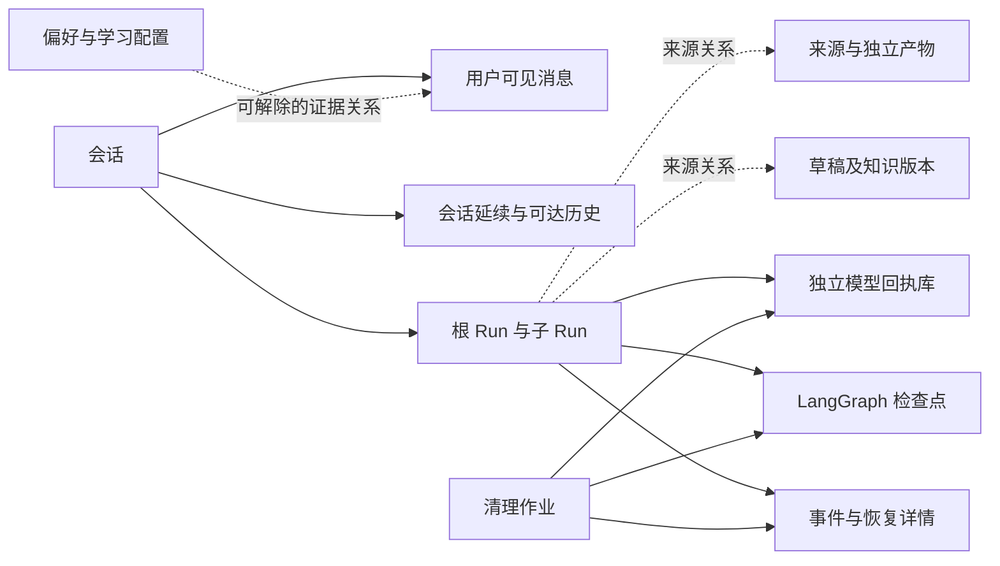

# 数据存储与生命周期

更新：2026-10-16。生命周期结构、资格检查、协议保留、详情与内部材料清理、周期维护、会话删除、前端和受管暂存回收已完成，正常业务库及回执库已增量迁移。下文说明当前实现及保留边界；L01—L12结果和完整批次后的定向修正见[交付核对](lifecycle-delivery.md)，当前环境状态见[进度](progress.md)，验收要求见[实施计划](implementation-plan.md)。

## 1. 先区分拥有者，再决定保存多久

本项目把“暂时需要”与“是否持久化”分开判断。一个 Python Future 失去执行进程后已经没有意义，应该在内存使用完释放；一次未确认结果的命令回执即使是中间数据，也必须保存在 PG，避免进程重启后重复执行。Redis 中的事件副本是加速数据，丢失可以回 PG；聊天的唯一原文则不能当作缓存。

同样，“来源于这次聊天”不代表“归这次聊天所有”。用户上传的资料、形成的知识版本、草稿和交付文件都有独立用途，删除聊天只解除来源关联，不删除这些资产。只有聊天自己的消息、摘要、延续、历史副本和恢复详情随聊天清理。

本项目使用现有 PostgreSQL 服务中的业务库和模型回执库，不增加数据库产品。业务 SQLAlchemy 模型在 `backend/src/knowledgeops_agent/persistence/models.py`，结构升级由根目录 Alembic 管理；模型回执库由 `harness/models/gateway.py` 的独立 metadata 和迁移函数管理；LangGraph 表由公开保存器管理。业务迁移不会接管后两者的内部结构。正常库名称与连接由环境配置确定，文档不复制密钥。

虚线表示追溯或证据，不授予级联删除权。PG 外键用于防止悬空身份，不能代替应用层的资产保留决策。

## 2. 保留规则及共同字段

- **资产**：用户资料、正文/版本、草稿、独立工作文件、长期记忆和学习配置，由其业务入口管理，本轮不增加定时删除。
- **会话**：消息、当前延续快照及其可达历史随会话保留。旧 Run 到期不能破坏新消息所需背景。已失去引用的旧快照和历史批次才有回收资格。
- **详情**：根任务组已结束且交接、审批、未知结果均解决后保留30天。默认每日扫描；恢复或出现未决依赖时停止倒计时，重新满足条件后按最新结束/依赖解决时刻计算。旧记录首次纳管给予完整30天。
- **交接**：通知收到不等于结果已消费。消费位置进入可恢复状态后才能确认消费；随后仍可能受原地恢复期限保护。
- **暂存**：已知由程序创建、没有写入者或引用且超过24小时的暂存可回收。无法证明拥有者的文件只报告，不推断可删。
- **作业**：清理失败保留阶段和短错误用于重试；完成的清理作业保留30天后可回收，但仍被未完成父作业等待的子作业继续保护，直到父作业消费完成凭据。不得把待删除正文复制进作业日志。

常见 `id` 是稳定身份，`created_at` 是产生时间；是否可删还取决于 `status`、引用和消费位置。JSONB 用于结构化快照，不意味着这些内容是无关紧要的日志。`root_id` 将主子运行统一预算与清理边界，`generation` 区分恢复代次，`authority_epoch` 防止旧许可重新生效。

## 3. 业务库逐表清单

下表逐项列出拥有者、生产/消费模块、关键字段和保留条件。除明确说明外，表的身份和关系存于业务 PG，正文文件位置另见第6节。具体索引/外键以模型和对应迁移为准，不能靠手工改表替代迁移。

### 来源、知识与业务动作

| 表 | 拥有者；生产 → 消费 | 关键字段与约束 | 生命周期及理由 |
|---|---|---|---|
| sources | 用户资料；sources → 导入/查询/逻辑删除 | id；唯一 identity_key；origin、kind、deleted_at | 资产；不随聊天或Run删除；用户移出材料列表后保留被引用版本与原件 |
| source_versions | 资料；sources → 解析/读取 | source_id FK；唯一 source_id/content_hash；storage_key、status、parser | 固定原件版本，证据依赖它 |
| source_segments | 资料版本；解析器 → 证据/阅读 | source_version_id FK；唯一版本/position；page、start_offset/end_offset、text | 解析正文与定位；不得随导入Run清除 |
| knowledge_documents | 用户知识；knowledge → 编辑/阅读 | workspace_path 唯一；current_version_id FK | 文档身份和当前指针，资产 |
| knowledge_versions | 知识文档；发布 → 引用/阅读 | document_id FK；唯一文档/number；body_storage_key、body_sha256、root_id | 不可变历史正文；root_id仅追溯 |
| evidence | 来源或知识版本；实际读取 → 发布/引用 | source_segment_id/knowledge_version_id 二选一；字符范围、quote | 稳定证据，保留被正文/草稿使用的摘录 |
| citations | 知识版本；发布 → 展示 | version_id/evidence_id 复合PK及FK | 跟随所属知识版本 |
| knowledge_relations | 知识版本；发布 → 导航 | version_id/target_id 复合PK；label | 跟随知识版本，保持历史关联 |
| search_entries | 当前知识投影；发布/重建 → 检索 | document_id PK；version_id 唯一；vector GIN、normalized_text | 可重建索引，跟随当前正式版本 |
| knowledge_search_chunks | 当前知识投影；分段 → BM25 | document_id/chunk_index PK；paradedb BM25；父投影删除级联 | 不与历史记忆索引混用 |
| changesets | 独立草稿；Agent/人工编辑 → 审批/发布 | operations、revision、publication_root_id、base版本；operation_key 唯一 | 跨聊天草稿；来源Run清理不删正文 |
| changeset_revisions | 草稿；修订 → 固定审读/重放 | changeset_id/revision PK；operations、content_hash | 跟随草稿保留，不改写旧修订 |
| task_grants | 一次根任务的发布授权；可信UI/意图入口 → 发布校验 | root_id PK；mode、actor | 在根任务封闭后不再授予执行；已发布业务保留自身回执 |
| operation_receipts | 业务动作；业务事务 → 重放 | operation_key PK；request_hash、result | 与业务结果同生命周期，不能因运行过期允许重复动作 |
| publish_receipts | 正式发布；发布事务 → 重放/追溯 | changeset_id及idempotency_key唯一；result | 随发布结果保留；不是临时日志 |

### 会话、执行与恢复

| 表 | 拥有者；生产 → 消费 | 关键字段与约束 | 生命周期及理由 |
|---|---|---|---|
| conversations | 用户会话；API → 聊天/入队 | id、user_sequence、execution_sequence、latest_snapshot_id、selected_learning_task_id、deletion_state | 用户删除；先封闭读写，再跨存储清理，最终墓碑不留正文 |
| chat_messages | 会话；入队/完成 → UI/下一轮 | conversation_id/run_id FK；role、content、user_sequence、protocol_payload | 随会话；私有协议字段不能送UI或检索 |
| runs | 根/子任务；入队/worker → 状态/恢复/清理 | checkpoint_id唯一；request_key唯一；root_id/parent_id；status、generation、budgets；lifecycle_state、details_summary、input_fingerprint | 完整详情30天；必要简短状态和防重身份另保留 |
| run_controls | Run；暂停/等待 → 调度/安全点 | run_id PK；pause_requested、revision、wait_spec | 活跃/等待/恢复依赖保护，封闭后可清 |
| run_dispatches | Run代次；事务外盒 → Celery投递 | 唯一run_id/generation；published_at、attempts、next_attempt_at | PG是可靠交接，Redis通知丢失可重投；不能发送后就无条件删 |
| message_deliveries | 会话引导；用户选择 → 目标Run | message_id/source_run_id唯一；target_root_id、target_generation、status | 未应用保护；已应用在恢复期限后随详情处理 |
| run_events | Run；事务提交 → SSE/详情及现存业务读取 | run_id/sequence PK；kind、data | 保留30天；先迁出必要业务事实，再整组清理，不改Redis事实源 |
| tool_budget_reservations | 工具尝试；程序预占 → 重放防重扣 | run_id/call_key PK；tool_name | 恢复期限内保留，封闭后由Run阻止旧尝试 |
| model_steps | 模型图步骤；模型中间件 → 准确重放 | run_id/step_key唯一；call_id唯一；request_hash/request_snapshot | 随完整恢复详情；未知调用保护 |
| execution_actions | 用户审批；工具提议 → 人工决定/图恢复 | run_id/tool_call_id唯一；batch_key、position、arguments、decision、status | pending保护；决定不能单靠过期授权执行 |
| command_executions | 命令尝试；执行边界 → 人工核对/重放 | run_id/tool_call_id唯一；attempt、request、result、history、status | running/unknown/retry_ready保护；已知完成后30天 |
| file_operations | 文件修改；写入意图 → 结果核对/同步 | run_id/tool_call_id唯一；before_hash/after_hash、content_key、status | prepared/running/applied/sync_pending/unknown/conflict仍保护 |
| run_questions | 一次补问；Agent/MCP → 用户回答/续接 | run_id/tool_call_id/round唯一；request、answer、status | pending保护；问题不是授权，结局后随详情 |
| child_instructions | 主子协作；主Agent/用户 → 子安全点 | run_id/request_key唯一；origin、authority_epoch、status | 未应用保护，不能仅因父Run已完成丢弃 |
| child_notifications | 主子协作；子完成 → 父图 | run_id/generation/event_key唯一；payload、consumed_at | 父图持久消费后才确认；之后保留恢复窗口 |
| run_artifacts | 内部运行材料；长输出/压缩 → 模型补读 | run_id/kind/content_hash唯一；content_storage_key、expired_at | 无实际引用且Run到期才删正文；身份可保留过期标记 |
| continuation_snapshots | 会话；完成/暂停 → 新Run背景 | run_id/generation唯一；content/hash、parent_snapshot_id、covered_sequence | 最新及可恢复Run绑定版本保留；父链不无限钉住祖先正文 |
| task_history_records | 会话历史范围；历史捕获 → 搜索/补读 | scope/source_id PK；payload、search_terms GIN | 可能是唯一原文，按可达批次判断，不能一律当可重建缓存 |
| task_history_chunks | 历史原文；分段 → BM25 | scope/source_id/chunk_index PK；父原文FK CASCADE；BM25 | 原文删除时一起清，不留搜索副本 |
| task_history_batches | 固定可读历史；捕获 → 检查点/延续 | scope/id PK；run_id FK；source_ids | 由有效延续/可恢复状态决定可达性，权限不能扩大 |
| run_resource_snapshots | 根Run；首次装配 → 运行/恢复 | root_id PK；content/hash | 固定Skills、策略和记忆等；随完整恢复详情清理 |

### 配置、长期记忆、学习与管理

| 表 | 拥有者；生产 → 消费 | 关键字段与约束 | 生命周期及理由 |
|---|---|---|---|
| execution_rules | 用户权限配置；设置/审批 → 命令校验 | workspace、conversation_id、argv、effect、revision、deleted | 全局规则保留；会话规则随会话处理，不遗留失效许可 |
| resource_revocations | 资源许可；撤回 → 每次调用校验 | kind/resource/content_hash PK | 撤回身份保留，不随日志过期复活许可 |
| preferences | 用户长期记忆；真实反馈/人工 → 检索/注入 | revision、content、scope、status、category、source_message_id、source | 正文保留；删除来源聊天时去原文证据并标记来源删除 |
| preference_revisions | 长期记忆；修订 → 冻结读取 | preference_id/revision PK；content | 正文与修订保留；嵌套source原文也须同步清理 |
| memory_evidence | 记忆证据；提取 → 追溯/排序 | preference_id/message_id唯一；quote、context_key | 原聊天删除时解除FK并清quote，不能旁路恢复原话 |
| memory_search_chunks | 记忆版本；分段 → BM25 | preference_id/revision/chunk_index PK；复合FK | 随有效记忆版本，不因删来源聊天丢记忆正文 |
| preference_extractions | 真人消息；解释器 → 提取去重 | message_id/extractor_version PK；result | 随所属消息删除；禁止晚到提取重新写入被删会话 |
| mcp_connections | 用户连接配置；管理 → 发现/调用 | revision、authorization_epoch、config、tools、enabled/deleted | 独立配置保留，不保存活客户端 |
| mcp_connection_revisions | 连接配置；修改 → 冻结/核对 | connection_id/revision PK；content | 独立配置历史，不跟聊天删 |
| mcp_calls | Run调用；适配器 → 审批/恢复/证据 | run_id/tool_call_id唯一；connection_revision、request/response/result、status | pending/running/unknown/waiting_input保护；其余详情30天 |
| mcp_continuations | MCP补问；协议输入 → 协议续接 | mcp_call_id/round唯一；question_id FK；request_state/input_responses/status | 不透明续接状态，等待中保护；完成后随调用详情 |
| subagent_definitions | 用户角色配置；管理 → 委派 | name唯一；system_prompt、tools/tool_groups、revision、epoch | 独立配置；删除状态保留许可身份 |
| subagent_definition_revisions | 子角色；修改 → 冻结读取 | definition_id/revision PK；content | 配置历史保留，不跟Run删除 |
| tool_policies | 用户工具策略；设置 → 工具暴露/执行 | id PK；revision、content | 独立配置保留 |
| tool_policy_revisions | 策略；修改 → 恢复核对 | policy_id/revision PK；content | 保留版本与撤回依据 |
| learning_tasks | 学习业务任务；用户/协调器 → 推进/复用 | conversation_id可空；request_key唯一；goal/configuration/creation_input、revision/status | 保留配置与业务结果；删聊天后解绑并停止自动推进 |
| learning_task_revisions | 学习任务；修订 → 复用/审读 | task_id/revision PK；content | 独立任务历史；原会话来源不可成为坏链接 |
| learning_units | 学习任务；框架确认 → 协调器 | task_id/key唯一；dependencies、budgets、draft_id/result_version_id | 累计预算和成果保留，不因旧Run清理归零 |
| learning_collaborations | 草稿审读；实际子任务 → 发布核验 | child_run_id/operation_key唯一；draft_revision/hash、storage_key、report | 与成果绑定的审查依据保留；非终态依赖须先解决 |
| learning_advances | 学习推进；协调器 → 调度防重 | run_id唯一；task_id/sequence唯一；requirements_revision/status | 保留简短推进事实，避免同单元重复安排 |
| learning_profiles | 用户配置；编辑 → 角色装配 | identity_key/task_id唯一；revision、enabled、epoch | 通用与任务个性配置独立持久化 |
| learning_profile_revisions | 用户配置版本；编辑 → 装配/导出 | profile_id/revision PK；storage_key/sha256、source | 不可变正文保留；来源关联需检查而非删正文 |
| learning_profile_imports | 用户导入预览；上传 → 应用 | profile_id、expected_revision、storage_key/hash、applied_revision | 用户显式导入文件不自动当临时垃圾，本轮保留 |
| evaluation_reports | 开发证据；显式评估 → 开发复核 | configuration、status | 本轮保留原始证据，不作为产品数据自动清理或展示 |
| evaluation_results | 开发证据；评估 → 复核 | report_id/key PK；data、review | 跟随开发证据，禁止为通过验收改写历史失败 |
| artifact_retention_references | 有效引用拥有者；聊天/快照/业务 → GC | artifact_id/owner_kind/owner_id PK；owner索引；reason | 新增：实际引用保留正文，访问目录本身不创建引用 |
| cleanup_jobs | 清理协调器；删除意图 → 阶段执行/重试 | target_kind/target_id唯一；phase/cursor、claim_token/until、status、next_attempt_at | 新增：完成后30天回收；失败保留短错误和续跑位置 |
| maintenance_state | 应用维护；扫描器 → 下一批扫描 | name PK；cursor、claim_token/until、next_scan_at | 新增：固定少量调度状态，不积累逐次运行日志 |

## 4. 模型回执库与框架保存器

| 表 | 生产/消费与关键字段 | 保留/清理职责 |
|---|---|---|
| model_requests | 网关预占/完成 → 重放与上下文用量；id、scope/root_id/run_id、status、request/response/usage | reserved是未知结局，保护；完成详情随根任务窗口；必要协议先迁到会话私有消息 |
| model_call_links | 网关 → 同一调用去重；scope/run_id/call_id PK、input_hash、reservation_id唯一FK | 不能先删关联再允许旧调用重发；必须先封闭Run/根预算 |
| model_root_budgets | 网关 → 根任务限额；scope/root_id PK、request_limit/used、closed_at | closed_at封闭后拒绝旧关联重放和新预占；请求正文可删，原预算事实不清零；不恢复项目累计统计 |
| model_quotas | 旧迁移兼容；scope PK | 当前不读写累计数；保留兼容形状，不扩展统计功能 |
| accounting_migrations | 显式回执库迁移 → 维护 | 结构和旧迁移证据，不随Run清理 |
| checkpoints | PostgresSaver → 图状态/恢复；thread_id/checkpoint_ns/checkpoint_id | 仅调用公开delete_thread，当前项目thread_id是Run.checkpoint_id |
| checkpoint_blobs | PostgresSaver → 通道内容读取 | 与所属线程一起由保存器清理；Redis确定版本缓存同步失效 |
| checkpoint_writes | PostgresSaver → 中断/未合并写入恢复 | 未结束任务必须保护，不能当普通日志提前删除 |
| checkpoint_migrations | 保存器setup → 结构版本 | 不由业务Alembic管理，不随线程删除 |
| alembic_version | Alembic → 业务结构版本 | 仅迁移程序维护 |

业务库和回执库不能用一个本地事务实现共同提交。清理先记录持久意图并封闭写入，再按阶段处理；崩溃后重试同一阶段。已不存在视为成功，其余失败留下可重试状态。删除框架检查点使用锁定依赖的公开接口，不手工猜内部表顺序。

## 5. Redis与进程内对象

| 对象/键 | 拥有者与生产 → 消费 | 生命周期、恢复依据 |
|---|---|---|
| broker的knowledgeops.agent队列、Kombu绑定及未确认投递 | Celery/Kombu → worker；消息是run_id/generation | 沿框架ACK/visibility策略；PG outbox可补投；不得用通用TTL或FLUSHDB清队列 |
| knowledgeops:runtime:v1:{数据库及schema散列}:events:{run_id} | PG提交后事件桥 → SSE | 默认3600秒、1024条；PG为事实源；清理Run时主动失效 |
| 同前缀:checkpoint:{thread散列}:{确定版本散列} | 保存器读穿透 → 图恢复 | 默认900秒，单值2MiB；只缓存不可变通道，不缓存latest/pending_writes |
| 同前缀:checkpoint-order | RedisBlobCache → 容量淘汰 | 与缓存TTL一致，默认128条；线程删除同时移除对应索引项 |
| ThreadPool Future、子任务执行槽 | worker → 结果收集/退出 | 消费后移除引用，finally退出；PG Run与通知承担恢复 |
| PG连接、Session、控制锁、worker租约 | 服务/短事务 → 调度和业务 | Session事务结束释放；进程结束关闭池；不序列化活连接 |
| SSE读取器、异步Redis连接、取消Event | 一次HTTP连接 → 流式发送 | 客户端离开/终态/删除时finally关闭；重连从PG序号读取 |
| MCP池Entry、adapter、协程、锁、borrowers | 每worker会话池 → 工具调用 | 正常跨Run复用，默认空闲1800秒；禁用/删除作用域/退出关闭，重启不假装恢复远端状态 |
| 命令子进程、输出管道/捕获文件句柄 | 本地执行工具 → 命令回执 | 调用完成/取消/超时finally回收；可能已发生的副作用仍以PG回执核对 |
| 临时Skill资源目录、read-version内存视图 | 单次工具调用/运行 → 文件工具 | 调用/作用域结束释放；需要恢复的版本存原快照，不持久化临时绝对路径 |

## 6. 文件拥有者与清理边界

| 受管位置 | 生产 → 消费 | 生命周期 |
|---|---|---|
| uploads/originals | 上传/抓取 → 资料版本读取 | 用户原件；聊天删除仍保留 |
| knowledge/documents | 通用文件工具/同步 → 用户编辑 | 用户工作文件，禁止通用GC |
| knowledge/versions | 正式发布 → 固定版本引用 | 不可变知识正文，受PG版本引用保护 |
| knowledge/current | 导出器 → 本地阅读 | 可重建阅读视图；本轮不按Run清理 |
| profiles/versions及配置导入文件 | 配置服务 → 角色装配/导出 | 用户通用及任务配置，不随会话删除 |
| 学习审读storage_key指向的固定材料 | collaboration → 审查/发布核验 | 保留业务成果证据，不能把路径在artifacts下理解为可随Run删 |
| artifacts/{run_id}/{hash}.txt | 长工具输出/上下文捕获 → 补读 | 无有效引用且根任务过期时可回收；共享存储键需再次核对 |
| artifacts/file-operations/{receipt_id} | 文件写入日志 → 崩溃核对/同步 | prepared/unknown/sync_pending等保护，已完成且恢复窗口结束才可回收 |
| 工作区/原件根下.knowledgeops-temporary/{随机身份}.json与.part | FileStore/上传/命令捕获 → 原子安装/后台维护 | json保存用途和Run拥有者并持有写入锁；24小时且无活写入/恢复依赖才回收；不允许元数据指定删除地址 |
| 旧.capture-*.tmp或未登记的.tmp文件 | 旧写入程序或用户；无法仅凭路径确定 | 本轮保守保留，不猜测为垃圾；用户普通文件不自动GC |
| work、outputs与其他用户文件 | 通用工具/用户 → 用户使用 | 独立资产；没有登记不代表可以删除 |
| 仓库artifacts/backups、verification | 维护/测试 → 恢复/验收 | 不属于工作区GC；本轮不清备份或既有证据 |

路径必须经过真实路径归一化、受管根判断和符号链接检查。文件不存在可以推进清理，权限/IO错误必须重试；不得递归删除整个聊天目录。无主的正式正文或配置文件不能仅凭“数据库暂时没有指针”判断是垃圾，事务提交窗口和所有权不明时只报告。

文件删除组件限定RunArtifact地址必须等于artifacts/{run_id}/{content_hash}.txt，文件操作只接受其固定content/deleted回执路径。通过Linux目录描述符与O_NOFOLLOW逐层拒绝符号链接，文件必须是普通文件且哈希吻合。清理协调器已把它接在资格与引用核对之后；已保存的目录回执先验证总哈希并提交逐项清单，再分批删除，只操作该回执拥有的目录。用户工作文件不属于这个删除范围。

引用目录区分可访问ID和实际使用：事务钩子维护消息、配置及业务正文中的引用，Core写入材料显式维护同一关联，活动Run补读先登记临时保留关系。检查点与工作文件扫描补充实际使用证据。材料间接引用通过递归查询从存活拥有者出发计算，无存活根的循环不永久保留。过期材料保留身份与哈希并标记正文不可用；新引用消失后，周期维护可以重入保留阶段。

## 7. 迁移、执行次序与验收

0029是增量结构迁移：不删除旧行，不填造protocol_payload或通知consumed_at，不修改已有授权。分批纳管把retention_adopted_at写为实际时刻，之后还需完成旧消息协议、可达历史和引用回填才能开启破坏性清理。旧格式不能可信还原的记录列为保护项。

独立模型回执库增加显式0003_lifecycle迁移，只加model_root_budgets.closed_at并记录迁移身份，不封闭旧根或改变已用预算。清理时业务库先封闭执行，账本再以原预占锁复查未决请求并记录closed_at；随后分批先删调用关联再删请求正文。跨库没有共同事务，CleanupJob的阶段和幂等重试负责收敛。ReferenceCatalog将旧引用按表和主键分批纳管，进度保存在maintenance_state，不把扫描到的正文复制到维护记录。

实际执行次序为：确认资格与引用 → 锁定复查并封闭写入 → 保存简短结果及会话连续性 → 删除检查点/完整回执/无引用内部文件 → 关系与派生索引 → 缓存失效 → 标记完成。删除聊天额外清除所有正文副本与来源摘录；独立资产保持哈希和可读性。

数据库删除后的空间回收交给常规autovacuum。行删除不保证物理文件立即缩小，本轮不自动VACUUM FULL。恢复必须同时使用业务库、回执库和完整挂载工作区的同批备份；回退代码不能还原已经删除的内容。

维护命令和前端删除入口已接通。维护API循环在每日纳管、到期检查、引用再核对之后分批扫描受管暂存；关闭自动扫描仍继续已接受的清理作业。命令默认预览，显式执行和失败重试见README。生命周期交付时正常库已执行0029及0003_lifecycle，迁移没有清理或封闭旧记录；L01—L12核对已完成。2026-10-17新增0030的sources.deleted_at，旧资产默认可见；逻辑删除只隐藏材料入口、保留固定版本与原件。当前应用状态以PROJECT_CONTEXT为准。验证使用隔离PG/Redis、真实保存器/文件、控制时钟和模型替身，不调用收费模型。
