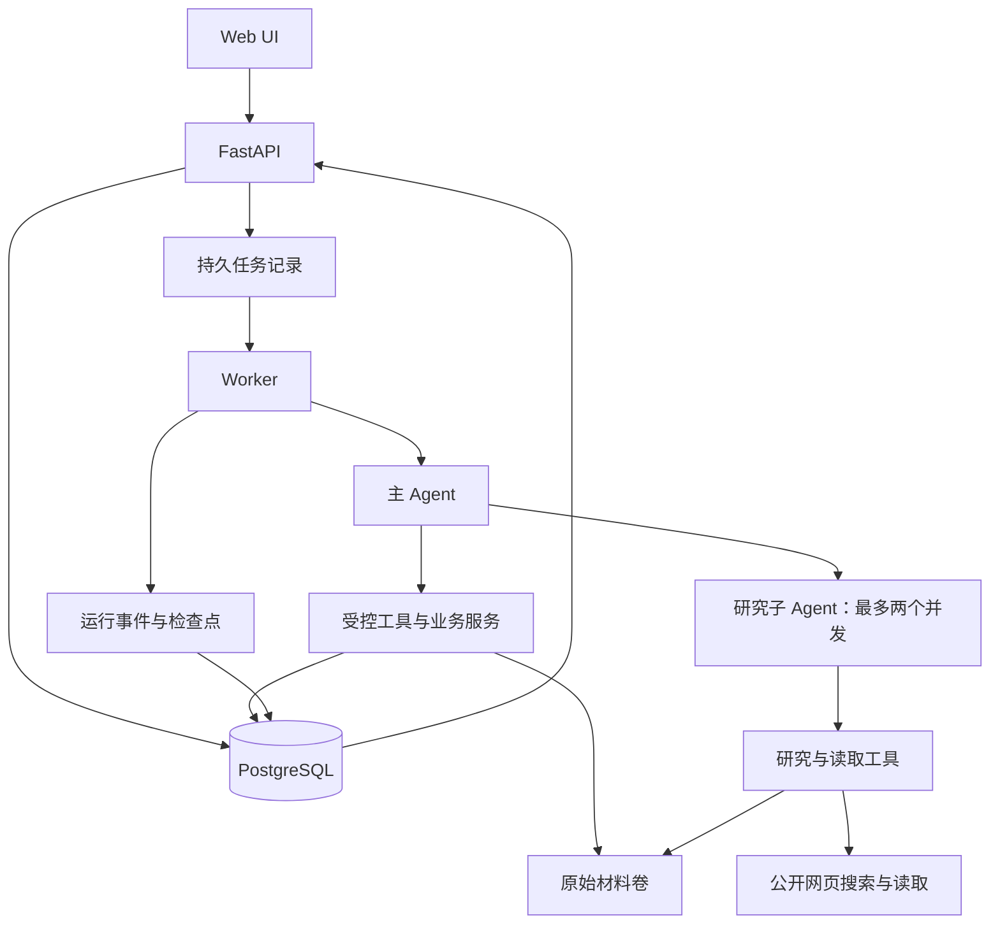

# KnowledgeOps Agent 首版 Web 应用实施计划（聊天导出）

> 导出日期：2026-10-08。
>
> 本文件包含聊天中完整实施计划的原文，以及用户随后补充的交付与自主执行要求。它是一份供打开、保存和审阅的快照，不单独维护成第二套实施方案。
>
> 正式执行前，应把内容统一整合进项目现有长期文档；[现有实施计划](../implementation-plan.md)目前仍是旧草案，本次没有覆盖它，也没有启动开发或创建长期目标。下方原文中的“当前状态”对应计划发布时的状态。
>
> 当前实战对象是 D:\codes\KnowledgeOps Agent 下的完整前后端 Web 应用，与桌面的个人知识库完全隔离。

---

# KnowledgeOps Agent 首版设计与完整实施计划

**目标：**在 `D:\codes\KnowledgeOps Agent` 完成一个可实际使用、可展示、可解释设计取舍的知识库 Agent 应用。它应能研究资料、构建和维护知识正文、回答知识问题，并提供来源追溯、运行记录、恢复能力和效果评估。

**交付范围：**覆盖整个首版。容器启动、Agent 循环跑通或某个演示成功，均只是中间成果。

**执行方式：**本计划批准并进入执行阶段后，Codex 在目标模式中按依赖顺序持续实现、验证和修复。使用 `superpowers:executing-plans` 的逐项验证方式，将进展维护在项目现有文档中。

**当前状态：**本阶段只完成了只读调查和设计讨论，尚未修改项目、安装依赖、启动容器或调用项目模型。

## 一、首版需要交付的应用

### 1. 用户能够完成的业务

| 场景 | 首版行为与完成标准 |
|---|---|
| 学习讨论与知识整理 | 用户通过聊天讨论问题、提供材料；Agent 能形成连贯的知识文章，保留必要解释、例子、适用条件和正文中的来源链接。 |
| 自主研究 | Agent 能自行搜索公开网页、选择来源、读取正文、交叉核对并形成结果。搜索摘要与实际读取的正文明确区分。 |
| 知识维护 | 支持新增、修订、合并、拆分、归档和恢复；修改前读取相关已有内容，避免重复建文或简单追加矛盾结论。 |
| 主动维护建议 | 问答中发现有依据的缺失、过时或冲突时，可以主动研究并准备变更建议，等待用户决定是否发布。 |
| 知识问答 | 默认优先检索项目知识库，必要时补充网络研究；回答区分内部知识与外部资料，并提供可打开的引用。提供“仅使用知识库”选项。 |
| 用户检查与编辑 | Web UI 能查看完整文章、来源、修改差异、历史版本，并提供简单 Markdown 编辑与预览。 |
| 长任务使用 | 关闭或刷新浏览器不会取消任务；重新打开后能看到进度和结果。服务中断后由用户明确恢复。 |
| 展示与验证 | 能运行固定演示场景，导出运行证据和评估报告，并比较单 Agent 与有限多 Agent 的效果和成本。 |

首版输入包括：应用内对话、粘贴文本、Markdown/TXT、PDF、用户提供的公开网页，以及 Agent 自主搜索获得的网页。PDF 支持文本提取及普通中英文扫描页 OCR；复杂图表、公式和手写内容无法可靠提取时，必须显示局限。

### 2. 知识发布规则

- 用户明确要求“先给我看”时，生成草稿与差异，等待确认。
- 用户明确要求“直接保存”时，在对应任务授权范围内完成检查和保存，不重复询问相同权限。
- 未说明交付方式时，询问一次“预览还是直接保存”；等待期间可以研究和起草，不能把沉默当作发布授权。
- 主动发现的问题可以先形成建议，但发布前仍需用户选择。
- 合并、拆分、批量归档等操作先展示影响范围，再按确认后的变更集执行。
- 用户编辑正文与 Agent 修改正文共用版本、冲突检查和审计机制。
- 草稿作为独立业务对象保存，不让一个待审核草稿长期阻塞整段聊天。

### 3. 明确边界

- 项目知识库与桌面个人知识库完全隔离；不挂载、不自动导入、不同步、不回写个人知识库。
- 两份规则副本用于借鉴知识组织方法，不自动成为本应用的权限规则。
- 首版不实现 GraphRAG、向量检索、多租户、递归子 Agent、通用代码执行沙盒或独立评估平台。
- 不接入已经弃用的 Agent-Evaluation-Framework。
- 保留已有练习代码，业务主项目不依赖练习实现。
- 不直接二次开发 DeerFlow，也不整体复制其后端。

## 二、架构、数据与运行设计

### 1. 技术栈与部署

| 部分 | 采用方案 | 选择理由 |
|---|---|---|
| Agent | LangChain `create_agent`、LangGraph、自定义工具与中间件 | 使用已有模型—工具循环，同时由项目明确状态、上下文、权限、预算和业务行为。 |
| 后端 | Python 3.12、FastAPI、Pydantic | 与 Agent 生态保持一致，便于定义接口和校验数据。 |
| 持久化 | PostgreSQL 17、SQLAlchemy 2、Alembic、psycopg | 统一处理业务数据、事务、任务记录及检查点，减少服务数量。 |
| 前端 | React、TypeScript、Vite，Node.js 24 LTS | 提供普通 Web 应用结构，保持页面简单。 |
| 搜索 | DDGS | 按已确认方案实现无需额外搜索 API Key 的搜索入口。 |
| 网页读取 | HTTPX 获取页面，Trafilatura 提取正文 | 明确控制下载、错误、快照和正文提取，便于来源追溯。 |
| PDF | pypdf；扫描页使用 pypdfium2 渲染与 Tesseract OCR | 文本提取优先，需要时使用本地 OCR，不为 OCR 默认增加模型费用。 |
| 依赖 | 后端 uv 与根目录 `uv.lock`；前端 npm 与锁文件 | 保证容器内安装与验证可复现。 |
| 测试 | pytest、Ruff、类型检查、前端测试、Playwright | 分别验证业务规则、接口和真实页面行为。 |

`create_agent` 提供基于 LangGraph 的 Agent 结构；持久化使用 PostgreSQL checkpointer，并与应用自身的业务记录分开。[LangChain Agent 文档](https://docs.langchain.com/oss/python/langchain/agents)、[LangGraph 持久化文档](https://docs.langchain.com/oss/python/langgraph/persistence)

建立名为 `knowledgeops-agent` 的独立 Compose 项目，包含五个服务：

- `dev`：开发、测试和维护工具。
- `api`：HTTP 接口、会话入口、数据读取和用户操作。
- `worker`：执行 Agent、材料解析及其他长任务。
- `web`：前端静态文件与 API 反向代理。
- `postgres`：数据库。

API、worker 和 dev 使用一致的后端依赖。数据库和原始材料使用项目独立持久卷。Web 默认仅绑定本机地址，数据库不对宿主机外部开放。

Windows 负责容器生命周期和浏览器访问；项目依赖安装、运行、测试在本项目容器内完成。依赖精确版本通过安装、兼容性检查和锁文件固定，不能把“计划采用”写成“已经验证兼容”。

### 2. 模块职责

按职责划分模块：

| 模块 | 负责什么 |
|---|---|
| `runtime` | Agent 创建、模型接入、状态、上下文、预算、停止、委派和恢复。 |
| `sources` | 上传、网页快照、解析、OCR、来源版本和定位信息。 |
| `knowledge` | 正文、版本、关系、草稿、授权、变更提交和恢复。 |
| `retrieval` | 知识搜索、片段定位、排序及可重建索引。 |
| `jobs` | 任务领取、执行状态、心跳、取消和中断识别。 |
| `observability` | 模型与工具调用记录、事件、耗时、用量和证据导出。 |
| `api` / `web` | 面向用户的接口与交互，不在页面中实现业务规则。 |
| `evaluation` | 本项目任务集、运行器、评分、对比和报告。 |

不为了填目录提前创建空模块；相关功能开始实现时再建立对应代码。

### 3. 数据如何保存和关联

| 数据 | 保存方式与关键约束 |
|---|---|
| 原始材料 | 文件卷保存上传文件及网页原始快照；数据库保存类型、哈希、来源、时间和解析状态。 |
| 解析内容 | 数据库保存来源版本、页码或章节、文本片段及解析方式；不能把 OCR 失败页当作已读内容。 |
| 知识正文 | PostgreSQL 保存完整 Markdown、稳定文档 ID、标题、分类、标签和当前版本。 |
| 历史版本 | 不可变版本记录，包含正文、元数据、引用及修改来源；恢复旧内容生成新版本。 |
| 草稿与变更集 | 独立记录待新增、修改、合并、拆分或归档的内容、基础版本及用户选择。 |
| 对话 | 保存用户消息、面向用户的回复和明确的操作选择。 |
| 运行记录 | 保存本次 Agent 的真实模型输入输出、工具调用、子任务、错误、用量和结果；敏感配置脱敏。 |
| 检查点 | 使用 LangGraph PostgreSQL checkpointer 保存恢复所需状态，不代替业务审计或幂等记录。 |
| 检索索引 | 可由正文和来源版本重建；索引记录明确关联内容版本。 |

关联链路为：

**用户消息 → 运行及子运行 → 读取的来源版本 → 证据位置 → 草稿 → 已发布知识版本。**

引用放在相关正文附近。引用中的来源 ID、版本和定位信息必须可以解析；网页引用同时保留原链接和抓取快照，PDF 引用能够打开对应页。历史回答引用旧版本时，仍能看到当时使用的内容。

知识组织采用主题、标签和有阅读价值的文章关联，不复刻个人库的全部目录。导出为 Markdown 时重写内部链接，并附带必要的来源清单。

### 4. 检索与一致性

首版采用非向量检索：

- 中文分词使用 jieba，结合 PostgreSQL 全文检索。
- 标题、关键词和正文分开加权。
- 对代码标识符、缩写和精确短语补充文本匹配。
- Agent 可以改写查询、读取更多相关段落和沿文章链接继续查找。
- 检索结果携带文档版本和位置，不能只返回无来源文本。

预留检索适配器，后续可以增加 pgvector；首版不安装嵌入模型，也不以向量能力作为完成条件。

正文提交时，在同一数据库事务内完成：

**版本检查 → 新版本 → 引用与关系 → 当前版本指针 → 检索索引 → 审计与操作回执。**

发生版本冲突时拒绝覆盖，要求重新读取并调整草稿。合并和拆分采用一个变更集原子提交，避免只完成一半。

### 5. Agent 如何运行

主 Agent 与研究子 Agent 都使用 `create_agent` 构建，工具执行进入统一业务服务。

**主 Agent：**

- 理解任务、在必要时维护计划。
- 选择知识检索、网页研究、材料读取和维护工具。
- 判断是否委派研究任务。
- 整合证据，回答问题或准备知识变更。
- 仅在程序确认授权后提交变更。

**研究子 Agent：**

- 使用一个通用研究模板，按任务传入目标、资料范围和输出要求。
- 最多两个研究实例并发，不允许递归创建子 Agent。
- 可以研究和读取材料，不能直接发布知识或提升权限。
- 返回结论、证据 ID、未解决问题；详细过程单独保留。
- 与主 Agent 共享根任务预算。

保留禁用委派的单 Agent 模式。简单任务不强制委派，多 Agent 也不被预设为一定更好。参考 Deep Agents 的子任务隔离方式，但由本项目实现业务边界。[Deep Agents 子 Agent 文档](https://docs.langchain.com/oss/python/deepagents/subagents)

**状态与上下文：**

- AgentState 保存消息、计划进度、证据与草稿引用、运行结果等必要状态。
- 数据库客户端、模型客户端、权限检查器等通过运行上下文注入，不序列化进检查点。
- 每次模型调用由上下文组件选择：系统规则、当前任务、近期消息、工作摘要、必要证据和计划。
- 长工具结果保存为材料记录，向模型返回摘要及可继续读取的引用。
- 历史压缩保留原记录；权限、预算和版本号不能只靠模型生成的摘要保存。
- 不展示或伪造模型未返回的内部思考。

### 6. 工具、网络与模型边界

工具包括知识搜索与读取、材料读取、网页搜索与读取、计划更新、变更提议、受控提交及研究委派。

DDGS 用于发现来源，网页读取用于取得证据。搜索结果中的摘要不能冒充已读取的正文；已经取得的正文可以复用，避免重复下载。[DDGS 文档](https://github.com/deedy5/ddgs)

网页读取只接受公开 HTTP/HTTPS 地址，检查重定向、地址范围和下载大小；不提供任意本地文件读取或命令执行能力。提取失败时保留失败原因，不能直接把导航栏或错误页当正文。

模型使用现有 `OPENAI_BASE_URL`、`OPENAI_API_KEY` 和 `AGENT_MODEL=deepseek-flash`，通过明确配置的 OpenAI 兼容客户端接入。先验证工具调用、工具结果回传、结构化结果及流式行为，不假定任意兼容地址都支持相同能力。

### 7. 长任务、停止与预算

API 接收任务后立即返回运行 ID，worker 从 PostgreSQL 领取任务。首版一个 worker 同时执行一个根任务，任务内部允许两个研究子 Agent 并发；不增加 Redis、Celery 或独立消息队列。

- 会话 ID、运行 ID、子运行 ID 分开。
- 每次根运行使用独立 checkpoint 标识；恢复同一次运行沿用原标识。
- 用户开启新任务时，从应用保存的会话内容组织上下文，不把“复用图对象”当作自动继承对话。
- 浏览器断开不取消任务。
- 服务重启后，之前未完成的任务标记为中断，不自动发起新的模型调用；用户选择继续后恢复。
- 等待用户审核的草稿独立保存，释放 worker。
- 取消阻止后续操作；已经提交的修改如实报告，不伪装成已撤销。
- 恢复可能重放工具，因此写入操作必须有持久化幂等键和回执。

运行状态与业务结果分别记录。例如，图结束后可能是“已回答”“草稿待选择”“已发布”“需要补充信息”或“部分完成”，不能一律显示成功。

根任务默认上限：

| 项目 | 默认值 |
|---|---:|
| 模型请求 | 40 次 |
| 搜索调用 | 20 次 |
| 工具执行尝试 | 80 次 |
| 活跃执行时间 | 20 分钟 |
| 并发研究子 Agent | 2 个 |

主 Agent、子 Agent 和重试都计入预算；等待用户的时间不计入活跃执行时间。预算由程序执行，模型不能自行增加。达到限制后保存结果、说明原因，由用户选择是否增加额度继续。

### 8. Web UI 与接口

界面提供四个主要区域：

1. 对话与任务进度：回复、工具活动、研究子任务、取消和继续。
2. 知识库：浏览、搜索、完整正文、Markdown 编辑、版本和导出。
3. 材料与来源：上传、解析状态、网页快照、PDF 页码和引用查看。
4. 变更与运行详情：完整草稿、差异、发布选择、审计与评估结果。

关键接口约定：

| 接口 | 职责 |
|---|---|
| `POST /api/conversations/{id}/messages` | 接收消息及材料引用，返回运行 ID。 |
| `GET /api/runs/{id}` | 查询状态、结果和停止原因。 |
| `GET /api/runs/{id}/events` | SSE 进度流，支持按事件游标重连。 |
| `POST /api/runs/{id}/cancel`、`resume` | 取消或明确恢复；恢复时校验剩余预算。 |
| `/api/sources` | 材料上传、导入、解析状态和来源读取。 |
| `/api/knowledge` | 正文查询、版本、关联和导出。 |
| `/api/changesets` | 草稿编辑、差异、用户决定和原子提交。 |
| `/api/evaluations` | 查看与导出评估报告。 |

前端提交正文修改也必须经过变更服务。流式消息不能成为唯一结果存储；刷新后从数据库重建页面状态。

## 三、按依赖顺序实施

以下编号用于跟踪依赖与完成证据，不是日期排期。后续任务不能用“代码已经存在”替代前置任务的验证。

| 步骤 | 具体产物与涉及模块 | 验证方法与完成条件 |
|---|---|---|
| **0. 固化设计与校正项目入口** | 将本计划整合进长期文档；更新已经过时的 Git、存储、容器和旧评估项目描述；记录取代旧草案的决策。保留现有骨架和练习。 | 文档明确区分现有实现、确认设计和待验证能力；不存在同时有效的冲突计划。记录开发起点的 Git 状态。 |
| **1. 建立独立环境并验证关键依赖** | Compose、Dev Container、后端及前端镜像、锁文件、配置校验、数据库迁移入口、健康检查。建立统一模型调用入口和验收调用账本。 | 五个服务按职责启动；数据重启后保留；依赖和基础检查在 dev 内运行。首次模型验证不超过 10 次，取得真实工具调用往返证据。配置错误明确报错，不打印密钥。 |
| **2. 实现数据基础与材料入库** | `sources`、`knowledge`、`retrieval` 的基础表和服务；Markdown/TXT/粘贴文本/对话材料导入；稳定来源定位、正文版本、变更集、词法索引。建立独立测试知识库及固定评估材料。 | 同一材料重复导入不重复产生相同内容；中文检索能定位预期文章；无效引用和过期基础版本被拒绝；事务失败不留下半份正文或错位索引。 |
| **3. 打通第一个真实业务闭环** | `runtime`、`jobs`、API 与最小 Web 页面；主 Agent 工具循环、上下文选择、预算、事件记录；草稿预览、用户选择、提交和再次问答。 | 用户在页面提交材料并提出整理任务，真实模型读取材料形成草稿；确认后保存，再次提问能引用新知识。预览模式不写正文，直接保存模式能在授权范围内执行。刷新页面可找回任务和结果。 |
| **4. 接入自主网络研究** | DDGS 搜索适配器、受控网页读取、正文提取、来源快照、缓存复用、知识库不足时补充研究、主动维护建议。 | 在项目容器内完成真实中英文搜索与正文读取；回答引用实际读取的来源。搜索失败、网页读取失败和知识不足均有明确反馈。“仅知识库”模式不能联网。主动建议未经选择不能发布。 |
| **5. 完成 PDF 与 OCR 链路** | 文件上传、PDF 原文保留、分页解析、扫描页 OCR、逐页状态、后台解析与来源查看。 | 文本 PDF、普通中文扫描 PDF、英文扫描 PDF、混合文档、损坏文件都有固定案例。能从回答跳到来源页；失败页不会被当作成功解析。 |
| **6. 完成知识维护与编辑体验** | Markdown 编辑预览、差异查看、修订、合并、拆分、归档、恢复、关系更新和导出。 | 用户编辑与 Agent 修改冲突时不覆盖新内容；合并与拆分中途失败整体回滚；归档后默认检索排除，历史引用仍可访问；导出正文及链接可用。 |
| **7. 完成有限多 Agent 与长上下文** | 研究委派工具、子运行记录、上下文隔离、并发限制、共享预算、工作摘要和单 Agent 开关。 | 一个真实任务发生有意义的研究委派；子 Agent 无发布权限且不能递归委派；并发不超过两个；长历史下仍保留任务要求、待处理草稿和证据引用；全部模型调用计入根任务与验收账本。 |
| **8. 验证故障、恢复和观测** | 检查点恢复、任务心跳、中断识别、取消、有限重试、幂等回执、预算停止、SSE 重连及运行详情。 | 注入“写入成功但回执前中断”等故障，恢复后不重复创建版本；重启不自动调用模型；取消和预算耗尽有真实部分结果；日志中的时间、token、错误和停止原因可核验。 |
| **9. 完成项目内评估与对比** | 固定任务集、执行器、确定性检查、语义评分、单/多 Agent 对比和可导出报告。 | 完成下述评估标准；报告同时包含结果、证据、成本和失败案例。模型评分与程序断言分开，不能靠评分模型一句“通过”宣布功能完成。 |
| **10. 完成交付、复现与维护验证** | 一键启动说明、演示数据和脚本、备份恢复、浏览器验收、CI 配置、架构说明、注释及最终进展记录。 | 从干净环境按说明启动；在新的空数据库和卷中验证备份恢复；演示不依赖个人知识库；全部首版验收有证据，未完成项不藏在“后续优化”中。 |

每个步骤遵循同一工作方式：读取对应设计与代码，完成一个可检查的变化，运行受影响的验证，记录结果，再推进下一项。修复后只重跑相关检查，最后进行一次完整交付验收。

## 四、验收、技术验证与完成证据

### 1. 必须通过的工程检查

以下属于硬性条件，不能通过平均分抵消：

- 未授权发布、跨个人知识库访问、子 Agent 越权均被程序拒绝。
- 引用可以解析到真实来源、版本与位置，不存在伪造来源 ID。
- 版本冲突不覆盖新内容，提交失败不破坏正文与索引一致性。
- 重复提交和故障恢复不重复产生业务修改。
- 服务重启不自动恢复有费用的任务。
- 单 Agent 与子 Agent 共享预算，额外重试不能绕过计数。
- 页面能够处理加载、空结果、失败、重连和待用户选择状态。
- 数据备份能够在隔离环境恢复。
- 代码质量检查、受影响测试和浏览器关键流程通过。

### 2. 真实模型评估

建立 **24 个固定业务案例**，覆盖构建、修订、问答、冲突材料、证据不足、主动建议、网络研究、PDF/OCR、委派和恢复。预先固定材料、期望事实、允许的结果及评分依据，其中保留一部分案例不用于逐例调提示词。

本项目首版采用以下验收门槛：

- 所有核心业务能力至少有一份真实成功记录。
- 24 个案例至少 21 个达到各自预先定义的通过标准。
- 上述工程硬性检查全部通过。
- 剩余失败案例明确记录原因和影响，不能涉及越权、数据破坏或伪造执行事实。
- 选择其中 6 个适合研究分工的任务，单 Agent 与多 Agent 各运行 3 次，比较结果质量、引用、模型调用、token 和耗时。
- 比较时保持材料、模型、根任务预算和评分口径一致；不要求多 Agent 必须胜出。

自动语义评分只作辅助。评分应关联实际证据，报告明确说明小样本、模型裁判和网络变化的限制，不包装成普遍能力证明。

### 3. 已授权的在线验证边界

后续执行阶段允许使用已配置的 `deepseek-flash`：

- 首次接通验证最多 **10 次**请求。
- 本次完整开发与验收累计最多 **600 次**请求。
- 包含主 Agent、子 Agent、重试、摘要生成及自动评分。
- 首次验证也包含在 600 次总额内。
- 调用次数在请求发出前持久化计数，不能因重启、重跑或重建测试数据而清零。
- 记录实际返回的 token 用量；供应商没有返回时标为未知。
- 达到上限停止项目模型调用并汇报，不自行提高额度或更换收费服务。

600 次是请求数量上限，不是金额上限，也不是必须消费的数量。

### 4. 必须尽早验证的风险

| 验证问题 | 通过条件 | 不通过时的处理 |
|---|---|---|
| 当前模型渠道是否满足 Agent 协议 | 工具选择、参数、工具回传和最终响应真实可用。 | 先排查同一渠道的配置与兼容参数；必须换模型或渠道时询问用户。 |
| DDGS 在容器网络中是否可用 | 固定中英文查询能发现相关来源，网页读取链路可运行。 | 保留真实失败记录；不能静默换成付费搜索或宣称网络研究已完成。 |
| 普通扫描 PDF 是否可用 | 固定中英文扫描样本能够提取关键事实并定位页码。 | 在选定解析链路内改进；无法满足时报告具体缺口。 |
| 中文词法检索是否足够支撑首版 | 固定查询能找到预期文章和位置。 | 调整分词、字段权重和查询策略；不能未经讨论扩大为向量/GraphRAG 项目。 |
| 恢复是否产生重复副作用 | 故障注入后只有一次已提交业务结果，费用记录不丢失。 | 修复后再进入完整真实评估。 |

### 5. 交付证据

每次正式验收记录：

- 代码版本或工作区差异标识、依赖锁文件、脱敏配置及提示词版本。
- 测试命令、结果、浏览器流程截图或记录。
- 真实运行 ID、输入材料版本、事件、最终结果及数据库实际变化。
- 单/多 Agent 对比报告与失败案例。
- 备份恢复记录及从干净环境启动的说明。

明确标注哪些来自静态检查、离线测试、真实网络、真实模型和浏览器操作，不互相替代。

## 五、长期文档与 Codex 目标任务说明

### 1. 文档归属

进入执行阶段后，将设计与实现计划整合进已有文档：

- `PROJECT_CONTEXT.md`：项目目标、硬边界、当前实现和阅读入口。
- `docs/architecture.md`：模块、数据、Agent 运行、权限与接口。
- `docs/implementation-plan.md`：本计划、依赖步骤、验收条件和目标执行契约。
- `docs/progress.md`：实际进展、验证证据、失败与剩余工作。
- `docs/decisions/`：重要选型及取舍，说明哪些旧决策已被取代。
- `README.md`、`AGENTS.md`：启动演示、维护方式和 Codex 工作要求。

以现有[项目上下文](<D:/codes/KnowledgeOps Agent/PROJECT_CONTEXT.md>)、[架构文档](<D:/codes/KnowledgeOps Agent/docs/architecture.md>)和[实施计划](<D:/codes/KnowledgeOps Agent/docs/implementation-plan.md>)作为长期入口，不新增一套平行维护的冲突计划。

旧记录中确实发生过的工作保留为历史；过时设计标明被取代，不能将历史改写为从未发生。

### 2. 可交给目标模式的任务说明

> 在 `D:\codes\KnowledgeOps Agent` 持续开发并完成本次批准的 KnowledgeOps Agent 首版。
>
> 首先将批准的设计和实施计划整合进项目现有长期文档，随后按依赖顺序实现、测试、联调和修复，直至本计划的全部首版能力与验收条件满足。
>
> 最终交付必须包含：本项目独立容器组、可实际使用的 Web UI、知识构建与维护、可追溯问答、自主网络研究、PDF/OCR、受控知识发布、有限多 Agent 与单 Agent 基线、运行观测、取消与恢复、项目内评估、备份恢复和可复现演示。
>
> 不以骨架完成、离线 mock 跑通、单个演示成功或评估报告已经生成作为整个目标完成的依据。根据真实结果修复问题，并维护进展与证据。
>
> 每次改动前读取项目上下文、进展及相关设计；保留已有练习与无关修改。代码需要有助于理解的注释，重点说明用途、输入输出、状态变化、异常与设计原因。
>
> 允许在项目范围内创建和维护容器、安装计划内依赖、实现代码、迁移项目数据库、运行测试和生成验证产物。真实模型验证遵守首次最多 10 次、累计最多 600 次请求的授权。
>
> 不操作个人知识库，不使用共享开发容器，不恢复已删除的个人知识副本，不接入弃用评估项目，不擅自增加付费服务、向量检索、GraphRAG 或递归多 Agent。
>
> 未经另行授权，不提交或推送 Git、不公开部署、不删除正常业务数据或持久卷。测试和恢复使用明确隔离的数据空间。
>
> 常规实现细节由 Codex 自行完成。若必须改变首版范围、知识发布规则、核心技术选择、费用额度，或需要不可逆的数据操作，停止依赖该决定的操作并提出具体问题；其他不受阻的工作继续推进。
>
> 只有全部必需能力达到约定验收、证据可查、启动与维护文档与实际实现一致时，才将目标标记为完成。否则如实报告剩余工作，不能因执行时间或预算耗尽降低完成标准。

本计划在当前阶段仅供审阅。批准并切换到允许执行的阶段后，先落入项目长期文档，再启动这一完整开发目标。

---

## 后续补充：交付口径与自主执行规则

### 完整应用交付

首版目标是一个以 Agent 为核心能力、带简单前后端的 KnowledgeOps 个人知识库实战 Web 应用。交付覆盖页面、后端接口、持久化、后台任务、Agent、独立容器和必要验证，不以单独的 Agent 循环或练习程序作为整个项目完成。

已有完整计划继续作为开发基线。先达到可用、可验证的初版，界面美化、性能提升和进一步效果调优等非阻断事项可以记录后迭代。核心流程无法使用、数据丢失、越权写入等问题必须在交付前解决；不能通过删除测试或降低既定验收标准掩盖问题。

### 优先自主排查和解决

- 编译、测试、依赖兼容、容器配置及接口联调等常规工程问题，由 Codex 自主读取日志、查阅官方资料、定位、修复和验证，不逐次请求用户介入。
- 能在既定范围、权限与技术选择内调整实现时，自主调整并记录理由和影响。
- 同一种方法失败且没有新证据时，改变排查思路，避免无效重试；一项任务受阻时，继续推进不依赖它的工作。
- 必须改变重要产品行为、核心技术选择、权限或费用额度，或需要用户提供无法自行取得的凭据时，带着调查证据、尝试结果和建议请求用户决定。
- 所有动作继续遵守原计划的个人知识库隔离、独立容器、Git、数据和模型调用边界。

### 开发问题与解决记录

执行阶段维护项目内的 docs/development-issues.md，作为用户最终审查入口；该问题文档尚未在本次导出中创建。

每条有意义的问题记录：

1. 现象、触发条件和影响；
2. 有意义的排查尝试及结果；
3. 原因与证据，区分已确认原因和推测；
4. 实际解决方案、相关代码与设计理由；
5. 验证方法、结果与运行证据；
6. 当前状态及遗留事项。

发现问题时建立记录，取得重要结论和验证完成后及时更新，不等项目结束才补写。文档顶部汇总未解决问题与待审查事项，不写入密钥。项目进度继续由 docs/progress.md 维护；重要设计决定关联 docs/decisions/，避免多份冲突结论。

### 后续目标启动说明

设置长期目标时，采用以下交付口径，并同时引用上方完整计划：

> 按已确认计划，自主完成 KnowledgeOps 个人知识库实战项目的首版 Web 应用。先将完整设计、实施计划和本节执行规则整合进项目长期文档，再持续完成前后端、Agent、存储、独立容器和必要验证，直到能够实际使用和演示，并满足既定验收条件。常规开发问题优先自主排查解决，及时更新开发问题与解决记录；非阻断优化留入后续清单。只有涉及重大需求变化、超出授权或无法自行解决的外部阻塞时，再请求用户介入。最终提供可运行应用、验收证据和待审查事项。

本文件的导出不等于已经创建或开始执行长期目标。
