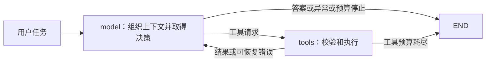

# 01：可观察的单 Agent 完整闭环

这个练习把已经讨论的运行原理变成可逐节点调试的程序：



默认案例是两篇虚构材料对“失败后重试”的不同说法。工具只访问代码内的教学材料，不读取个人知识库或项目知识库，也不写入它们。本练习不涉及 RAG、数据库、显式规划或多 Agent。

## 先运行一次

环境：Windows 本地 Python 3.11.14，独立 uv 项目和 `.venv`。本机使用 `C:\Users\cyq\.local\bin\uv.exe`；Python 由 uv 独立管理，不依赖 Miniconda。

本目录的 `.python-version` 固定开发解释器为 3.11.14，`pyproject.toml` 的 `python-preference = "only-managed"` 限定只选择 uv 管理的 Python。`requires-python` 表示代码声明支持的版本范围，与开发环境固定版本的用途不同。首次准备解释器可运行 `uv python install 3.11.14 --no-bin --no-registry`，不需要激活 conda。已安装后，在本目录打开 PowerShell：

```powershell
uv sync --group dev
uv run agent-loop
uv run agent-loop --scenario recover
uv run agent-loop --scenario loop --max-model-calls 2
uv run agent-loop --trace runs/first-run.json
```

最后一条会创建本地轨迹，不覆盖同名文件。`loop` 情节预期以退出码 1 停止；这是预算生效，不是测试失败。默认流程：

1. 第 1 次模型决策请求列出材料。
2. 第 2 次请求读取 A、B 的片段。
3. 第 3 次请求读取 A、B 的上下文。
4. 第 4 次给出带 `[A]`、`[B]` 的文本。

正常案例共 4 次决策、5 次工具派发。`recover` 会先产生一次非法参数调用，再从错误反馈恢复，共 5 次决策、6 次工具派发。

**scripted 模式是测试替身，不是 LLM。** 它消费真实工具返回的标准消息，但动作和结论来自预写教学情节。运行它可以验证 Runtime 与工具闭环，不能证明模型自主决策质量，也不支持任意自然语言问题。

## 环境与依赖文件

- `pyproject.toml` 声明项目直接需要的运行依赖、可选的 `online` 依赖和开发工具；构建工具在 `[build-system]` 中单独声明。
- `uv.lock` 记录解析后的直接与传递依赖、确定版本、平台条件和分发文件信息；它覆盖多个环境，并非当前 `.venv` 的逐项安装清单。由 uv 更新，不手工删改其中的包。
- `.venv/` 保存当前环境实际安装的包。运行 `uv sync` 时按当前平台以及选择的 extras、依赖组同步；例如需要保留在线适配依赖时使用 `uv sync --locked --extra online --group dev`。

2026-09-25 已将本练习从 Miniconda 基础解释器迁移到 uv 管理的 CPython 3.11.14；迁移前后锁文件内容及 50 个已安装发行包的版本一致。本机独立 uv 使用现有 0.11.7 原生可执行文件的同版本副本，未改动 Miniconda 安装或全局 PATH。此迁移仅覆盖本练习，不代表主项目或其他项目环境已经迁移。

## 使用真实模型

用户当前选择的模型名为 `deepseek-flash`。项目根目录 `D:\codes\KnowledgeOps Agent\.env` 中已经填写 `OPENAI_BASE_URL`、`OPENAI_API_KEY`，并补充 `AGENT_MODEL=deepseek-flash`。在线模式自动读取这些配置，无需在每次运行前设置终端环境变量或传入 `--env-file`。

在本练习目录运行：

```powershell
uv run --locked --extra online agent-loop --mode online
uv run --locked --extra online agent-loop --mode online --question '材料 B 为什么不能盲目重试？'
```

首次在另一台机器准备环境时，先运行 `uv sync --locked --extra online --group dev`，再在项目根目录的 `.env` 填写配置。可以参考根目录 `.env.example`；密钥文件已被 Git 忽略。

```dotenv
OPENAI_BASE_URL=你的模型服务接口地址
OPENAI_API_KEY=你的密钥
AGENT_MODEL=deepseek-flash
```

配置解析位于 [config.py](src/agent_loop/config.py)，使用 [python-dotenv 的 dotenv_values](https://bbc2.github.io/python-dotenv/#load-configuration-without-altering-the-environment) 读取文件而不修改进程环境。规则如下：

- 优先级从高到低：进程环境变量、练习目录 `.env`、项目根目录 `.env`。一般只需维护根目录那一份文件；练习的独立配置文件可选。
- 支持 `API_KEY` / `OPENAI_API_KEY`、`BASE_URL` / `OPENAI_BASE_URL`；同一来源同时配置别名时，`OPENAI_*` 优先。
- 路径相对练习源码确定，不随终端或 IDE 的工作目录变化，也不向任意父目录搜索配置。
- 只使用模型、密钥和地址三个字段；文件内容不注入全局环境，不读取 Codex 凭据。配置支持 UTF-8 BOM，变量插值关闭。
- 只有 `--mode online` 会读取配置和启用真实客户端。根目录的 `MODEL_CALLS_ENABLED` 属于主项目配置，本练习不使用它作为运行开关。

在线模式仍使用同一份 graph、状态和工具；模型服务必须兼容当前客户端的工具调用协议。SDK 超时为 30 秒，自动重试关闭；没有人为配置模型温度，避免强加某些模型不支持的参数。

本次验证包括文件解析、配置传递和在线 CLI 的 mock 闭环，未发送真实模型请求；服务商兼容性与模型决策质量尚未验证。CLI 禁用继承的 LangSmith 自动追踪；`--trace` 只保存本地可观察消息，不保存客户端密钥或隐藏思维链。

## 按什么顺序阅读

[源码阅读与实现要点](CODE_WALKTHROUGH.md)直接嵌入六个运行相关 Python 模块及依赖配置的完整源码，解释调用链、状态、工具反馈、错误与预算，并区分学习和面试中需要掌握与可以查阅的内容。该文档随练习代码维护。

| 文件 | 学习重点 |
|---|---|
| [tools.py](src/agent_loop/tools.py) | `@tool` 如何把参数类型、描述和实现连起来；模型看到描述，Runtime 执行函数 |
| [config.py](src/agent_loop/config.py) | .env 路径、配置来源优先级、别名及凭据隔离 |
| [models.py](src/agent_loop/models.py) | `AIMessage.tool_calls` 与 `ToolMessage`；脚本如何依据观察推进；真实模型如何绑定工具 |
| [runtime.py](src/agent_loop/runtime.py) | `AgentState`、`add_messages`、节点更新、条件边、两类预算和终态 |
| [cli.py](src/agent_loop/cli.py) | 从任务输入到图执行、消息展示、轨迹保存及退出码 |
| [test_loop.py](tests/test_loop.py) | 用完整图验证消息配对、上下文读取、失败恢复、预算及运行隔离 |

建议先用默认离线案例，在 `model_node` 的 `model.invoke` 前后、`tool_node` 的 `target.invoke` 前后设置断点。观察：本轮上下文包含什么、请求里有哪些参数和 ID、工具结果怎样返回、状态字段如何更新、下一条边为何被选择。

工具函数的 docstring 会成为模型可见的工具说明，所以保持简明；面向学习者的长注释放在实现处。其余关键函数用教学注释交代作用、调用位置、状态变化、错误边界和设计原因。

## 状态与边界

- `messages` 用 LangGraph 的 `add_messages` 合并，节点只返回新增消息；每次运行重新调用 `initial_state`。
- `model_calls` 统计请求尝试，包括模型异常；`tool_calls` 统计派发尝试，包括参数错误或未知工具。未执行的预算阻止不计入派发次数。
- `answered` 只表示模型给出了最终文本，可能是答案、拒答或澄清请求，不代表任务质量已验收；本练习尚未把这几种文本意图再做结构化细分。
- `budget_exhausted`、`model_error`、`protocol_error` 都是未完成终态，不伪造成功答案。
- 工具参数错误/未知工具以 `ToolMessage(status="error")` 反馈给模型；协议损坏和模型异常停止运行。
- 同一轮多个工具顺序执行；工具预算在中途耗尽时，也为未执行请求返回匹配 ID 的错误结果。
- 预算保证调用次数有界，不是总运行时长、token 或费用的精确预算。CLI 的图递归上限按模型预算设置。

这些是小程序的教学取舍，不代表实战项目必须采用相同终态、工具或存储架构。

## 与参考项目如何对齐

核对日期：2026-09-25。下面的源码链接跟随 `main`，用于阅读机制，不宣称对某个未固定提交做了完整复现；本练习自身依赖由 `uv.lock` 固定。

- [LangGraph 官方 Quickstart](https://docs.langchain.com/oss/python/langgraph/quickstart)提供模型节点、工具节点和条件边组成循环的基础示例。本练习使用同类图结构，并补充预算、工具错误反馈及终态。
- [Deep Agents 的 graph.py](https://github.com/langchain-ai/deepagents/blob/main/libs/deepagents/deepagents/graph.py)将模型、工具、系统提示词和 middleware 组织后交给 LangChain `create_agent`。本练习沿用消息/工具接口，把模型与运行机制分开；为教学显式展开循环，不复制其完整 middleware 体系。
- [DeerFlow 官方说明](https://github.com/bytedance/deer-flow)作为完整应用与 harness 的设计参考。本轮未移植其源码或复现沙箱、技能、记忆和子 Agent；这些能力超出当前单 Agent 练习范围。

理解这个版本后，可以进一步对照 `create_agent` 的封装，并比较哪些职责可以交给框架。无需为了练习另造一套工具消息协议。

## 验证

```powershell
uv run --group dev pytest
uv run --group dev ruff check .
uv run --group dev ruff format --check .
```

安装 `online` 可选依赖后，还会执行真实客户端构造的 mock 测试；未安装时该项跳过。测试和离线演示均不调用真实模型。实际执行结果记录在项目的 [进展文档](../../docs/progress.md)。
