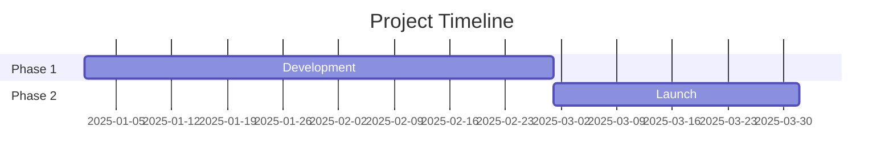
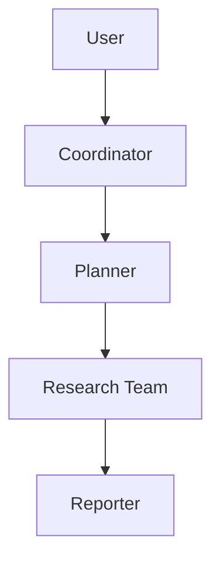
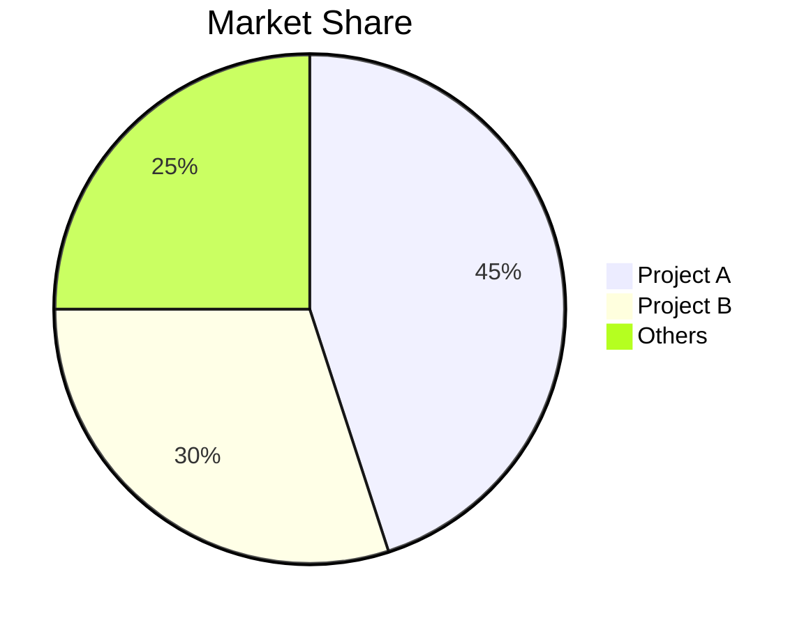

## KnowledgeOps 运行约定（2026-10-13 适配）

本包的方法来自 DeerFlow，执行环境为 KnowledgeOps。先遵循用户本次的目标、范围、详略和已有工具许可；下文的默认篇幅、搜索轮次及模板是参考，不得扩大简单任务。只使用本轮实际提供的工具和技能，不安装其他技能或依赖，不启用付费服务，不自动发布或发送内容。

- 联网使用 `search_web` 发现来源、`read_web` 读取原文，再按其返回的固定来源链接引用。关闭联网时不通过脚本绕过，可使用用户提供的材料并说明时效边界。
- 文件工具以挂载工作区为虚拟根：材料在 `/work` 或已登记的上传位置，产物写入 `/outputs`，通过 `present_files` 取得真实下载地址。知识正文编辑与发布仍遵循本应用规则。
- 技能正文和附属文本用 `read_file("/skills/<name>/...")` 按需读取；只有提供了 `execute` 时才可运行脚本。命令中使用 `python "$SKILLS_DIR/<name>/scripts/<file>.py"`，工作文件使用 `work/...`、`outputs/...` 相对路径。不要把文件工具的虚拟绝对路径直接当成 shell 路径。
- 当前日期采用运行上下文给出的日期；模板中的历史日期和示例数字不能当作事实。若缺少决定研究范围的关键条件，先提出简短澄清或说明有界假设。


# GitHub Deep Research Skill

Multi-round research combining GitHub API, search_web, read_web to produce comprehensive markdown reports.

## Research Workflow

- Round 1: GitHub API
- Round 2: Discovery
- Round 3: Deep Investigation
- Round 4: Deep Dive

## Core Methodology

### Query Strategy

**Broad to Narrow**: Start with GitHub API, then general queries, refine based on findings.

```
Round 1: GitHub API
Round 2: "{topic} overview"
Round 3: "{topic} architecture", "{topic} vs alternatives"
Round 4: "{topic} issues", "{topic} roadmap", "site:github.com {topic}"
```

**Source Prioritization**:
1. Official docs/repos (highest weight)
2. Technical blogs (Medium, Dev.to)
3. News articles (verified outlets)
4. Community discussions (Reddit, HN)
5. Social media (lowest weight, for sentiment)

### Research Rounds

**Round 1 - GitHub API**
Use the frozen script below if execute and network access are available. Source inspection with read_file is allowed. If execute is unavailable, use the existing web tools:
```bash
python "$SKILLS_DIR/github-deep-research/scripts/github_api.py" <owner> <repo> summary
python "$SKILLS_DIR/github-deep-research/scripts/github_api.py" <owner> <repo> readme
python "$SKILLS_DIR/github-deep-research/scripts/github_api.py" <owner> <repo> tree
```

**Available commands (the last argument of `github_api.py`):**
- summary
- info
- readme
- tree
- languages
- contributors
- commits
- issues
- prs
- releases

**Round 2 - Discovery (3-5 search_web)**
- Get overview and identify key terms
- Find official website/repo
- Identify main players/competitors

**Round 3 - Deep Investigation (5-10 search_web + read_web)**
- Technical architecture details
- Timeline of key events
- Community sentiment
- Use read_web on valuable URLs for full content

**Round 4 - Deep Dive**
- Analyze commit history for timeline
- Review issues/PRs for feature evolution
- Check contributor activity

## Report Structure

Follow template in `assets/report_template.md`:

1. **Metadata Block** - Date, confidence level, subject
2. **Executive Summary** - 2-3 sentence overview with key metrics
3. **Chronological Timeline** - Phased breakdown with dates
4. **Key Analysis Sections** - Topic-specific deep dives
5. **Metrics & Comparisons** - Tables, growth charts
6. **Strengths & Weaknesses** - Balanced assessment
7. **Sources** - Categorized references
8. **Confidence Assessment** - Claims by confidence level
9. **Methodology** - Research approach used

### Mermaid Diagrams

Include diagrams where helpful:

**Timeline (Gantt)**:


**Architecture (Flowchart)**:


**Comparison (Pie/Bar)**:


## Confidence Scoring

Assign confidence based on source quality:

| Confidence | Criteria |
|------------|----------|
| High (90%+) | Official docs, GitHub data, multiple corroborating sources |
| Medium (70-89%) | Single reliable source, recent articles |
| Low (50-69%) | Social media, unverified claims, outdated info |

## Output

Save with write_file as: `/outputs/research_{topic}_{YYYYMMDD}.md`, then present_files. The script uses unauthenticated public GitHub access; application credentials are not inherited. Respect rate-limit errors and do not retry indefinitely.

### Formatting Rules

- Chinese content: Use full-width punctuation（，。：；！？）
- Technical terms: Provide Wiki/doc URL on first mention
- Tables: Use for metrics, comparisons
- Code blocks: For technical examples
- Mermaid: For architecture, timelines, flows

## Best Practices

1. **Start with official sources** - Repo, docs, company blog
2. **Verify dates from commits/PRs** - More reliable than articles
3. **Triangulate claims** - 2+ independent sources
4. **Note conflicting info** - Don't hide contradictions
5. **Distinguish fact vs opinion** - Label speculation clearly
6. **CRITICAL: Always include inline citations** - Use the citation link returned by the KnowledgeOps source tools immediately after each sourced claim; API-only findings must name their actual GitHub URL and must not fabricate a registered evidence identifier
7. **Extract URLs from search results** - search_web returns {title, url, snippet} - always use the URL field
8. **Update as you go** - Don't wait until end to synthesize

### Citation Examples

**Good - With inline citations:**
```markdown
The project gained 10,000 stars within 3 months of launch [citation:GitHub Stats](https://github.com/owner/repo).
The architecture uses LangGraph for workflow orchestration [citation:LangGraph Docs](https://langchain.com/langgraph).
```

**Bad - Without citations:**
```markdown
The project gained 10,000 stars within 3 months of launch.
The architecture uses LangGraph for workflow orchestration.
```
